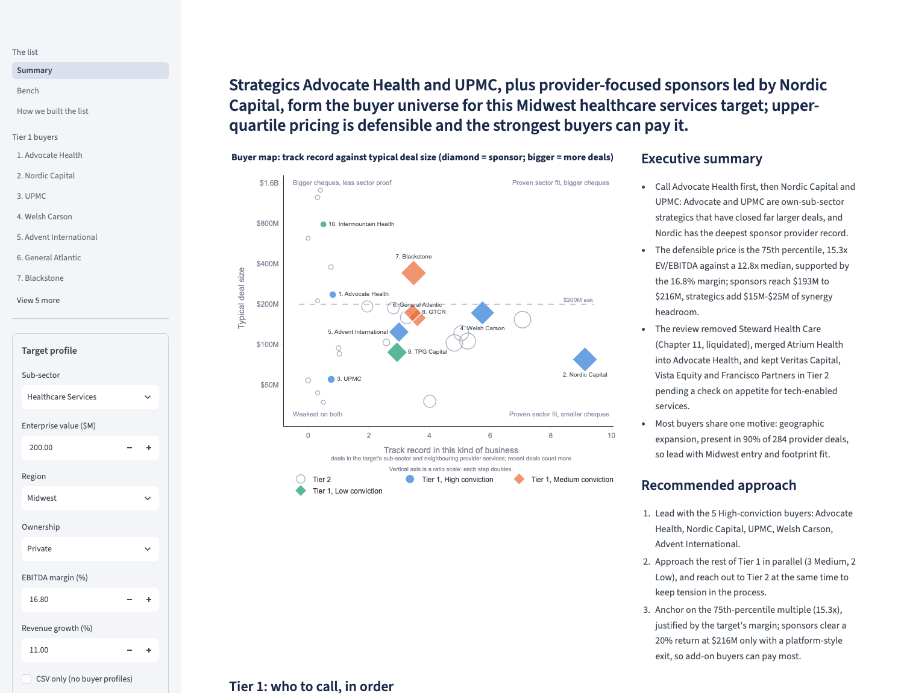
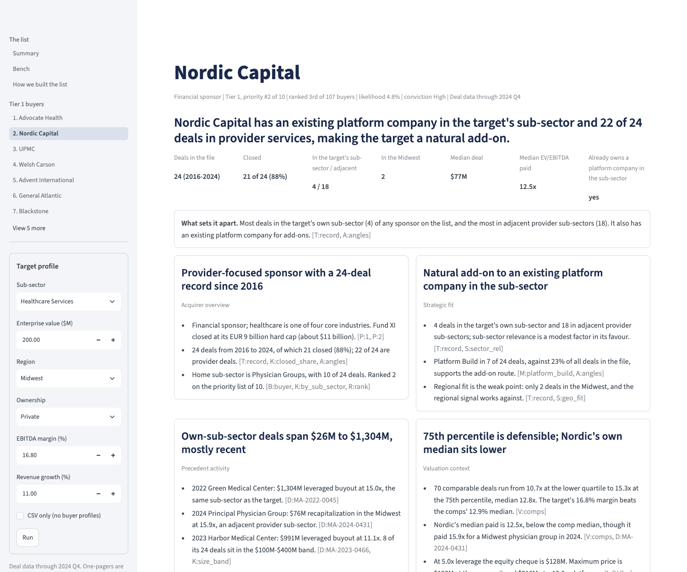
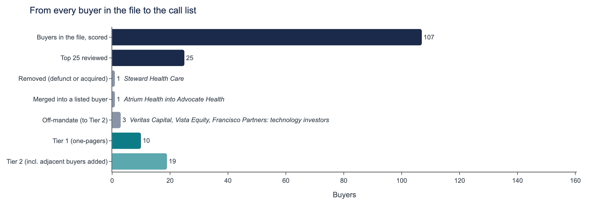
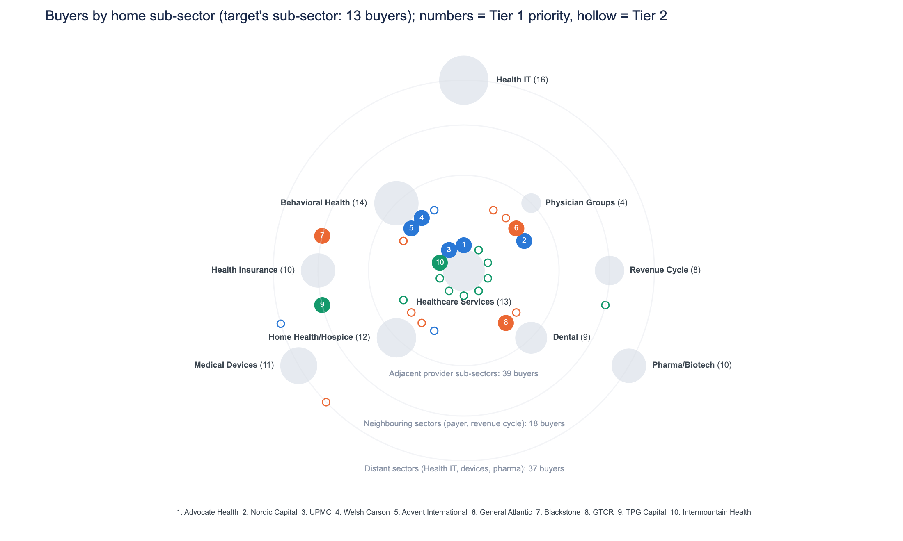
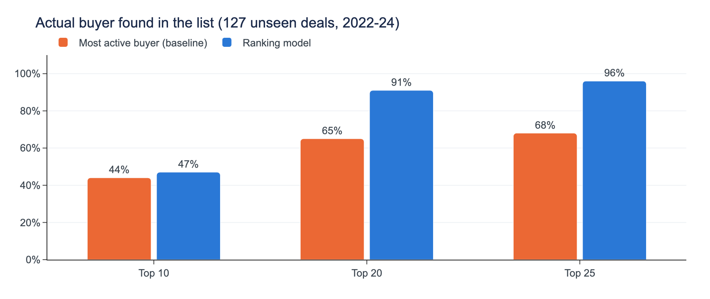
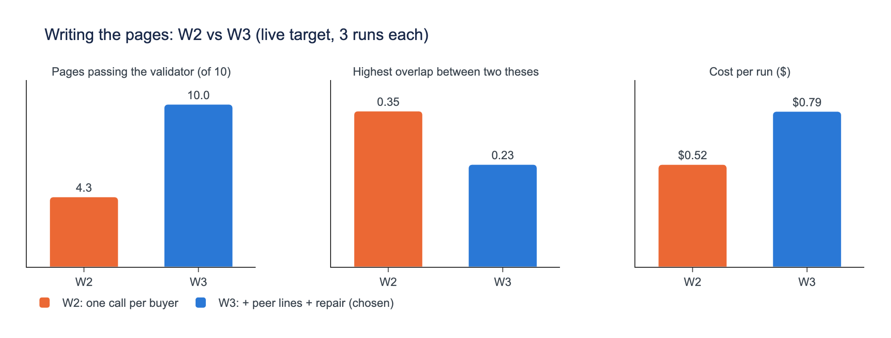
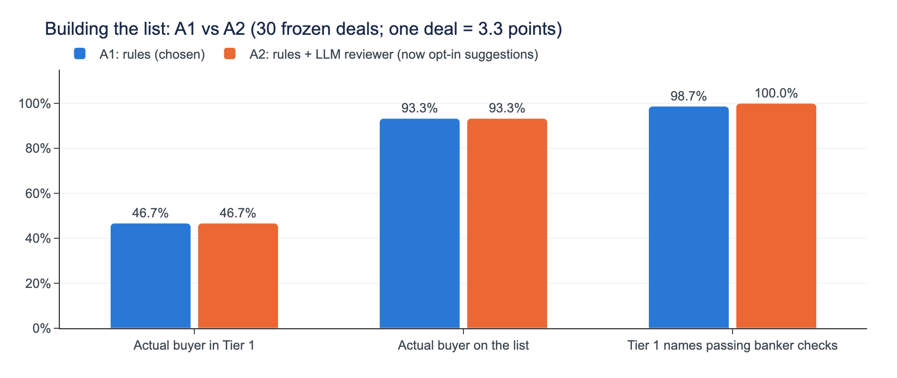

# M&A Acquirer Identification Engine

The 10 most likely acquirers for a ~$200M healthcare services company (mid-market, private, regional, strong margins), each with a cited one-page rationale, plus a bench of the next buyers and every decision behind the list.

**Sample output:** [`samples/default_target/report.md`](samples/default_target/report.md) · more under [Samples](#samples) · **Demo:** [Loom walkthrough](https://www.loom.com/share/30623c04184349d4a00d1b4f56d7908a)

| Summary page | A buyer one-pager |
|---|---|
|  |  |

| How we built the list: from every buyer to the call list | Buyers by home sub-sector (Tier 1 numbered) |
|---|---|
|  |  |

## Run it

```bash
python3.12 -m venv .venv && source .venv/bin/activate
pip install -r requirements.txt && pip install -e . --no-deps   # exact pins, about 30 s
python -m acquirer_engine run      # full report from the committed cache: no key, no cost (~10 s)
streamlit run app.py               # the same report as an app (cache only)
```

- **Regenerate with an LLM:** `pip install -r requirements-llm.txt`, copy `.env.example` to `.env`, set `LLM_PROVIDER` and the key, then `run --allow-paid`. Without `--allow-paid` nothing that costs money runs; a $50 budget stop and a cost ledger guard every call. A cold live run takes about 65 s.
- **Any target:** `run --target configs/<your>.yaml --allow-paid`, or the app's sidebar.
- **Other commands:** `rank`, `review [--suggest]`, `flag` / `unflag` / `rules`, `compare a.yaml b.yaml`; `pytest`; `bash experiments/run_all.sh` reproduces every number in the experiment log.
- **Develop:** `pip install -r requirements-dev.txt && pre-commit install` runs ruff (lint and format) on every commit. Modules sit in layers that only import downwards ([`docs/hierarchy.md`](docs/hierarchy.md), enforced by `tests/test_repo.py`); changes are recorded in [`CHANGELOG.md`](CHANGELOG.md).

## What it does, in one picture

```
target profile -> buyer signals -> ranking model -> ability to pay -> banker review -> fact packs -> LLM one-pagers -> report
 (YAML)           (as-of, 16)      (per buyer type,  (quick LBO,      (rules with      (every fact   (six sections,
                                    banker weights,   synergy          reason codes,    has an ID)    validated,
                                    signs locked)     headroom)        every move logged)              repaired)
                                                                       (+ deal-team flags,
                                                                        opt-in LLM suggestions)
```

**Who vs why.** Choosing the buyers is a data problem that can be tested against what actually happened, so code does it. Explaining why is a writing problem, so the LLM does it, but only from evidence code has assembled, and code checks every number it writes.

## Architecture decisions

**How the CSV is used**
- **To rank buyers:** every past deal becomes a multiple-choice question ("of the buyers active before this deal, who did it?"): 36,214 buyer x deal rows. Each row has 16 banker signals (sub-sector share, close precedents, size fit, region, seller type, margin and growth fit, close rate, an existing platform company), computed only from deals dated before it, so nothing leaks from the future.
- **One model per buyer type:** a logistic regression for sponsors and one for strategics, each starting from banker weights (the data moves them), with no weight allowed below zero.
- **To value the target:** comparable closed control deals in the target's business model at 0.5-2x its size, using the stated EV/EBITDA and EV/Revenue only.
- **As evidence for the pages:** each buyer's own deals, counts and prices become cited facts in its fact pack.

**How the LLM prompt is structured** ([`prompts/onepager_v4.yaml`](prompts/onepager_v4.yaml), versioned; earlier versions kept)
- **System prompt:**
  - **Audience:** a VP writing for an MD, where the bar is "usable without edits".
  - **Evidence rules:** use only the fact pack, copy numbers rather than computing them, and know that every page is checked and sent back.
  - **Language rules:** plain banker English, no internal labels.
  - **Section rules:** what each of the six boxes must say, with word limits.
- **User message, in tagged parts:**
  - `<target>`
  - `<peer_angles>`: every other Tier 1 buyer's key numbers, so each page argues a different thesis and can't claim a lead the numbers contradict.
  - `<fact_pack>`: JSON with an ID on every fact (D = a deal in the CSV, P = a sourced profile fact, K/T/V = computed figures, S = a likelihood factor, M = a motive tag), with counts and shares pre-computed so the writer never does arithmetic.
  - An optional style `<example>` from a different buyer.
  - `<task>`.
- **Output:** JSON matching a pydantic schema. The endpoint rejects forced tool calls, so the schema goes in the prompt, with one parse retry.
- **Checks:** a validator rejects any number not in the fact pack, unknown fact IDs, generic phrases and internal jargon. A failing page is sent back with its problems listed (one repair, a second only if needed).
- **Set by code, not the LLM:** the list, the order and the conviction level. Every LLM output is cached and committed, so the same inputs replay the same report. The executive summary has its own prompt (`summary_v6`) and its own validator.

**Banker review.** Dated, sourced buyer profiles (37 buyers, 69 facts, SEC EDGAR first) remove defunct buyers, merge duplicates and move off-mandate investors, each with a reason code. Every rule was back-tested before use; one that would have dropped the real buyer in 35% of test deals was cut.

**What I'd improve with more time**
- **More sourcing:** profiles cover 37 of 107 buyers, and non-profit and private buyers come from websites; I'd profile every buyer, sourcing non-profits from their bond disclosures.
- **A sponsor-specific quick LBO:** today it is the same for every sponsor; I'd use each fund's size and usual leverage.
- **A stricter validator:** today it proves a number exists in the fact pack, not that it is attached to the right fact.
- **The untried architecture arms:** the tool-using agent and a second model.
- **A blind banker read** of the pages.

## Results

**1. Does the ranking find the real buyer?** For 127 deals from 2022-24 that the model never saw, the share where the buyer who actually did the deal appears in the top 10, 20 or 25. Blue is the ranking model; orange is a simple baseline that lists the most active buyers. Higher is better.



**2. How should the one-pagers be written?** Two ways of writing the ten pages for the default target, each run three times (averages shown). Left: pages that pass every automatic check (higher is better). Middle: how alike the two most similar pages are, from 0 (nothing shared) to 1 (identical; lower is better). Right: LLM cost per run of ten pages. W2 writes each page on its own; W3 also shows each writer the other buyers' key numbers and repairs a failing page.



**3. Should an LLM reviewer change the list?** Rules alone (A1) against rules plus an LLM reviewer (A2), on 30 past deals. Left and middle: how often the real buyer made Tier 1, or the list at all. Right: share of Tier 1 names with no serious flag (e.g. no completed deal in the file, a deal size it has never done).



- **Pages:** W3 is the only approach whose pages all pass, and it keeps theses distinct, for about $0.27 more per run.
- **List:** the LLM reviewer (A2) ties the rules (A1) on the back-test. Its footprint judgments are plausible but can't be scored on synthetic data, so A1 builds the list and A2 is offered as cited, opt-in suggestions.
- **Sponsors:** the file barely separates sponsors (the winner is in the top 3 sponsors 28% of the time, against 20% at random), so the report compares them side by side and the summary says the order is close to a tie.

Full tables and every decision, with dates: [`docs/experiment-log.md`](docs/experiment-log.md).

## Beyond the brief

- **Any target:** rings, comparable deals, pricing anchor and wording re-centre on the target; Health IT and Dental samples check it end to end.
- **Feedback loop:** "flag as irrelevant" on any listed buyer refills the list on the next run. Repeated flags suggest a rule, with its history check, that applies only once accepted.
- **Comparison mode:** two targets side by side, with shared and unique buyers, the conviction points that differ, one buyer map and a validated note.

## Assumptions

- **Target:** Healthcare Services, $200M EV, Midwest, private, 16.8% margin (75th percentile of the file's Healthcare Services deals), 11.0% growth (median). See `configs/target_default.yaml`.
- **Data end:** scored as of Q4 2024; every page says "deal data through 2024 Q4".
- **Ability to pay:** 5.0x debt at 8.5%, 20% target IRR, five years; strategic synergies of 3-5% of implied opex, half realised. The target's own EBITDA isn't given, so multiples convert to price at the EBITDA the $200M ask implies at the comparable median.
- **Dataset:** the 500-deal file is treated as the full deal history; the stated multiples are trusted, and the EBITDA field is not (it doesn't tie to deal size in 447 of 500 rows). Buyer names are matched as written, and real-world facts (bankruptcies, mergers, mandates) come only from dated, sourced profiles, never from the model's memory.

## Known limitations

- Only buyers in the file can be listed (15 of 142 recent deals went to buyers new to it).
- A page's cache key covers its fact pack, not the other buyers' peer lines in its prompt: after a flag swaps a buyer, unchanged pages replay, so a differentiator may name a buyer no longer on the list (re-run without the cache to refresh them all).
- The `anthropic` provider is wired but not yet smoke-tested; all committed outputs came from Databricks.

**Failure modes and how they surface**
- **Out-of-range targets:** a target with fewer than 5 comparable deals, a 0% margin or an `as_of` before the data end stops with a stated reason instead of guessing.
- **Pages that still fail after repair:** marked as failing in the run log (first drafts fail more often on unfamiliar targets).
- **Missing or rejected LLM output:** with no cached output, no permission to pay, or the budget stop, the run stops before any spend, and the executive summary falls back to a data-built version.
- **Unresearched buyers:** a buyer with no profile is labelled "not researched" on its page, never filled in.

## Samples

| Folder | Shows |
|---|---|
| [`default_target/`](samples/default_target/report.md) | The brief's target: summary, ten one-pagers, bench, appendix, sources |
| [`target_healthit/`](samples/target_healthit/report.md) | Health IT, $300M, National: rings and the technology-investor rule re-centre |
| [`target_dental/`](samples/target_dental/report.md) | Dental, $80M, Southeast: sponsors can't reach their return at the ask |
| [`compare_healthit_dental/`](samples/compare_healthit_dental/report.md) | Comparison mode |
| [`feedback_demo/`](samples/feedback_demo/README.md) | Feedback loop: flags, refill, suggested rule |

## Repository

| Path | What it is |
|---|---|
| `src/acquirer_engine/` | The engine: data, signals, model, valuation, review, fact packs, LLM layer, pipeline, report |
| `app.py` | Streamlit app (cache only) |
| `configs/`, `prompts/`, `data/` | Target profiles and prices, versioned prompts, the CSV and buyer profiles |
| `cache/llm/`, `ledger/` | Cached LLM outputs and the cost ledger |
| `experiments/`, `research/` | Back-tests and data review behind the experiment log |
| `tests/` | Tests: experiment match, no look-ahead, validator, review rules, app, CLI, targets, feedback, comparison, package layers, regressions |
| `docs/` | Experiment log, package layers, model explainer, banker style guide, demo script; `readme_charts.py` draws the charts above |

API keys live in `.env` (git-ignored; see `.env.example`). `src/acquirer_engine/edgar/` is reused from an earlier project.
