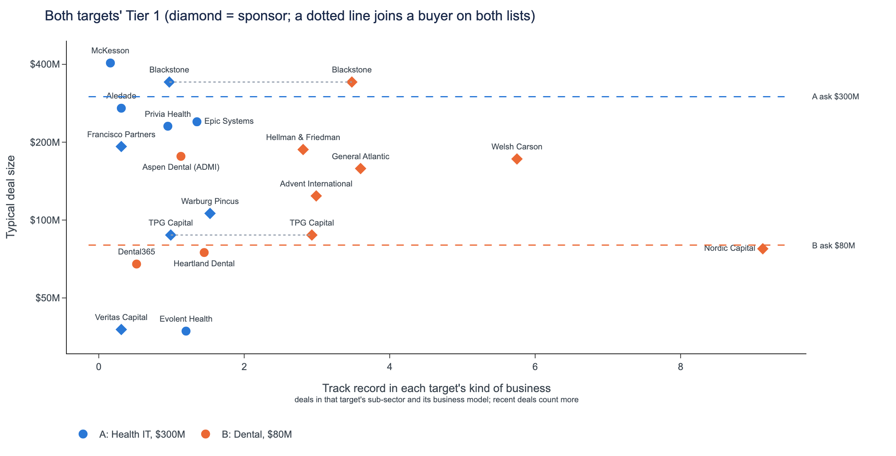

# Only Blackstone and TPG Capital span both lists; Health IT sponsors clear their target return at the ask, while Dental sponsors do not.
*A: Health IT, $300M, National, 25.0% margin, 20.0% growth, pe-backed; deal data through 2024 Q4.*
*B: Dental, $80M, Southeast, 18.0% margin, 8.0% growth, private; deal data through 2024 Q4.*

- Only two buyers sit on both lists, Blackstone and TPG Capital, so the two universes barely overlap and each target needs its own outreach.
- Blackstone is High on both targets, while TPG Capital is Medium for Health IT but High for Dental, because its median deal of $88M is under half the $300M EV.
- Health IT adds Evolent Health, a High strategic, and Francisco Partners, a Medium sponsor; Dental adds High strategics Heartland Dental and Aspen Dental (ADMI) and High sponsors Hellman & Friedman, General Atlantic, Welsh Carson.
- Health IT's defensible multiple is 21.4x and sponsors clear their 20% target return at the ask; Dental's is 15.4x and sponsors do not clear 20%.

## Shared Tier 1 buyers (2)
| Buyer | Priority A / B | Conviction A (Health IT, $300M, National) | Conviction B (Dental, $80M, Southeast) | Conviction points that differ |
|---|---|---|---|---|
| Blackstone | 2 / 4 | High | High | Among the 3 highest-scored after the review (A: for: among the 3 highest-scored buyers left after the review (#2); B: neutral: not among the 3 highest-scored) |
| TPG Capital | 6 / 7 | Medium | High | Concern: deal size (A: against: median deal $88M is under half the $300M EV; B: neutral: does not apply) |

## A only (Health IT, $300M, National): 8 buyers
| Buyer | Type | Conviction | Why them | On the other list |
|---|---|---|---|---|
| Evolent Health | Strategic | High | Same-sub-sector Health IT add-on; pays near the comparable median | not listed |
| Francisco Partners | Financial sponsor | Medium | Add-on to open Health IT platform; returns clear at asking price | Tier 2 |
| Aledade | Strategic | Medium | Same-sub-sector buyer with a national footprint; paid up before | not listed |
| Privia Health | Strategic | Medium | Repeat Health IT buyer in the target's size band; pays near median | not listed |
| Warburg Pincus | Financial sponsor | Medium | Add-on to open Health IT platform; three sub-sector deals | Tier 2 |
| Epic Systems | Strategic | Low | Deepest own-sub-sector record, but says it does not acquire | not listed |
| Veritas Capital | Financial sponsor | Low | Technology mandate sponsor; closes deals; clears 20% IRR at ask | Tier 2 |
| McKesson | Strategic | Low | Health IT bolt-on precedent; paid highest multiple on the list | not listed |

## B only (Dental, $80M, Southeast): 8 buyers
| Buyer | Type | Conviction | Why them | On the other list |
|---|---|---|---|---|
| Heartland Dental | Strategic | High | Dental specialist; closes every deal; pays near upper quartile | not listed |
| Hellman & Friedman | Financial sponsor | High | Southeast dental precedent, existing platform company add-on route, pays above upper quartile | Tier 2 |
| Aspen Dental (ADMI) | Strategic | High | Dental bolt-on to an established platform; full closing record | not listed |
| General Atlantic | Financial sponsor | High | Add-on to open dental platform; pays above upper quartile | Tier 2 |
| Welsh Carson | Financial sponsor | High | Add-on to its dental platform; pays above upper-quartile multiples | Tier 2 |
| Dental365 | Strategic | Medium | Pure dental buyer with a 100% close record | not listed |
| Nordic Capital | Financial sponsor | Medium | Provider specialist sponsor; size fits; must stretch on price | Tier 2 |
| Advent International | Financial sponsor | Medium | Repeat dental investor, Southeast-active, pays 15.5x median | Tier 2 |

*Deal data through 2024 Q4. Conviction points come from each target's own fact packs; the note is checked so that every number in it appears in the comparison data.*