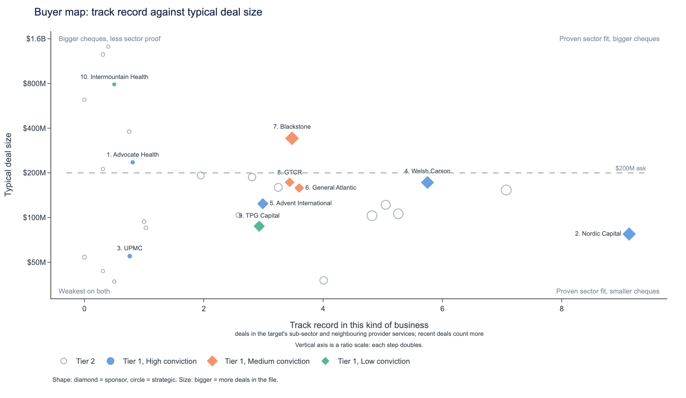
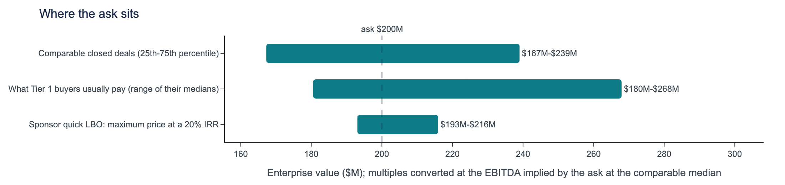

## Health systems and provider-focused sponsors form the buyer universe for this Midwest healthcare services target; upper-quartile pricing at 15.3x EV/EBITDA is defensible.
*Healthcare Services, $200M, Midwest, 16.8% margin, 11.0% growth, private. Deal data through 2024 Q4.*

- Advocate Health and UPMC go first, with 5 and 3 sub-sector deals and the capacity to pay; sponsor order is close to a tie, with back-tests at 28% against 20% random.
- Upper-quartile 15.3x is defensible given the 16.8% margin; strategics can pay it, with $15M-$25M of synergy headroom, while sponsors reach $193M to $216M.
- The review removed Steward Health Care after its bankruptcy, folded Atrium Health into Advocate Health, and kept Veritas Capital, Vista Equity and Francisco Partners in the second list pending confirmation of appetite for tech-enabled services.
- Most buyers share one motive, geographic expansion, seen in 90% of 284 provider deals, so frame the pitch around the Midwest footprint.

*Tier 1 numbered by priority; hollow markers are Tier 2. Vertical axis is a ratio scale: each step doubles.*

## Tier 1: who to call, in order
| Priority | Buyer | Type | Conviction | Why them | Can pay |
|---|---|---|---|---|---|
| 1 | Advocate Health | Strategic | High | Own-sub-sector strategic; pays above the comparable median | comfortable: closed $436M |
| 2 | Nordic Capital | Financial sponsor | High | Add-on to its existing platform company; deepest provider record among sponsors | add-on exit; usual deal $77M, fund $11B |
| 3 | UPMC | Strategic | High | Pure sub-sector strategic with a perfect close record | comfortable: closed $444M |
| 4 | Welsh Carson | Financial sponsor | High | Add-on to existing platform company; Midwest provider specialist paying upper-quartile prices | add-on exit; usual deal $172M, fund $5B |
| 5 | Advent International | Financial sponsor | High | Add-on to its existing platform company; pays upper-quartile multiples | add-on exit; usual deal $124M, fund $25B |
| 6 | General Atlantic | Financial sponsor | Medium | Provider-focused sponsor; pays upper-quartile prices; closes what it starts | add-on exit; usual deal $158M, AUM $125B |
| 7 | Blackstone | Financial sponsor | Medium | Scaled sponsor, pays top multiples, prior Midwest services deal | add-on exit; usual deal $342M, AUM $416B |
| 8 | GTCR | Financial sponsor | Medium | Midwest provider specialist; pays near upper-quartile multiples | add-on exit; usual deal $173M, fund $11.5B |
| 9 | TPG Capital | Financial sponsor | Low | Pays above upper-quartile comps; adjacent provider record; lower-priority call | add-on exit; usual deal $88M, AUM $303B |
| 10 | Intermountain Health | Strategic | Low | Healthcare Services strategic with a platform precedent; Midwest entry | comfortable: closed $789M |

## Recommended approach
1. Lead with the 5 High-conviction buyers: Advocate Health, Nordic Capital, UPMC, Welsh Carson, Advent International.
2. Approach the rest of Tier 1 in parallel (3 Medium, 2 Low), and reach out to Tier 2 at the same time to keep tension in the process.
3. Anchor on the 75th-percentile multiple (15.3x), justified by the target's margin; sponsors clear a 20% return at $216M only with a platform-style exit, so add-on buyers can pay most.

*Healthcare Services, $200M, Midwest, 16.8% margin, 11.0% growth, private. Deal data through 2024 Q4.*

---

## Advocate Health
### Same-sub-sector strategic with five closed deals and a Midwest precedent; ranked first on the priority list and able to support upper-quartile pricing.
*Strategic | Tier 1, priority #1 of 10 | ranked 1st of 107 buyers | likelihood 5.0% | conviction **High** | deal data through 2024 Q4*

| Deals in the file | Closed | In the target's sub-sector / adjacent | In the Midwest | Median deal | Median EV/EBITDA paid |
|---|---|---|---|---|---|
| 5 (2016-2023) | 5 of 5 (100%) | 5 / 0 | 1 | $436M | 13.8x |

> **What sets it apart:** Five deals in the target's own sub-sector, more than any other buyer on the priority list, all closed; its median multiple paid sits above the comparable-deal median. T:record, K:closed_share, V:comps

#### 1. Acquirer overview: Nonprofit system formed by merger, with five closed deals
- Nonprofit system headquartered in Charlotte, NC, created when Advocate Aurora Health and Atrium Health merged; 69 hospitals (2024). P:1, P:2, P:3
- Five deals, 2016 to 2023: all closed, all control, all in the target's sub-sector, none in adjacent provider sub-sectors. T:record, K:closed_share, K:control_share
- Median deal $436M, ranging from $35M to $2,022M; 2 deals since 2022. T:record, K:recent

#### 2. Strategic fit: Sub-sector focus is the strongest factor, backed by platform-build history
- Share of deals in the target's sub-sector is the strongest factor; target margin close to what it usually buys is a strong one. S:sector_share, S:margin_fit
- Platform Build in 2 of 5 deals and Scale in 2 of 5, motives that fit a target of this kind. M:platform_build, M:scale
- Has bought from this kind of seller (a modest factor); its regional history is a slight factor against. S:own_fit_s, S:geo_fit

#### 3. Precedent activity: Precedents run from $35M to $2,022M at 9.3x to 18.5x
- Charter Care Partners ($2,022M, Platform Investment, 2023) at 18.5x; Apex Medical Group ($1,920M, Recapitalization, 2016, Midwest) at 17.9x. D:MA-2023-0330, D:MA-2016-0065
- Silver Health Partners ($35M, Leveraged Buyout, 2022) at 13.8x; Granite Care ($336M, Platform Investment, 2020) at 13.6x. D:MA-2022-0311, D:MA-2020-0408
- Hudson Medical Group ($436M, Strategic Acquisition, 2020) at 9.3x. D:MA-2020-0496

| Deal | Year | Sub-sector | Size | Type | Region | EV/EBITDA | EV/Revenue | Outcome |
|---|---|---|---|---|---|---|---|---|
| Charter Care Partners (as Atrium Health) | 2023 | Healthcare Services | $2,022M | Platform Investment | Great Plains | 18.5x | 2.45x | Closed |
| Silver Health Partners | 2022 | Healthcare Services | $35M | Leveraged Buyout | Southwest | 13.8x | 1.69x | Closed |
| Hudson Medical Group | 2020 | Healthcare Services | $436M | Strategic Acquisition | Northeast | 9.3x | 2.04x | Closed |
| Granite Care (as Atrium Health) | 2020 | Healthcare Services | $336M | Platform Investment | Great Plains | 13.6x | 2.80x | Closed |
| Apex Medical Group (as Atrium Health) | 2016 | Healthcare Services | $1,920M | Recapitalization | Midwest | 17.9x | 3.03x | Closed |

#### 4. Valuation context: Upper-quartile pricing is defensible; its own median sits below that level
- Comparable deals run 10.7x to 15.3x, median 12.8x; 75th percentile is defensible as the 16.8% margin beats the 12.9% comp median. V:comps
- Its median paid of 13.8x is above the comparable median of 12.8x and below the 15.3x upper quartile. V:comps, T:record
- Cost-synergy headroom of $15M-$25M supports a stretch bid; buyer revenue not researched. V:synergy

#### 5. Risk flags
| Risk | Concern | Mitigant | Reality |
|---|---|---|---|
| **Size mismatch** | Only 1 of 5 deals sits in the $100M-$400M comparable size band, against a median deal of $436M. | It has done a $35M deal and a $336M deal in the same sub-sector. | Target size is within its range but not its usual pattern. K:size_band, D:MA-2022-0311, D:MA-2020-0408 |
| **Thin Midwest record** | Only 1 deal in the target's region, and regional history is a slight factor against. | That deal, Apex Medical Group (2016), was in the Midwest; its footprint includes Illinois and Wisconsin. | Regional evidence is limited and dated. S:geo_fit, D:MA-2016-0065, P:2 |
| **Price gap to sponsors** | A 75th-percentile bid of 15.3x is above its 13.8x median paid. | It paid 18.5x and 17.9x in two deals, and synergy headroom is $15M-$25M. | Stretching is possible, but buyer revenue is not researched, so capacity is unconfirmed. V:comps, T:record, V:synergy |

#### 6. Conviction: High
Five deals in the target's own sub-sector, one in its region, and a first-place rank on the priority list drive the call; the thin Midwest record and size pattern are the offsets. T:record, R:rank, C:conviction

*Sources: P:1 https://en.wikipedia.org/wiki/Advocate_Health (as of 2022-12-02); P:2 https://en.wikipedia.org/wiki/Advocate_Health (as of 2026-10-23); P:3 https://en.wikipedia.org/wiki/Advocate_Health (as of 2024-12-31)*
*D: deals in the provided CSV; K, T, V: figures computed from it; S: likelihood factors; P: dated, sourced buyer facts.*

---

## Nordic Capital
### Nordic Capital has an existing platform company in the target's sub-sector and 22 of 24 deals in provider services, making the target a natural add-on.
*Financial sponsor | Tier 1, priority #2 of 10 | ranked 3rd of 107 buyers | likelihood 4.8% | conviction **High** | deal data through 2024 Q4*

| Deals in the file | Closed | In the target's sub-sector / adjacent | In the Midwest | Median deal | Median EV/EBITDA paid | Already owns a platform company in the sub-sector |
|---|---|---|---|---|---|---|
| 24 (2016-2024) | 21 of 24 (88%) | 4 / 18 | 2 | $77M | 12.5x | yes |

> **What sets it apart:** Most deals in the target's own sub-sector (4) of any sponsor on the list, and the most in adjacent provider sub-sectors (18). It also has an existing platform company for add-ons. T:record, A:angles

#### 1. Acquirer overview: Provider-focused sponsor with a 24-deal record since 2016
- Financial sponsor; healthcare is one of four core industries. Fund XI closed at its EUR 9 billion hard cap (about $11 billion). P:1, P:2
- 24 deals from 2016 to 2024, of which 21 closed (88%); 22 of 24 are provider deals. T:record, K:closed_share, A:angles
- Home sub-sector is Physician Groups, with 10 of 24 deals. Ranked 2 on the priority list of 10. B:buyer, K:by_sub_sector, R:rank

#### 2. Strategic fit: Natural add-on to an existing platform company in the sub-sector
- 4 deals in the target's own sub-sector and 18 in adjacent provider sub-sectors; sub-sector relevance is a modest factor in its favour. T:record, S:sector_rel
- Platform Build in 7 of 24 deals, against 23% of all deals in the file, supports the add-on route. M:platform_build, A:angles
- Regional fit is the weak point: only 2 deals in the Midwest, and the regional signal works against. T:record, S:geo_fit

#### 3. Precedent activity: Own-sub-sector deals span $26M to $1,304M, mostly recent
- 2022 Green Medical Center: $1,304M leveraged buyout at 15.0x, the same sub-sector as the target. D:MA-2022-0045
- 2024 Principal Physician Group: $76M recapitalization in the Midwest at 15.9x, an adjacent provider sub-sector. D:MA-2024-0431
- 2023 Harbor Medical Center: $991M leveraged buyout at 11.1x. 8 of its 24 deals sit in the $100M-$400M band. D:MA-2023-0466, K:size_band

| Deal | Year | Sub-sector | Size | Type | Region | EV/EBITDA | EV/Revenue | Outcome |
|---|---|---|---|---|---|---|---|---|
| Harbor Health Network | 2024 | Healthcare Services | $35M | Carve-out | National | 11.6x | 2.70x | Closed |
| Harbor Medical Center | 2023 | Healthcare Services | $991M | Leveraged Buyout | Great Plains | 11.1x | 3.40x | Closed |
| Green Medical Center | 2022 | Healthcare Services | $1,304M | Leveraged Buyout | Mid-Atlantic | 15.0x | 2.47x | Closed |
| Pioneer Ambulatory Care | 2016 | Healthcare Services | $26M | Platform Investment | Mountain West | 9.1x | 2.42x | Closed |
| Principal Physician Group | 2024 | Physician Groups | $76M | Recapitalization | Midwest | 15.9x | 2.40x | Closed |
| Hudson Behavioral Services | 2023 | Behavioral Health | $16M | Merger of Equals | West Coast | 15.8x | 3.02x | Pending |

#### 4. Valuation context: 75th percentile is defensible; Nordic's own median sits lower
- 70 comparable deals run from 10.7x at the lower quartile to 15.3x at the 75th percentile, median 12.8x. The target's 16.8% margin beats the comps' 12.9% median. V:comps
- Nordic's median paid is 12.5x, below the comp median, though it paid 15.9x for a Midwest physician group in 2024. V:comps, D:MA-2024-0431
- At 5.0x leverage the equity cheque is $128M. Maximum price is $193M at the same exit and $216M at a 15.0x platform exit. V:lbo

#### 5. Risk flags
| Risk | Concern | Mitigant | Reality |
|---|---|---|---|
| **Size stretch** | Median deal of $77M is under half the target's $200M EV. | 8 of 24 deals sit in the $100M-$400M band; its biggest is $1,304M. | Size is a stretch against its median but within its demonstrated range. T:record, K:size_band |
| **Return at the asking price** | IRR at the ask is 18.7%, below its 20% target. | A 15.0x platform exit lifts the maximum price to $216M, above the $200M EV. | Clears only on an add-on exit; at the same exit the maximum is $193M. V:lbo |
| **Thin Midwest footprint** | Only 2 Midwest deals; its regional record leans West and Great Plains. | Principal Physician Group (2024, Midwest) shows it will buy in the region. | Welsh Carson and GTCR have more Midwest deals, so competition for the asset is real. T:record, D:MA-2024-0431, S:geo_fit |

#### 6. Conviction: High
Rests on 4 own-sub-sector and 18 adjacent provider deals, an existing platform company add-on route, and #2 among the top-scored buyers after review. The $77M median deal against the $200M EV is the offset. T:record, A:angles, R:rank

*Sources: P:1 https://en.wikipedia.org/wiki/Nordic_Capital (as of 2026-10-23); P:2 https://en.wikipedia.org/wiki/Nordic_Capital (as of 2022-10-31)*
*D: deals in the provided CSV; K, T, V: figures computed from it; S: likelihood factors; P: dated, sourced buyer facts.*

---

## UPMC
### UPMC has bought only in the target's own sub-sector, closed every deal, and has the scale to fund a $200M Midwest add-on.
*Strategic | Tier 1, priority #3 of 10 | ranked 4th of 107 buyers | likelihood 4.7% | conviction **High** | deal data through 2024 Q4*

| Deals in the file | Closed | In the target's sub-sector / adjacent | In the Midwest | Median deal | Median EV/EBITDA paid |
|---|---|---|---|---|---|
| 3 (2018-2020) | 3 of 3 (100%) | 3 / 0 | 0 | $55M | 11.7x |

> **What sets it apart:** All three of its deals are in the target's own sub-sector and all closed. Only Advocate and Nordic Capital have more deals there, and UPMC's revenue is US$27.7 billion (2023).

#### 1. Acquirer overview: A large strategic with a short, fully closed record
- Strategic buyer with Revenue US$27.7 billion (2023); hospitals in Pennsylvania, Maryland and New York P:1, P:2.
- Three deals between 2018 and 2020: all closed, all control deals T:record, K:closed_share, K:control_share.
- No deals since 2022, a slight factor against its likelihood K:recent, S:recency.

#### 2. Strategic fit: Sub-sector focus is the strongest factor in its likelihood
- Share of its deals in the target's sub-sector is the strongest factor; all three of its deals are in Healthcare Services S:sector_share, K:by_sub_sector.
- The target's 16.8% margin is close to what UPMC usually buys, a strong factor S:margin_fit, X:target.
- Platform Build and Cross-sell each appear in 1 of 3 deals, above their file shares. Geographic expansion (2 of 3) is on 90% of deals, so not distinct M:platform_build, M:cross_sell, M:geographic_expansion.

#### 3. Precedent activity: Three sub-sector deals from 2018 to 2020, median 11.7x
- Sterling Care Network: $55M Strategic Acquisition, 2020, at 11.3x EV/EBITDA D:MA-2020-0312.
- Principal Behavioral Health: $444M Bolt-on Acquisition, 2019, at 11.7x. Keystone Behavioral Health: $33M Recapitalization, 2018, at 17.0x D:MA-2019-0090, D:MA-2018-0486.
- No deal in the Midwest and none in the $100M-$400M size band T:record, K:size_band.

| Deal | Year | Sub-sector | Size | Type | Region | EV/EBITDA | EV/Revenue | Outcome |
|---|---|---|---|---|---|---|---|---|
| Sterling Care Network | 2020 | Healthcare Services | $55M | Strategic Acquisition | National | 11.3x | 2.73x | Closed |
| Principal Behavioral Health | 2019 | Healthcare Services | $444M | Bolt-on Acquisition | Northeast | 11.7x | 1.99x | Closed |
| Keystone Behavioral Health | 2018 | Healthcare Services | $33M | Recapitalization | Mountain West | 17.0x | 2.33x | Closed |

#### 4. Valuation context: 75th percentile is defensible, but above UPMC's usual price
- Comparable range is 10.7x to 15.3x with a median of 12.8x. The target's 16.8% margin beats the comps' median of 12.9%, supporting the 75th percentile V:comps.
- UPMC's median paid is 11.7x, below the 12.8x comparable median, so an upper-quartile bid stretches its pattern V:comps, T:record.
- Synergy headroom of $15M-$25M and Revenue US$27.7 billion (2023) show capacity to pay V:synergy.

#### 5. Risk flags
| Risk | Concern | Mitigant | Reality |
|---|---|---|---|
| **Price expectations** | UPMC's median paid of 11.7x sits well below the 15.3x upper quartile the target can defend V:comps. | Synergy headroom of $15M-$25M can fund a higher bid V:synergy. | It paid 17.0x for Keystone in 2018, so a premium is not unprecedented D:MA-2018-0486. |
| **No Midwest record, quiet since 2020** | No deal in the target's region and none since 2022 T:record, K:recent. | Geographic expansion drove 2 of 3 deals, and Washington Health System merged with UPMC in 2024 M:geographic_expansion, P:2. | Expansion appetite exists, but the Midwest would be new ground T:record. |
| **Size and competing bidders** | None of its three deals sits in the $100M-$400M band, and the priority list has other sub-sector buyers K:size_band. | It closed a $444M deal in 2019, larger than this $200M target D:MA-2019-0090. | Scale is proven, but only once and not in the Midwest D:MA-2019-0090, T:record. |

#### 6. Conviction: High
Three deals in the target's own sub-sector and none adjacent, plus a place among the three highest-scored buyers after review (#3). No Midwest deal is neutral C:conviction, R:rank.

*Sources: P:1 https://en.wikipedia.org/wiki/University_of_Pittsburgh_Medical_Center (as of 2023-12-31); P:2 https://en.wikipedia.org/wiki/University_of_Pittsburgh_Medical_Center (as of 2024-12-31)*
*D: deals in the provided CSV; K, T, V: figures computed from it; S: likelihood factors; P: dated, sourced buyer facts.*

---

## Welsh Carson
### Provider specialist with an existing platform company in the sub-sector, six Midwest deals and a median deal of $172M, close to the target's size.
*Financial sponsor | Tier 1, priority #4 of 10 | ranked 10th of 107 buyers | likelihood 4.3% | conviction **High** | deal data through 2024 Q4*

| Deals in the file | Closed | In the target's sub-sector / adjacent | In the Midwest | Median deal | Median EV/EBITDA paid | Already owns a platform company in the sub-sector |
|---|---|---|---|---|---|---|
| 23 (2017-2023) | 18 of 23 (78%) | 1 / 15 | 6 | $172M | 16.2x | yes |

> **What sets it apart:** Second-most adjacent provider deals on the list (15, behind Nordic Capital's 18), level with GTCR at six Midwest deals, and a median deal of $172M near the target's size. T:record

#### 1. Acquirer overview: A provider-focused sponsor with a closed record and fresh capital
- Financial sponsor with 23 deals from 2017 to 2023; 18 closed (78%) T:record, K:closed_share.
- Provider specialist: 16 of 23 deals are in provider services, and it has an existing platform company in the target's sub-sector A:angles.
- Capacity: a 2023 headline reports its largest private equity fund to date at over $5 Billion P:2.

#### 2. Strategic fit: An add-on to an existing platform company, backed by a deep provider record
- The existing platform company makes the target an add-on. Deals in this or neighbouring sub-sectors are a modest factor in its likelihood A:angles, S:sector_rel.
- Cross-sell is a distinctive motive: 8 of 23 deals, against 21% of all deals in the file M:cross_sell.
- Six Midwest deals, including Jefferson Ambulatory Care ($75M, 2021) in the target's own sub-sector T:record, D:MA-2021-0083.

#### 3. Precedent activity: Midwest and mid-size precedents, priced well above the comparable median
- Jefferson Ambulatory Care: $75M management buyout, 2021, Midwest, 17.8x, closed D:MA-2021-0083.
- Clearwater Mental Health: $398M recapitalization, 2023, Midwest, 16.8x, withdrawn D:MA-2023-0166.
- Woodland PACE: $204M management buyout, 2021, 17.6x, closed. 9 of 23 deals sit in the $100M-$400M size band D:MA-2021-0025, K:size_band.

| Deal | Year | Sub-sector | Size | Type | Region | EV/EBITDA | EV/Revenue | Outcome |
|---|---|---|---|---|---|---|---|---|
| Jefferson Ambulatory Care | 2021 | Healthcare Services | $75M | Management Buyout | Midwest | 17.8x | 3.40x | Closed |
| Alliance DSO | 2023 | Dental | $57M | Leveraged Buyout | Mid-Atlantic | 16.1x | 3.63x | Closed |
| Clearwater Mental Health | 2023 | Behavioral Health | $398M | Recapitalization | Midwest | 16.8x | 1.98x | Withdrawn |
| Southeast Home Health | 2022 | Home Health/Hospice | $114M | SPAC Merger | Southeast | 16.3x | 2.45x | Closed |
| Delta Multispecialty Group | 2022 | Physician Groups | $38M | Recapitalization | Southwest | 8.3x | 2.08x | Withdrawn |
| Woodland PACE | 2021 | Home Health/Hospice | $204M | Management Buyout | Great Plains | 17.6x | 2.78x | Closed |

#### 4. Valuation context: Upper-quartile pricing is defensible; the bid leans on the platform exit
- Across 70 comparable deals the range is 10.7x to 15.3x, median 12.8x. The target's 16.8% margin beats the 12.9% comp median, supporting the 75th percentile V:comps.
- Its own median paid is 16.2x, above the 15.3x upper quartile of comparable deals V:comps, T:record.
- With 5.0x leverage and a $128M equity cheque, maximum price is $193M at the same exit and $216M at a 15.0x platform exit V:lbo.

#### 5. Risk flags
| Risk | Concern | Mitigant | Reality |
|---|---|---|---|
| **Return at the asking price** | IRR at the ask of 18.7% is below the 20% target V:lbo. | A platform exit at 15.0x lifts the maximum price to $216M V:lbo. | The bid works only if it underwrites the add-on exit; same-exit maximum is $193M V:lbo. |
| **Completion record** | 18 of 23 deals closed (78%); share closed is a slight factor against K:closed_share, S:close_rate_s. | Both Midwest-relevant control precedents, Jefferson and Woodland PACE, closed D:MA-2021-0083, D:MA-2021-0025. | Clearwater Mental Health ($398M, 2023) was withdrawn, so certainty of close should be tested D:MA-2023-0166. |
| **Competitive process** | Nordic Capital has 4 same-sub-sector deals and an existing platform company; GTCR also has six Midwest deals T:record. | Welsh Carson's existing platform company and 15 adjacent provider deals give a credible add-on case A:angles, T:record. | Only 1 own-sub-sector deal, and Platform Build is tagged on 1 of 23 deals M:platform_build. |

#### 6. Conviction: High
High because it has 1 deal in the target's own sub-sector and 15 in adjacent provider sub-sectors, plus an existing platform company in the sub-sector, which gives an add-on route C:conviction, A:angles.

*Sources: P:1 https://en.wikipedia.org/wiki/Welsh,_Carson,_Anderson_%26_Stowe (as of 2019-07-31); P:2 https://www.prnewswire.com/news/welsh%2C-carson%2C-anderson-%26-stowe/ (as of 2023-07-12)*
*D: deals in the provided CSV; K, T, V: figures computed from it; S: likelihood factors; P: dated, sourced buyer facts.*

---

## Advent International
### Open-platform sponsor with a 2024 deal in the target's own sub-sector, making the target a natural add-on at upper-quartile pricing.
*Financial sponsor | Tier 1, priority #5 of 10 | ranked 13th of 107 buyers | likelihood 3.7% | conviction **High** | deal data through 2024 Q4*

| Deals in the file | Closed | In the target's sub-sector / adjacent | In the Midwest | Median deal | Median EV/EBITDA paid | Already owns a platform company in the sub-sector |
|---|---|---|---|---|---|---|
| 18 (2016-2024) | 15 of 18 (83%) | 1 / 7 | 1 | $124M | 15.5x | yes |

> **What sets it apart:** Existing platform company in the sub-sector, plus a 15.5x median paid that is above every strategic buyer on the priority list and a behavioral health home base.

#### 1. Acquirer overview: Nine active years, a control-oriented record and a roughly $25 billion fund
- Active since 2016 with 18 deals, 15 closed (83%), 17 of 18 control deals and 5 since 2022 T:record, K:closed_share, K:control_share, K:recent.
- Median deal is $124M, and 8 of 18 deals fall in the $100M-$400M band that brackets the target T:record, K:size_band.
- Advent Global Private Equity X is about $25 billion (2022 vintage); AUM is approximately $100 billion as of November 2025 P:1, P:2.

#### 2. Strategic fit: An add-on to an existing platform company, backed by a provider record
- Deals in this or neighbouring sub-sectors are a modest factor in its likelihood: 1 deal in the target's own sub-sector and 7 in adjacent provider sub-sectors S:sector_rel, T:record.
- Margin Improvement was a motive in 7 of 18 deals, and its existing platform company in the sub-sector makes the target an add-on M:margin_improvement, A:angles.
- Behavioral Health is its home sub-sector with 3 deals, and 8 of 18 deals are provider deals B:buyer, K:by_sub_sector, A:angles.

#### 3. Precedent activity: A 2024 own-sub-sector deal and a run of $100M+ provider deals
- Crest Care Partners: $304M Recapitalization, 2024, in the target's own sub-sector, at 9.3x EV/EBITDA D:MA-2024-0120.
- Crown Addiction Treatment ($123M, Recapitalization, 2023, 14.6x) and Principal Counseling ($163M, Minority Investment, 2021, 13.2x) D:MA-2023-0108, D:MA-2021-0341.
- Summit DSO: $303M Merger of Equals, 2018, in the Midwest at 11.7x, its one deal in the target's region D:MA-2018-0184, T:record.

| Deal | Year | Sub-sector | Size | Type | Region | EV/EBITDA | EV/Revenue | Outcome |
|---|---|---|---|---|---|---|---|---|
| Crest Care Partners | 2024 | Healthcare Services | $304M | Recapitalization | Southeast | 9.3x | 3.36x | Closed |
| Crown Addiction Treatment | 2023 | Behavioral Health | $123M | Recapitalization | Mountain West | 14.6x | 3.23x | Closed |
| Principal Counseling | 2021 | Behavioral Health | $163M | Minority Investment | Great Plains | 13.2x | 1.85x | Closed |
| Western Medical Practice | 2021 | Physician Groups | $30M | Merger of Equals | National | 15.7x | 2.10x | Closed |
| Madison Behavioral Health | 2019 | Behavioral Health | $95M | Management Buyout | National | 12.3x | 3.19x | Closed |
| Summit DSO | 2018 | Dental | $303M | Merger of Equals | Midwest | 11.7x | 3.05x | Closed |

#### 4. Valuation context: Margin supports the 75th percentile; its own multiples meet that level
- 70 comparable deals in the $100M-$400M band: EV/EBITDA 10.7x at the 25th percentile, 12.8x median, 15.3x at the 75th V:comps.
- Target margin of 16.8% beats the comps' median of 12.9% and exceeds 87% of comps, supporting the 75th percentile V:comps.
- Its median paid is 15.5x; at 5.0x leverage the equity cheque is $128M, and maximum price is $193M at the same exit, $216M at a platform exit V:comps, V:lbo.

#### 5. Risk flags
| Risk | Concern | Mitigant | Reality |
|---|---|---|---|
| **Return at the asking price** | IRR at the ask is 18.7%, below the 20% target V:lbo. | A platform exit at 15.0x lifts the maximum price to $216M V:lbo. | The bid works only if Advent underwrites the add-on exit; same-exit maximum is $193M V:lbo. |
| **Thin Midwest record** | Only 1 deal in the target's region, and regional fit is a slight factor against T:record, S:geo_fit. | Summit DSO ($303M, 2018) was a Midwest deal, and it has 3 Great Plains deals D:MA-2018-0184, K:by_region. | Regional experience is limited, but the existing platform company route reduces the need for a local footprint A:angles. |
| **Low own-sub-sector price anchor** | Its latest deal in the target's sub-sector priced at 9.3x, below the comps' 25th percentile of 10.7x D:MA-2024-0120, V:comps. | Its overall median paid is 15.5x, above the 75th percentile of 15.3x T:record, V:comps. | Buyer may anchor low; the 16.8% margin is the argument for 75th-percentile pricing V:comps. |

#### 6. Conviction: High
Rests on 1 deal in the target's own sub-sector and 7 in adjacent provider sub-sectors, plus an existing platform company in the sub-sector as an add-on route; thin Midwest record is the main offset C:conviction, S:geo_fit.

*Sources: P:1 https://en.wikipedia.org/wiki/Advent_International (as of 2022-05-24); P:2 https://en.wikipedia.org/wiki/Advent_International (as of 2025-11-25)*
*D: deals in the provided CSV; K, T, V: figures computed from it; S: likelihood factors; P: dated, sourced buyer facts.*

---

## General Atlantic
### Provider-focused sponsor that has closed 13 of 14 deals and pays a 16.5x median, enough to meet upper-quartile pricing for this target.
*Financial sponsor | Tier 1, priority #6 of 10 | ranked 7th of 107 buyers | likelihood 4.5% | conviction **Medium** | deal data through 2024 Q4*

| Deals in the file | Closed | In the target's sub-sector / adjacent | In the Midwest | Median deal | Median EV/EBITDA paid | Already owns a platform company in the sub-sector |
|---|---|---|---|---|---|---|
| 14 (2019-2024) | 13 of 14 (93%) | 1 / 8 | 2 | $158M | 16.5x | no |

> **What sets it apart:** Best completion record among sponsors on the list (13 of 14 closed, 93%), and a 16.5x median price paid, second only to Blackstone. K:closed_share, T:record

#### 1. Acquirer overview: A growth equity investor with a provider-heavy record since 2019
- Growth equity firm investing across Technology, Consumer, Financial Services, Healthcare and Life Sciences; AUM US$125.3 billion. P:1, P:2
- 14 deals from 2019 to 2024, 13 closed (93%), all control deals; 9 of 14 are provider deals. T:record, K:closed_share, K:control_share, A:angles
- Home sub-sector is Physician Groups, where 4 of its 14 deals sit. B:buyer, K:by_sub_sector

#### 2. Strategic fit: Provider specialist with size fit; one deal in the target's own sub-sector
- Deals in this or neighbouring sub-sectors and the share of its deals that closed (93%) are modest factors in its likelihood. S:sector_rel, S:close_rate_s, K:closed_share
- Market Share (revenue synergies) is a motive in 5 of 14 deals against 19% across the file, a distinct pattern. M:market_share
- Against: a slight factor is its low share of deals in the target's own sub-sector, and it has no existing platform company. S:sector_share, A:angles

#### 3. Precedent activity: Record spans a $1,708M own-sub-sector merger to small provider deals
- Oak Health, Healthcare Services: $1,708M Merger of Equals in 2021 at 18.8x, in the target's own sub-sector. D:MA-2021-0066
- Crest Medical Practice, Physician Groups: $121M leveraged buyout in 2023 at 11.5x; only 3 of its 14 deals fall in the $100M-$400M band. D:MA-2023-0499, K:size_band
- Harbor Home Health Partners: $15M Midwest strategic acquisition in 2022 at 16.9x; only 2 of its 14 deals were in the target's region. D:MA-2022-0273, T:record

| Deal | Year | Sub-sector | Size | Type | Region | EV/EBITDA | EV/Revenue | Outcome |
|---|---|---|---|---|---|---|---|---|
| Oak Health | 2021 | Healthcare Services | $1,708M | Merger of Equals | Southeast | 18.8x | 2.65x | Closed |
| Crest Medical Practice | 2023 | Physician Groups | $121M | Leveraged Buyout | Southeast | 11.5x | 2.31x | Closed |
| Harbor Home Health Partners | 2022 | Home Health/Hospice | $15M | Strategic Acquisition | Midwest | 16.9x | 1.56x | Closed |
| Frontier Clinics | 2021 | Physician Groups | $7M | Platform Investment | National | 14.4x | 2.23x | Terminated |
| Metro Counseling | 2021 | Behavioral Health | $75M | SPAC Merger | Great Plains | 14.0x | 2.40x | Closed |
| Reliable Medical Associates | 2021 | Physician Groups | $71M | Strategic Acquisition | West Coast | 13.8x | 1.71x | Closed |

#### 4. Valuation context: Upper-quartile pricing is defensible, and its 16.5x median is above the range
- 70 comparable deals: 10.7x at the lower quartile, 12.8x median, 15.3x at the upper quartile; the 75th percentile is defensible. V:comps
- Target margin of 16.8% exceeds the comparable median of 12.9% and sits above 87% of comps, supporting upper-quartile pricing. V:comps
- It has paid a 16.5x median; at 5.0x leverage the equity cheque is $128M, with IRR at the ask of 18.7% against a 20% target. V:comps, V:lbo

#### 5. Risk flags
| Risk | Concern | Mitigant | Reality |
|---|---|---|---|
| **Return at the asking price** | IRR at the ask of 18.7% is below the 20% target. V:lbo | Maximum price is $193M at the same exit and $216M at a 15.0x platform exit. V:lbo | Only the platform exit clears the $200M value, yet it has no existing platform company. V:lbo, X:target, A:angles |
| **Thin own-sub-sector depth** | Only 1 deal in the target's own sub-sector; that share is a slight factor against. T:record, S:sector_share | 8 deals in adjacent provider sub-sectors, and Physician Groups is its home sub-sector. T:record, B:buyer | Fit is real but broader than direct, which is why conviction is Medium. C:conviction |
| **Crowded sponsor field** | Nordic Capital and Welsh Carson have existing platform companies; General Atlantic does not. A:angles | Its 13 of 14 closed deals (93%) top every other sponsor on the list. K:closed_share | Welsh Carson and GTCR each have 6 Midwest deals against its 2. T:record |

#### 6. Conviction: Medium
1 deal in the target's own sub-sector and 8 in adjacent provider sub-sectors support fit, but having no existing platform company in the sub-sector is neutral, not a positive. C:conviction, T:record

*Sources: P:1 https://en.wikipedia.org/wiki/General_Atlantic (as of 2025-09-30); P:2 https://en.wikipedia.org/wiki/General_Atlantic (as of 2026-03-31)*
*D: deals in the provided CSV; K, T, V: figures computed from it; S: likelihood factors; P: dated, sourced buyer facts.*

---

## Blackstone
### Blackstone has bought twice in the target's own sub-sector, including one Midwest deal, and pays the highest median multiple on the priority list.
*Financial sponsor | Tier 1, priority #7 of 10 | ranked 9th of 107 buyers | likelihood 4.3% | conviction **Medium** | deal data through 2024 Q4*

| Deals in the file | Closed | In the target's sub-sector / adjacent | In the Midwest | Median deal | Median EV/EBITDA paid | Already owns a platform company in the sub-sector |
|---|---|---|---|---|---|---|
| 25 (2015-2024) | 22 of 25 (88%) | 2 / 7 | 2 | $342M | 17.1x | no |

> **What sets it apart:** Pays the highest median multiple on the priority list (17.1x) and has the largest median deal of any sponsor listed ($342M), so it can meet an upper-quartile price.

#### 1. Acquirer overview: Large sponsor with a 25-deal record, mostly outside provider services
- Financial sponsor with 25 deals from 2015 to 2024; 22 closed (88%) and 23 were control deals T:record, K:closed_share, K:control_share.
- Private Equity segment held $416.4 billion of assets under management as of December 31, 2025 P:1.
- Home sub-sector is Health Insurance; 16 of its 25 deals sit outside provider services and 9 are provider deals B:buyer, T:record, A:angles.

#### 2. Strategic fit: Credible fit through own-sub-sector precedents, but no existing platform company
- Deals in this or neighbouring sub-sectors and its number of past deals are each a modest factor in its likelihood S:sector_rel, S:activity.
- Platform Build in 9 of 25 deals M:platform_build; with no existing platform company in the sub-sector, the target would anchor a new one A:angles.
- The deal is not smaller than its usual range, a slight factor in its favour; its median deal is $342M S:not_smaller, T:record.

#### 3. Precedent activity: Two same-sub-sector deals, one in the Midwest, plus dental deals near this size
- Peak Medical Management: $342M SPAC Merger, 2021, Midwest, 10.0x EBITDA, in the target's own sub-sector D:MA-2021-0407.
- Evergreen Care Solutions: $299M Bolt-on Acquisition, 2021, Southwest, 14.6x EBITDA, also in the target's own sub-sector D:MA-2021-0195.
- North Smile Group (Dental): $222M Management Buyout, 2021, 13.5x EBITDA, close to the target's size D:MA-2021-0453.

| Deal | Year | Sub-sector | Size | Type | Region | EV/EBITDA | EV/Revenue | Outcome |
|---|---|---|---|---|---|---|---|---|
| Peak Medical Management | 2021 | Healthcare Services | $342M | SPAC Merger | Midwest | 10.0x | 1.52x | Closed |
| Evergreen Care Solutions | 2021 | Healthcare Services | $299M | Bolt-on Acquisition | Southwest | 14.6x | 2.45x | Closed |
| Great Substance Use | 2023 | Behavioral Health | $10M | Strategic Acquisition | Multi-Regional | 9.0x | 1.54x | Rumored |
| Tri Home Health | 2022 | Home Health/Hospice | $75M | Minority Investment | Southwest | 14.8x | 2.41x | Closed |
| Crest Oral Health | 2021 | Dental | $558M | Leveraged Buyout | Northeast | 13.5x | 3.47x | Closed |
| North Smile Group | 2021 | Dental | $222M | Management Buyout | Mountain West | 13.5x | 2.76x | Closed |

#### 4. Valuation context: Upper-quartile pricing is defensible, and Blackstone's history supports it
- Across 70 comparable deals (9 in the same sub-sector), EV/EBITDA runs 10.7x at the 25th percentile, 12.8x at the median and 15.3x at the 75th V:comps.
- The target's 16.8% margin sits above the comparable median of 12.9%, which supports the 75th percentile V:comps.
- Its median multiple paid is 17.1x; at the ask, IRR is 18.7% against a 20% target, and a platform exit lifts maximum price to $216M T:record, V:lbo.

#### 5. Risk flags
| Risk | Concern | Mitigant | Reality |
|---|---|---|---|
| **Return at the asking price** | IRR at the ask of 18.7% is below the 20% target V:lbo. | A platform exit at 15.0x lifts the maximum price to $216M V:lbo. | Same-exit maximum is $193M, so the bid works only if it underwrites an add-on exit V:lbo. |
| **Thin Midwest record** | Geographic history is a slight signal against; only 2 of its 25 deals were in the target's region S:geo_fit, T:record. | Peak Medical Management, a $342M Midwest deal in the target's own sub-sector, closed in 2021 D:MA-2021-0407. | Region is a slight negative, not a barrier; other sponsors on the list may have deeper Midwest records S:geo_fit. |
| **No existing platform company, limited provider focus** | No existing platform company in the sub-sector, and 16 of 25 deals were outside provider services A:angles, T:record. | Platform Build motivated 9 of 25 deals, and 9 deals were in provider sub-sectors M:platform_build, A:angles. | The target would have to anchor a new platform rather than slot into an existing one A:angles. |

#### 6. Conviction: Medium
Two own-sub-sector deals and seven in adjacent provider sub-sectors support the case, but no existing platform company in the sub-sector and a slight regional signal against hold it at Medium C:conviction, S:geo_fit.

*Sources: P:1 https://www.sec.gov/Archives/edgar/data/1393818/000119312526082531/d48618d10k.htm (as of 2026-02-27)*
*D: deals in the provided CSV; K, T, V: figures computed from it; S: likelihood factors; P: dated, sourced buyer facts.*

---

## GTCR
### Midwest-active provider specialist with a same-sub-sector precedent and a 15.2x median multiple paid, in line with upper-quartile pricing.
*Financial sponsor | Tier 1, priority #8 of 10 | ranked 11th of 107 buyers | likelihood 3.8% | conviction **Medium** | deal data through 2024 Q4*

| Deals in the file | Closed | In the target's sub-sector / adjacent | In the Midwest | Median deal | Median EV/EBITDA paid | Already owns a platform company in the sub-sector |
|---|---|---|---|---|---|---|
| 14 (2015-2023) | 11 of 14 (79%) | 1 / 8 | 6 | $173M | 15.2x | no |

> **What sets it apart:** Joint-most active Midwest buyer on the priority list (6 deals, level with Welsh Carson), with a $173M median deal close to the target's size. K:by_region, T:record

#### 1. Acquirer overview: Provider-focused sponsor with 14 deals and a Midwest weighting
- Financial sponsor with 14 deals from 2015 to 2023; 11 of 14 closed (79%). T:record, K:closed_share
- Fund XIV is $11.5 billion; the mandate covers financial services and technology, healthcare, and growth business services. P:1, P:2
- 9 of 14 deals were in provider services, and 6 of the 14 were in the Midwest. A:angles, K:by_region

#### 2. Strategic fit: Provider specialist whose Midwest deals and platform-build record fit the target
- Having bought in this or a neighbouring region is its strongest factor for the target, though only a modest one. S:geo_fit
- Platform Build in 5 of 14 deals and Margin Improvement in 6 of 14 suit a target with a 16.8% margin and 11.0% growth. M:platform_build, M:margin_improvement, X:target
- 1 deal in the target's own sub-sector and 8 in adjacent provider sub-sectors; it has no existing platform company in the sub-sector. T:record, A:angles

#### 3. Precedent activity: A same-sub-sector Midwest deal and larger Midwest buyouts on record
- Sterling Health Systems: $911M bolt-on, 2018, Midwest, 12.2x EBITDA, closed; its one deal in the target's own sub-sector. D:MA-2018-0357
- Golden Orthodontics: $588M leveraged buyout, 2020, Midwest, 15.2x EBITDA, closed. D:MA-2020-0276
- Zenith Specialty Care: $76M bolt-on, 2023, Midwest, 8.9x EBITDA, withdrawn. D:MA-2023-0279

| Deal | Year | Sub-sector | Size | Type | Region | EV/EBITDA | EV/Revenue | Outcome |
|---|---|---|---|---|---|---|---|---|
| Sterling Health Systems | 2018 | Healthcare Services | $911M | Bolt-on Acquisition | Midwest | 12.2x | 2.30x | Closed |
| Zenith Specialty Care | 2023 | Physician Groups | $76M | Bolt-on Acquisition | Midwest | 8.9x | 2.07x | Withdrawn |
| Superior Behavioral Health | 2023 | Behavioral Health | $70M | Strategic Acquisition | Northeast | 14.6x | 2.72x | Closed |
| Cascade Orthodontics | 2022 | Dental | $42M | Minority Investment | Midwest | 11.3x | 1.97x | Closed |
| Vantage Care Providers | 2022 | Physician Groups | $117M | Merger of Equals | Mountain West | 10.8x | 1.64x | Closed |
| Golden Orthodontics | 2020 | Dental | $588M | Leveraged Buyout | Midwest | 15.2x | 1.96x | Closed |

#### 4. Valuation context: Upper-quartile pricing is defensible and matches GTCR's own record
- 70 comparable deals: 10.7x at the lower quartile, 12.8x median, 15.3x at the upper quartile; the defensible percentile is the 75th. V:comps
- The target's 16.8% margin beats the comparable median of 12.9%, supporting upper-quartile pricing; GTCR's median multiple paid is 15.2x. V:comps
- Equity cheque $128M; IRR at the ask 18.7% against a 20% target; maximum price $193M, or $216M on a 15.0x platform exit. V:lbo

#### 5. Risk flags
| Risk | Concern | Mitigant | Reality |
|---|---|---|---|
| **Return at the asking price** | IRR at the ask of 18.7% is below GTCR's 20% target. V:lbo | A platform exit at 15.0x lifts the maximum price to $216M. V:lbo | The bid works only if GTCR underwrites a platform exit; the same-exit maximum is $193M. V:lbo |
| **No existing platform company in the sub-sector** | GTCR has no existing platform company, and only 1 deal in the target's own sub-sector. A:angles, T:record | It has 8 deals in adjacent provider sub-sectors and a Platform Build motive in 5 of 14 deals. T:record, M:platform_build | Nordic Capital, Welsh Carson and Advent International each have an existing platform company, so GTCR competes against better-placed sponsors. A:angles |
| **Completion record** | Share of deals that closed is a slight factor against; 11 of 14 closed (79%). S:close_rate_s, K:closed_share | 4 deals since 2022 show it is still active, and 12 of 14 were control deals. K:recent, K:control_share | The 2023 Midwest bolt-on Zenith Specialty Care was withdrawn, so execution is not assured. D:MA-2023-0279 |

#### 6. Conviction: Medium
One deal in the target's own sub-sector and eight in adjacent provider sub-sectors support the case, but the lack of an existing platform company in the sub-sector holds conviction at Medium. C:conviction

*Sources: P:1 https://en.wikipedia.org/wiki/GTCR (as of 2023-12-31); P:2 https://en.wikipedia.org/wiki/GTCR (as of 2026-10-23)*
*D: deals in the provided CSV; K, T, V: figures computed from it; S: likelihood factors; P: dated, sourced buyer facts.*

---

## TPG Capital
### Sponsor with a same-sub-sector precedent and upper-quartile pricing, but a thin Midwest record and smaller typical deal make it a lower-priority call.
*Financial sponsor | Tier 1, priority #9 of 10 | ranked 12th of 107 buyers | likelihood 3.7% | conviction **Low** | deal data through 2024 Q4*

| Deals in the file | Closed | In the target's sub-sector / adjacent | In the Midwest | Median deal | Median EV/EBITDA paid | Already owns a platform company in the sub-sector |
|---|---|---|---|---|---|---|
| 18 (2016-2023) | 15 of 18 (83%) | 1 / 8 | 1 | $88M | 15.7x | no |

> **What sets it apart:** Pays a median 15.7x, above Advent and GTCR on the priority list. Its Quality Medical Group precedent ($187M) is in the target's own sub-sector and close to its size. V:comps, D:MA-2022-0350

#### 1. Acquirer overview: Large sponsor with a half-provider record since 2016
- Financial sponsor with $303.0 billion in assets under management as of December 31, 2025 P:1.
- 18 deals from 2016 to 2023; 15 closed, and 17 of 18 were control deals K:closed_share, K:control_share, T:record.
- Provider services made up 9 of 18 deals; its home sub-sector is Health Insurance, and it has no existing platform company A:angles, B:buyer.

#### 2. Strategic fit: Growth appetite and a same-sub-sector deal, offset by weak Midwest fit
- Growth was a motive in 10 of 18 deals, matching the target's 11.0% revenue growth M:high_growth, X:target.
- Has bought from this kind of seller (a modest factor), with 1 deal in the target's sub-sector and 8 in adjacent provider sub-sectors S:own_fit_s, T:record.
- Past buying in this or a neighbouring region is a slight factor against; only 1 deal was in the Midwest S:geo_fit, T:record.

#### 3. Precedent activity: Closest precedent is a $187M same-sub-sector deal, but a minority stake
- Quality Medical Group: $187M minority investment, 2022, at 11.2x EV/EBITDA, in the target's own sub-sector D:MA-2022-0350.
- Granite Dental Network: $203M platform investment, 2021, at 12.2x, an adjacent provider sub-sector deal in the target's size band D:MA-2021-0439.
- Only Midwest deal: Metro Medical Associates, $15M, 2018, at 8.8x, far below the target's size D:MA-2018-0415.

| Deal | Year | Sub-sector | Size | Type | Region | EV/EBITDA | EV/Revenue | Outcome |
|---|---|---|---|---|---|---|---|---|
| Quality Medical Group | 2022 | Healthcare Services | $187M | Minority Investment | Southeast | 11.2x | 2.99x | Closed |
| Meridian Physician Partners | 2023 | Physician Groups | $7M | Strategic Acquisition | Mountain West | 12.3x | 1.59x | Closed |
| Liberty Addiction Treatment | 2021 | Behavioral Health | $118M | Leveraged Buyout | National | 8.8x | 2.33x | Closed |
| Granite Dental Network | 2021 | Dental | $203M | Platform Investment | West Coast | 12.2x | 1.77x | Closed |
| Quantum Counseling | 2019 | Behavioral Health | $12M | Platform Investment | Mid-Atlantic | 15.7x | 1.57x | Closed |
| Metro Medical Associates | 2018 | Physician Groups | $15M | SPAC Merger | Midwest | 8.8x | 2.43x | Closed |

#### 4. Valuation context: 75th percentile pricing is defensible and within TPG's own pricing range
- 70 comparable deals: 10.7x at the lower quartile, 12.8x median, 15.3x at the 75th percentile V:comps.
- Target margin of 16.8% against a comparable median of 12.9% supports the 75th percentile V:comps.
- TPG's median paid is 15.7x; IRR at the ask is 18.7% against a 20% target, on a $128M equity cheque V:comps, V:lbo.

#### 5. Risk flags
| Risk | Concern | Mitigant | Reality |
|---|---|---|---|
| **Size stretch** | Median deal of $88M is under half the target's $200M EV T:record. | 8 of 18 deals sit in the $100M-$400M band; the biggest was $1,388M K:size_band, T:record. | Capacity exists, but this is a larger-than-typical cheque for TPG T:record, C:conviction. |
| **Return at the asking price** | IRR at the ask of 18.7% is below the 20% target V:lbo. | A platform exit at 15.0x lifts the maximum price to $216M V:lbo. | At the same exit the maximum is $193M, below $200M; the bid needs a platform exit V:lbo. |
| **Thin Midwest record** | Only 1 deal in the target region, and geography is a signal against T:record, S:geo_fit. | Growth and adjacent provider buying are signals for; one Midwest deal exists S:activity, S:sector_rel, D:MA-2018-0415. | Welsh Carson and GTCR have far deeper Midwest records on the priority list, a stronger regional claim T:record. |

#### 6. Conviction: Low
Ranked 9th on the priority list of 10, with a likelihood of 3.7%. The record is relevant (1 own-sub-sector and 8 adjacent provider deals), but the $88M median deal is under half the $200M EV. R:rank, C:conviction

*Sources: P:1 https://www.sec.gov/Archives/edgar/data/1880661/000188066126000011/tpg-20251231.htm (as of 2026-02-17)*
*D: deals in the provided CSV; K, T, V: figures computed from it; S: likelihood factors; P: dated, sourced buyer facts.*

---

## Intermountain Health
### Intermountain Health is a strategic with a deal in the target's own sub-sector, but one deal and no Midwest presence make this a low-conviction call.
*Strategic | Tier 1, priority #10 of 10 | ranked 15th of 107 buyers | likelihood 3.6% | conviction **Low** | deal data through 2024 Q4*

| Deals in the file | Closed | In the target's sub-sector / adjacent | In the Midwest | Median deal | Median EV/EBITDA paid |
|---|---|---|---|---|---|
| 1 (2022-2022) | 1 of 1 (100%) | 1 / 0 | 0 | $789M | 12.5x |

> **What sets it apart:** Its single precedent, $789M, is larger than any peer's median deal, so a $200M target is no stretch in size. Same-sub-sector share is its strongest factor. T:record, S:sector_share

#### 1. Acquirer overview: A single-deal strategic from Salt Lake City with Healthcare Services roots
- Strategic buyer whose home sub-sector is Healthcare Services; 33 hospitals in Utah, Colorado, Idaho and Montana, headquartered in Salt Lake City. B:buyer, P:2
- Completed a merger with SCL Health in 2022, extending into Colorado, Kansas and Montana; it left Kansas in 2024. P:1, P:2
- Record is one control deal, in 2022, and it closed: 1 of 1 (100%). T:record, K:closed_share, K:control_share

#### 2. Strategic fit: Same-sub-sector share is the case; a thin record limits it
- Share of its deals in the target's sub-sector is the strongest factor in its likelihood. S:sector_share
- Platform Build and Scale each apply to 1 of 1 deals, against 23% of all deals in the file. That is a distinct motive, though it rests on one deal. M:platform_build, M:scale
- Target margin close to what it usually buys is a modest factor; a deal no bigger than any it has done is a slight factor. S:margin_fit, S:not_bigger

#### 3. Precedent activity: One closed 2022 platform deal in the target's own sub-sector
- Paramount Care Partners: $789M Platform Investment, 2022, at 12.5x EBITDA and 3.03x revenue, closed. D:MA-2022-0183
- That deal was Multi-Regional; it has no deals in the target's region and 0 of 1 in the $100M-$400M size band. K:by_region, K:size_band
- No deals in adjacent provider sub-sectors and none outside provider services. T:record

| Deal | Year | Sub-sector | Size | Type | Region | EV/EBITDA | EV/Revenue | Outcome |
|---|---|---|---|---|---|---|---|---|
| Paramount Care Partners | 2022 | Healthcare Services | $789M | Platform Investment | Multi-Regional | 12.5x | 3.03x | Closed |

#### 4. Valuation context: Upper-quartile pricing is defensible; its own history sits lower
- 70 comparable deals in the $100M-$400M band: 10.7x at the 25th percentile, 12.8x median, 15.3x at the 75th. V:comps
- Target margin of 16.8% sits above the comps' median of 12.9%, supporting the 75th percentile. Its own median paid is 12.5x. V:comps
- Synergy headroom of $15M-$25M (cost synergies, half realised). Buyer revenue is not researched, so balance-sheet capacity is unconfirmed. V:synergy

#### 5. Risk flags
| Risk | Concern | Mitigant | Reality |
|---|---|---|---|
| **Thin track record** | Only one deal in the file, in 2022, and recent activity is a slight factor against. T:record, S:recency | That deal was in the target's own sub-sector and closed. | No adjacent provider deals; this is why conviction is Low. C:conviction, T:record |
| **No Midwest footprint** | No deal in the target's region; its hospitals are in Utah, Colorado, Idaho and Montana. T:record, P:2 | The 2022 SCL Health merger and Geographic Expansion motive show it has entered new states before. P:1, M:geographic_expansion | It left Kansas in 2024, so Midwest commitment is unproven. P:2 |
| **Price and competitive process** | Its 12.5x median paid is below the 15.3x needed for upper-quartile pricing. V:comps | Synergy headroom of $15M-$25M could support a higher bid. V:synergy | It is 10th of 10 on the priority list at a 3.6% likelihood. R:rank |

#### 6. Conviction: Low
Low because it has only 1 deal in the target's own sub-sector, 0 in adjacent provider sub-sectors and none in the target's region. C:conviction, T:record

*Sources: P:1 https://en.wikipedia.org/wiki/Intermountain_Health (as of 2022-04-01); P:2 https://en.wikipedia.org/wiki/Intermountain_Health (as of 2026-10-23)*
*D: deals in the provided CSV; K, T, V: figures computed from it; S: likelihood factors; P: dated, sourced buyer facts.*

---

# The bench: Tier 2 buyers, by what holds them back
*Deal data through 2024 Q4.*

### Technology investors the file shows in provider services
*What would promote one: Confirmation, on a first call, that the firm wants tech-enabled provider services, or a dated statement of a provider-services strategy.*
| Buyer | Type | Record | Why not Tier 1 |
|---|---|---|---|
| Veritas Capital | Financial sponsor | 16 deals, median $38M | The file credits Veritas Capital with 10 provider deals; the firm describes itself as "Investing at the intersection of technology and government": technology or technology-enabled solutions to government and commercial customers. Confirm appetite for tech-enabled services before outreach. |
| Vista Equity | Financial sponsor | 24 deals, median $153M | The file credits Vista Equity with 19 provider deals and a platform company in the target's sub-sector; the firm describes itself as "A leading technology investor" managing "a diversified portfolio of software companies". Confirm appetite for tech-enabled services before outreach. |
| Francisco Partners | Financial sponsor | 14 deals, median $192M | The file credits Francisco Partners with 7 provider deals and a platform company in the target's sub-sector; the firm describes itself as "One of the largest and most active technology-focused private equity firms in the world". Confirm appetite for tech-enabled services before outreach. |

### Sponsors without a distinct angle
*What would promote one: Evidence that the sponsor already owns a platform company in the target's sub-sector (bought in the last five years), so this business could be bolted on, or a recent deal in the target's region.*
| Buyer | Type | Record | Why not Tier 1 |
|---|---|---|---|
| Bain Capital | Financial sponsor | 24 deals, median $103M | No existing platform company in the sub-sector |
| New Mountain Capital | Financial sponsor | 21 deals, median $122M | No existing platform company in the sub-sector |
| Hellman & Friedman | Financial sponsor | 15 deals, median $187M | No existing platform company in the sub-sector |
| Warburg Pincus | Financial sponsor | 23 deals, median $106M | No existing platform company in the sub-sector |
| KKR | Financial sponsor | 17 deals, median $160M | No existing platform company in the sub-sector |

### Health systems and provider strategics with thin or large-only records
*What would promote one: A closed deal near the target's size, or a stated plan to expand into the target's region.*
| Buyer | Type | Record | Why not Tier 1 |
|---|---|---|---|
| Bon Secours Mercy Health | Strategic | 1 deal, median $212M | Thin record: 1 deal |
| Mass General Brigham | Strategic | 1 deal, median $1,418M | Only 1 deal, all above $400M |
| HCA Healthcare | Strategic | 1 deal, median $37M | Thin record: 1 deal |
| Ardent Health Services | Strategic | 2 deals, median $94M | Thin record: 2 deals |
| CHRISTUS Health | Strategic | 2 deals, median $1,254M | Only 2 deals, all above $400M |
| Ascension Health | Strategic | 2 deals, median $379M | No completed deal in the file |
| Trinity Health | Strategic | 1 deal, median $44M | No completed deal in the file |
| VNS Health | Strategic | 6 deals, median $104M | Buys in Home Health/Hospice, not the target's own sub-sector |
| InterDent | Strategic | 2 deals, median $85M | Thin record: 2 deals |

### Adjacent-sector buyers considered
*What would promote one: A cited, dated strategy to own provider services.*
| Buyer | Type | Record | Why not Tier 1 |
|---|---|---|---|
| Waystar | Strategic | 3 deals, median $54M | Home sub-sector is Revenue Cycle (neighbouring sector (payer or revenue cycle)); no cited provider strategy |
| Stryker | Strategic | 1 deal, median $622M | Home sub-sector is Medical Devices (outside provider services); no cited provider strategy |

## Sponsor scorecard: the file barely separates sponsors, so compare them side by side
| Sponsor | Tier | Provider deals | Already owns a platform company in the sub-sector | Median deal | Median EV/EBITDA paid | Minority deals | Capital | Angles |
|---|---|---|---|---|---|---|---|---|
| Nordic Capital | 1 | 22 of 24 | yes | $77M | 12.5x | 2 | Fund XI closed at its EUR 9 billion hard cap (about $11 billion); cites the PR Newswire release | Add-on to an existing platform company in the sub-sector, provider specialist |
| Veritas Capital | 2 | 10 of 16 | no | $38M | 13.7x | 2 | $50B+ AUM across 3 strategies, including committed capital | Provider specialist |
| General Atlantic | 1 | 9 of 14 | no | $158M | 16.5x | 0 | AUM US$125.3 billion (infobox, citing SEC Form ADV; body text says over $118 billion as of September 2025) | Provider specialist, size fit |
| Vista Equity | 2 | 19 of 24 | yes | $153M | 13.5x | 2 | not researched | Add-on to an existing platform company in the sub-sector, provider specialist, size fit |
| Blackstone | 1 | 9 of 25 | no | $342M | 17.2x | 2 | Private Equity segment: $416.4 billion of Total Assets Under Management as of December 31, 2025 | Size fit |
| Welsh Carson | 1 | 16 of 23 | yes | $172M | 16.2x | 2 | "Raises Over $5 Billion in Its Largest Private Equity Fund to Date" (PR Newswire headline) | Add-on to an existing platform company in the sub-sector, provider specialist, size fit |
| GTCR | 1 | 9 of 14 | no | $173M | 15.2x | 2 | Fund XIV, $11.5 billion (year only) | Provider specialist, size fit |
| TPG Capital | 1 | 9 of 18 | no | $88M | 15.7x | 1 | $303.0 billion in assets under management as of December 31, 2025 (TPG Inc.) | none |
| Advent International | 1 | 8 of 18 | yes | $124M | 15.5x | 1 | Advent Global Private Equity X, about $25 billion (2022 vintage; PEI: 'close world's second-largest PE fund') | Add-on to an existing platform company in the sub-sector, size fit |
| Francisco Partners | 2 | 7 of 14 | yes | $192M | 16.2x | 0 | not researched | Add-on to an existing platform company in the sub-sector, size fit |
| Bain Capital | 2 | 15 of 24 | no | $103M | 14.7x | 5 | not researched | Provider specialist, minority / partial-liquidity option, size fit |
| New Mountain Capital | 2 | 15 of 21 | no | $122M | 12.8x | 0 | not researched | Provider specialist, size fit |
| Hellman & Friedman | 2 | 8 of 15 | no | $187M | 16.1x | 1 | not researched | Size fit |
| Warburg Pincus | 2 | 15 of 23 | no | $106M | 15.6x | 2 | Over $100 billion in assets under management as of March 2026, investing across sectors including health care and technology | Provider specialist, size fit |
| KKR | 2 | 11 of 17 | no | $160M | 15.7x | 1 | Private Equity business line: $229 billion of AUM as of December 31, 2025 | Provider specialist, size fit |

---

# Appendix: how we built the list
*Deal data through 2024 Q4.*

### From the whole file to the call list

### Buyer motives and the evidence for them
| Motive | What does that mean? | Source | Evidence in the file (CSV tags) | Tier 1 buyers who show it most |
|---|---|---|---|---|
| Cost synergies and scale | Combine with similar businesses to cut costs and buy better | M&A guide: consolidation / economies of scale | Cost Synergies, Scale, Margin Improvement: 35% of 284 provider deals | Blackstone (76%), GTCR (71%) |
| Revenue synergies | Sell more to the combined customer base, or take share in a fragmented market | M&A guide: acquire customers or distribution; gain market share | Cross-sell, Market Share: 41% of 284 provider deals | UPMC (67%), Welsh Carson (52%) |
| Geographic expansion | Enter or deepen a region | M&A guide: geographic expansion | Geographic Expansion: 90% of 284 provider deals | GTCR (100%), Blackstone (96%) |
| Vertical integration | Own the next step in the chain (e.g. a payer buying care delivery) | M&A guide: synergies along the value chain | Vertical Integration: 16% of 284 provider deals | Blackstone (24%), Advent International (22%) |
| Diversification | Add a new service line, capability or growth market | M&A guide: product expansion or diversification; key technologies | Diversification, Technology Capability: 20% of 284 provider deals | TPG Capital (39%), Nordic Capital (25%) |
| Platform build and add-ons | A sponsor buys a platform, then bolts on smaller deals | LBO guide: add-on acquisitions | Platform Build: 23% of 284 provider deals | Blackstone (36%), GTCR (36%) |
| Growth | Buy into above-market growth | LBO guide: fast-growing, fragmented markets | High Growth: 35% of 284 provider deals | TPG Capital (56%), Blackstone (44%) |

### Review log: model rank vs final tier, with the reason for every move
| Model rank | Buyer | Final tier | Reason code | Note | Source |
|---|---|---|---|---|---|
| 1 | Advocate Health | Tier 1 |  |  |  |
| 2 | Steward Health Care | Removed | STATUS_DEFUNCT | Status: Filed for Chapter 11 bankruptcy; hospitals since sold or closed and the company liquidated | https://en.wikipedia.org/wiki/Steward_Health_Care, as of 2024-05-06 |
| 3 | Nordic Capital | Tier 1 |  |  |  |
| 4 | UPMC | Tier 1 |  |  |  |
| 5 | Atrium Health | Merged | ENTITY_DUPLICATE | Now part of Advocate Health: Combined with Advocate Aurora Health to form Advocate Health | https://en.wikipedia.org/wiki/Advocate_Health, as of 2022-12-02 |
| 6 | Veritas Capital | Tier 2 | MANDATE_MISMATCH | Mandate: "Investing at the intersection of technology and government": technology or technology-enabled solutions to government and commercial customers | https://www.veritascapital.com/, as of 2026-10-23 |
| 7 | General Atlantic | Tier 1 |  |  |  |
| 8 | Vista Equity | Tier 2 | MANDATE_MISMATCH | Mandate: "A leading technology investor" managing "a diversified portfolio of software companies" | https://www.vistaequitypartners.com/about/, as of 2026-06-30 |
| 9 | Blackstone | Tier 1 |  |  |  |
| 10 | Welsh Carson | Tier 1 |  |  |  |
| 11 | GTCR | Tier 1 |  |  |  |
| 12 | TPG Capital | Tier 1 |  |  |  |
| 13 | Advent International | Tier 1 |  |  |  |
| 14 | Francisco Partners | Tier 2 | MANDATE_MISMATCH | Mandate: "One of the largest and most active technology-focused private equity firms in the world" | https://www.franciscopartners.com/about, as of 2026-10-23 |
| 15 | Intermountain Health | Tier 1 |  |  |  |
| 16 | Bain Capital | Tier 2 |  |  |  |
| 17 | New Mountain Capital | Tier 2 |  |  |  |
| 18 | Hellman & Friedman | Tier 2 |  |  |  |
| 19 | Warburg Pincus | Tier 2 |  |  |  |
| 20 | Bon Secours Mercy Health | Tier 2 |  |  |  |
| 21 | Mass General Brigham | Tier 2 |  |  |  |
| 22 | HCA Healthcare | Tier 2 |  |  |  |
| 23 | KKR | Tier 2 |  |  |  |
| 24 | Ardent Health Services | Tier 2 |  |  |  |
| 25 | CHRISTUS Health | Tier 2 |  |  |  |
| 29 | Waystar | Tier 2 | ADJACENCY_COVERAGE | Best-ranked strategic from a neighbouring sector (payer or revenue cycle), shown so adjacent buyers are visibly considered | deal file |
| 30 | VNS Health | Tier 2 | ADJACENCY_COVERAGE | Best-ranked strategic from an adjacent provider sub-sector, shown so adjacent buyers are visibly considered | deal file |
| 33 | Stryker | Tier 2 | ADJACENCY_COVERAGE | Best-ranked strategic from outside provider services, shown so adjacent buyers are visibly considered | deal file |
| 38 | InterDent | Tier 2 | OBVIOUS_BUYER | Recent similar-size provider deal in the target's region | deal file |
| 50 | Change Healthcare | Merged | ENTITY_DUPLICATE | Now part of UnitedHealth Group: Acquired by UnitedHealth Group (combined with Optum) for $13.9 billion in cash | https://www.sec.gov/Archives/edgar/data/731766/000073176623000008/unh-20221231.htm, accession 0000731766-23-000008, as of 2022-10-03 |
| 60 | Ciox Health | Removed | STATUS_ACQUIRED | Now part of Datavant: Merged with Datavant in a $7 billion deal | https://en.wikipedia.org/wiki/Datavant, as of 2021-06-09 |
| 77 | Amedisys | Merged | ENTITY_DUPLICATE | Now part of UnitedHealth Group: UnitedHealth Group completed its acquisition of Amedisys (merger agreed June 2023) | https://www.sec.gov/Archives/edgar/data/896262/000110465925078145/tm2523306d1_8k.htm, accession 0001104659-25-078145, as of 2025-08-14 |
| 80 | Cerner (Oracle) | Removed | STATUS_ACQUIRED | Now part of Oracle: Oracle completed its acquisition of Cerner (now Oracle Health) | https://www.sec.gov/Archives/edgar/data/1341439/000119312522169835/d290344d8k.htm, accession 0001193125-22-169835, as of 2022-06-08 |
| 81 | Kindred at Home | Merged | ENTITY_DUPLICATE | Now part of CenterWell Home Health: Fully acquired by Humana; now operates as CenterWell Home Health (Humana's home health business) | https://www.sec.gov/Archives/edgar/data/49071/000004907123000011/hum-20221231.htm, accession 0000049071-23-000011, as of 2021-08-17 |

*Deal data through 2024 Q4. Method: every buyer in the file is scored by a model per buyer type (sponsor or strategic) on banker signals computed only from earlier deals, tested on 127 deals from 2022-24 it never saw (actual buyer in its top 20 for 91% of them). A banker review then removes defunct and merged buyers and moves off-mandate investors, using dated, sourced profiles (see Sources). Conviction comes from named data signals; the LLM writes the pages from fact packs, and every number is checked against them. The quick LBO is set by the target (its EBITDA, growth and today's debt terms), so it is the same for every sponsor; differences in sponsor capacity come from fund size and usual deal size. Glossary: an existing platform company means the sponsor already owns a platform company in the target's sub-sector (bought in the last five years), so this business could be bolted on.*

# Sources
*Deal data through 2024 Q4. Real-world facts below come from dated, sourced buyer profiles; every deal figure comes from the provided CSV.*

**Not researched** (no sourced profile facts; deal-file evidence only): Bain Capital, New Mountain Capital, Hellman & Friedman, Trinity Health, VNS Health, Waystar, Stryker, InterDent.

| Buyer | Fact | Value | As of | Source |
|---|---|---|---|---|
| Advent International | fund_size | Advent Global Private Equity X, about $25 billion (2022 vintage; PEI: 'close world's second-largest PE fund') | 2022-05-24 | https://en.wikipedia.org/wiki/Advent_International |
| Advent International | aum | Approximately $100 billion AUM as of November 2025 | 2025-11-25 | https://en.wikipedia.org/wiki/Advent_International |
| Advocate Health | merger | Created when Advocate Aurora Health and Atrium Health merged | 2022-12-02 | https://en.wikipedia.org/wiki/Advocate_Health |
| Advocate Health | footprint | Nonprofit system headquartered in Charlotte, NC; facilities in 6 states: Alabama, Illinois, Georgia, North Carolina, South Carolina, Wisconsin | 2026-10-23 | https://en.wikipedia.org/wiki/Advocate_Health |
| Advocate Health | size | 69 hospitals (2024) | 2024-12-31 | https://en.wikipedia.org/wiki/Advocate_Health |
| Aledade | status | Private; became a Public Benefit Corporation in 2023, "a deliberate legal step that binds our decisions to the interests of patients, practices and society" | 2026-10-23 | https://aledade.com/about/ |
| Aledade | mandate | "a physician-led value-based care company" that "partners with clinicians", founded "to support primary care organizations, protect clinical autonomy": a partnership model, not an owner of practices | 2026-10-23 | https://aledade.com/about/ |
| Aledade | footprint | Aledade partners located in 46 states and the District of Columbia | 2026-10-23 | https://aledade.com/why-aledade/ |
| Aledade | size | Aledade ACOs generated more than $1B in shared savings in 2024 (CMS ACO Public Use File) | 2026-10-23 | https://aledade.com/about/ |
| Amedisys | merger | UnitedHealth Group completed its acquisition of Amedisys (merger agreed June 2023) | 2025-08-14 | https://www.sec.gov/Archives/edgar/data/896262/000110465925078145/tm2523306d1_8k.htm (accession 0001104659-25-078145) |
| Ardent Health Services | revenue | Annual revenue $6,324M (fiscal year ending 2025-12-31) | 2026-03-16 | https://data.sec.gov/api/xbrl/companyfacts/CIK0001756655.json (accession 0001628280-26-018174) |
| Ascension Health | revenue | Revenue US$28.3 billion (2023) | 2023-12-31 | https://en.wikipedia.org/wiki/Ascension_(healthcare_system) |
| Ascension Health | footprint | 90 hospitals (2025), down from 142 in 2021; 17 states and DC as of July 1, 2025; Midwest sites in Wisconsin, Indiana and Michigan | 2025-07-01 | https://en.wikipedia.org/wiki/Ascension_(healthcare_system) |
| Ascension Health | divestiture | Prime Healthcare acquired eight Chicago-area Ascension hospitals | 2025-03-01 | https://en.wikipedia.org/wiki/Ascension_(healthcare_system) |
| Atrium Health | merger | Combined with Advocate Aurora Health to form Advocate Health | 2022-12-02 | https://en.wikipedia.org/wiki/Advocate_Health |
| Blackstone | aum | Private Equity segment: $416.4 billion of Total Assets Under Management as of December 31, 2025 | 2026-02-27 | https://www.sec.gov/Archives/edgar/data/1393818/000119312526082531/d48618d10k.htm (accession 0001193125-26-082531) |
| Bon Secours Mercy Health | merger | Bon Secours finalized its merger with Mercy Health | 2018-09-07 | https://en.wikipedia.org/wiki/Bon_Secours_Mercy_Health |
| Bon Secours Mercy Health | footprint | 51 hospitals; headquartered in Cincinnati, OH; hospitals in Ohio, Kentucky, South Carolina, Virginia and Ireland | 2026-10-23 | https://en.wikipedia.org/wiki/Bon_Secours_Mercy_Health |
| CHRISTUS Health | footprint | More than 60 hospitals and long-term care facilities; headquartered in Irving, TX; Texas, Arkansas, Louisiana, New Mexico, plus Chile, Mexico and Colombia | 2026-10-23 | https://en.wikipedia.org/wiki/Christus_Health |
| CenterWell Home Health | parent | Home health business of Humana (formerly Kindred at Home, fully acquired on August 17, 2021) | 2023-02-16 | https://www.sec.gov/Archives/edgar/data/49071/000004907123000011/hum-20221231.htm (accession 0000049071-23-000011) |
| CenterWell Home Health | revenue | Parent Humana: annual revenue $129,664M (fiscal year ending 2025-12-31) | 2026-02-19 | https://data.sec.gov/api/xbrl/companyfacts/CIK0000049071.json (accession 0000049071-26-000009) |
| Cerner (Oracle) | merger | Oracle completed its acquisition of Cerner (now Oracle Health) | 2022-06-08 | https://www.sec.gov/Archives/edgar/data/1341439/000119312522169835/d290344d8k.htm (accession 0001193125-22-169835) |
| Change Healthcare | merger | Acquired by UnitedHealth Group (combined with Optum) for $13.9 billion in cash | 2022-10-03 | https://www.sec.gov/Archives/edgar/data/731766/000073176623000008/unh-20221231.htm (accession 0000731766-23-000008) |
| Ciox Health | merger | Merged with Datavant in a $7 billion deal | 2021-06-09 | https://en.wikipedia.org/wiki/Datavant |
| Epic Systems | mandate | Epic on its own site: "We are a software factory (no acquisitions)" | 2026-10-23 | https://www.epic.com/about/ |
| Epic Systems | status | Privately held, founded 1979 by Judith Faulkner; never took venture capital or private equity; "they have never acquired another company, and Faulkner has stated they will never go public" | 2026-10-23 | https://en.wikipedia.org/wiki/Judith_Faulkner |
| Epic Systems | revenue | Revenue $6.7B (2025, as reported by Forbes) | 2026-10-23 | https://en.wikipedia.org/wiki/Epic_Systems |
| Epic Systems | size | About 14,000 employees (2025); the largest electronic health records vendor by market share; more than 325 million patients have an Epic record | 2026-10-23 | https://en.wikipedia.org/wiki/Epic_Systems |
| Evolent Health | status | Independent public company (NYSE EVH); no merger agreement in its 8-Ks since 2025. A February 2025 cooperation agreement with the activist investor Engaged Capital refreshed the board | 2025-02-04 | https://www.sec.gov/Archives/edgar/data/1628908/000162890825000010/ (accession 0001628908-25-000010) |
| Evolent Health | revenue | Annual revenue $1,876M (fiscal year ending 2025-12-31) | 2026-02-25 | https://data.sec.gov/api/xbrl/companyfacts/CIK0001628908.json (accession 0001628908-26-000015) |
| Evolent Health | mandate | 10-K: "we may continue to acquire or invest in companies, businesses, products or technologies that complement our current products and services, enhance our market coverage or technical capabilities or offer growth opportunities" | 2026-02-25 | https://www.sec.gov/Archives/edgar/data/1628908/000162890826000015/evh-20251231.htm (accession 0001628908-26-000015) |
| Evolent Health | acquisition_8k | Completed the acquisition of National Imaging Associates (Magellan Specialty Health) for about $386.7M in cash plus 8,474,576 shares (8-K Item 2.01) | 2023-01-23 | https://www.sec.gov/Archives/edgar/data/1628908/000119312523012645/d331612d8k.htm (accession 0001193125-23-012645) |
| Evolent Health | divestiture | Sold its accountable care business (Evolent Care Partners) to Privia Health for $100M plus up to $13M contingent; closed 2025-12-05 (8-K Item 8.01) | 2025-12-08 | https://www.sec.gov/Archives/edgar/data/1628908/000162890825000145/ (accession 0001628908-25-000145) |
| Francisco Partners | mandate | "One of the largest and most active technology-focused private equity firms in the world" | 2026-10-23 | https://www.franciscopartners.com/about |
| Francisco Partners | capital_raised | More than $75 billion of capital raised (undated on the page) | 2026-10-23 | https://www.franciscopartners.com/about |
| GTCR | fund_size | Fund XIV, $11.5 billion (year only) | 2023-12-31 | https://en.wikipedia.org/wiki/GTCR |
| GTCR | mandate | Targets financial services and technology, healthcare, and growth business services | 2026-10-23 | https://en.wikipedia.org/wiki/GTCR |
| General Atlantic | mandate | Growth equity firm; invests across Technology, Consumer, Financial Services, Healthcare and Life Sciences | 2025-09-30 | https://en.wikipedia.org/wiki/General_Atlantic |
| General Atlantic | aum | AUM US$125.3 billion (infobox, citing SEC Form ADV; body text says over $118 billion as of September 2025) | 2026-03-31 | https://en.wikipedia.org/wiki/General_Atlantic |
| HCA Healthcare | revenue | Annual revenue $75,600M (fiscal year ending 2025-12-31) | 2026-02-10 | https://data.sec.gov/api/xbrl/companyfacts/CIK0000860730.json (accession 0001193125-26-044769) |
| Intermountain Health | merger | Completed a merger with SCL Health, extending into Colorado, Kansas and Montana | 2022-04-01 | https://en.wikipedia.org/wiki/Intermountain_Health |
| Intermountain Health | footprint | 33 hospitals in Utah, Colorado, Idaho and Montana; headquartered in Salt Lake City; left Kansas in 2024 | 2026-10-23 | https://en.wikipedia.org/wiki/Intermountain_Health |
| KKR | aum | Private Equity business line: $229 billion of AUM as of December 31, 2025 | 2026-02-27 | https://www.sec.gov/Archives/edgar/data/1404912/000140491226000007/kkr-20251231.htm (accession 0001404912-26-000007) |
| Kindred at Home | merger | Fully acquired by Humana; now operates as CenterWell Home Health (Humana's home health business) | 2021-08-17 | https://www.sec.gov/Archives/edgar/data/49071/000004907123000011/hum-20221231.htm (accession 0000049071-23-000011) |
| Mass General Brigham | revenue | Annual revenue $20.6 billion in 2024 (infobox says $22.6 billion; flagged in the source as needing a citation) | 2024-12-31 | https://en.wikipedia.org/wiki/Mass_General_Brigham |
| Mass General Brigham | footprint | Hospitals mainly in Massachusetts, plus Wentworth-Douglass Hospital in New Hampshire (acquired 2017) | 2026-10-23 | https://en.wikipedia.org/wiki/Mass_General_Brigham |
| McKesson | revenue | Annual revenue $403,430M (fiscal year ending 2026-03-31) | 2026-05-08 | https://data.sec.gov/api/xbrl/companyfacts/CIK0000927653.json (accession 0000927653-26-000069) |
| McKesson | size | 10-K: acquired an 80% interest in PRISM Vision for $875M in cash and a 70% controlling interest in Core Ventures for $2.5B in cash (physician practices retained the rest) | 2026-05-08 | https://www.sec.gov/Archives/edgar/data/927653/000092765326000069/mck-20260331.htm (accession 0000927653-26-000069) |
| McKesson | mandate | 10-K: a "separation strategy" for its Medical-Surgical Solutions segment, with Apollo Funds agreeing on 2026-04-20 to buy about a 13% minority interest for about $1.25B | 2026-05-08 | https://www.sec.gov/Archives/edgar/data/927653/000092765326000069/mck-20260331.htm (accession 0000927653-26-000069) |
| McKesson | footprint | 10-K: "We operate in highly competitive markets across North America" | 2026-05-08 | https://www.sec.gov/Archives/edgar/data/927653/000092765326000069/mck-20260331.htm (accession 0000927653-26-000069) |
| Nordic Capital | mandate | Healthcare is one of four core industries (with Technology & Payments, Financial Services, Services & Industrial Technology) | 2026-10-23 | https://en.wikipedia.org/wiki/Nordic_Capital |
| Nordic Capital | fund_size | Fund XI closed at its EUR 9 billion hard cap (about $11 billion); cites the PR Newswire release | 2022-10-31 | https://en.wikipedia.org/wiki/Nordic_Capital |
| Privia Health | revenue | Annual revenue $2,123M (fiscal year ending 2025-12-31) | 2026-02-27 | https://data.sec.gov/api/xbrl/companyfacts/CIK0001759655.json (accession 0001759655-26-000010) |
| Privia Health | mandate | 10-K, "Disciplined and Strategic Acquisitions and Investments": "the opportunity to acquire minority or majority ownership of provider groups or clinically integrated networks in existing and new markets" | 2026-02-27 | https://www.sec.gov/Archives/edgar/data/1759655/000175965526000010/prva-20251231.htm (accession 0001759655-26-000010) |
| Privia Health | acquisition_8k | Bought Evolent Health's accountable care business for $100M in cash plus up to $13M; closed 2025-12-05 (8-K Item 8.01) | 2025-12-08 | https://www.sec.gov/Archives/edgar/data/1759655/000175965525000113/ (accession 0001759655-25-000113) |
| Privia Health | footprint | 10-K: 1,226 employees in 43 states and the District of Columbia (as of 2025-12-31) | 2026-02-27 | https://www.sec.gov/Archives/edgar/data/1759655/000175965526000010/prva-20251231.htm (accession 0001759655-26-000010) |
| Steward Health Care | status | Filed for Chapter 11 bankruptcy; hospitals since sold or closed and the company liquidated | 2024-05-06 | https://en.wikipedia.org/wiki/Steward_Health_Care |
| TPG Capital | aum | $303.0 billion in assets under management as of December 31, 2025 (TPG Inc.) | 2026-02-17 | https://www.sec.gov/Archives/edgar/data/1880661/000188066126000011/tpg-20251231.htm (accession 0001880661-26-000011) |
| UPMC | revenue | Revenue US$27.7 billion (2023) | 2023-12-31 | https://en.wikipedia.org/wiki/University_of_Pittsburgh_Medical_Center |
| UPMC | footprint | Hospitals in Pennsylvania, Maryland and New York; Washington Health System merged with UPMC in 2024 | 2024-12-31 | https://en.wikipedia.org/wiki/University_of_Pittsburgh_Medical_Center |
| Veritas Capital | mandate | "Investing at the intersection of technology and government": technology or technology-enabled solutions to government and commercial customers | 2026-10-23 | https://www.veritascapital.com/ |
| Veritas Capital | aum | $50B+ AUM across 3 strategies, including committed capital | 2026-06-30 | https://www.veritascapital.com/ |
| Vista Equity | mandate | "A leading technology investor" managing "a diversified portfolio of software companies" | 2026-06-30 | https://www.vistaequitypartners.com/about/ |
| Warburg Pincus | aum | Over $100 billion in assets under management as of March 2026, investing across sectors including health care and technology | 2026-10-23 | https://en.wikipedia.org/wiki/Warburg_Pincus |
| Warburg Pincus | fund_size | Warburg Pincus Global Growth fund closed at $14.8 billion (late 2018) | 2018-12-31 | https://en.wikipedia.org/wiki/Warburg_Pincus |
| Warburg Pincus | capital_raised | Has raised 22 private equity funds, which with its other funds have invested over $130 billion in more than 1,100 companies across 45 countries | 2026-10-23 | https://en.wikipedia.org/wiki/Warburg_Pincus |
| Warburg Pincus | mandate | A growth investor across sectors (retail, industrial, energy, financial services, health care, technology, media, real estate); in December 2025 agreed with Permira to buy the software company Clearwater Analytics for $8.4 billion | 2026-10-23 | https://en.wikipedia.org/wiki/Warburg_Pincus |
| Welsh Carson | mandate | Focuses on investing in technology and healthcare; US$8 billion of capital raised devoted to healthcare (2016 figure) | 2019-07-31 | https://en.wikipedia.org/wiki/Welsh,_Carson,_Anderson_%26_Stowe |
| Welsh Carson | fund_size | "Raises Over $5 Billion in Its Largest Private Equity Fund to Date" (PR Newswire headline) | 2023-07-12 | https://www.prnewswire.com/news/welsh%2C-carson%2C-anderson-%26-stowe/ |