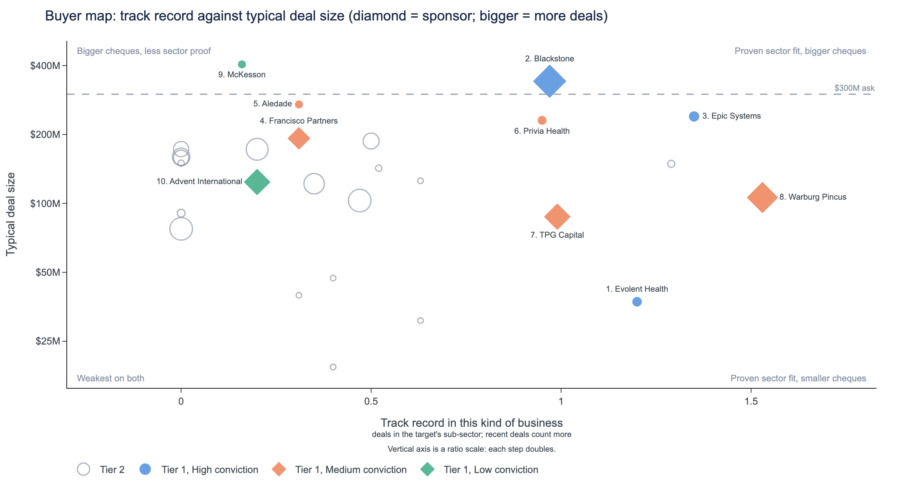
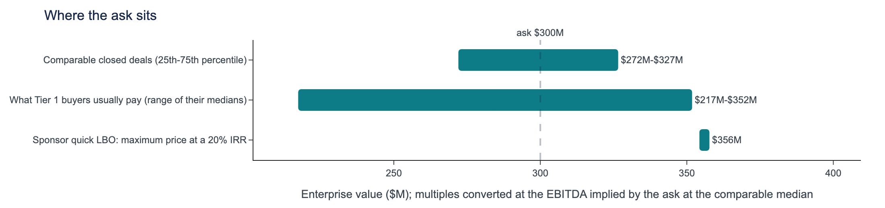
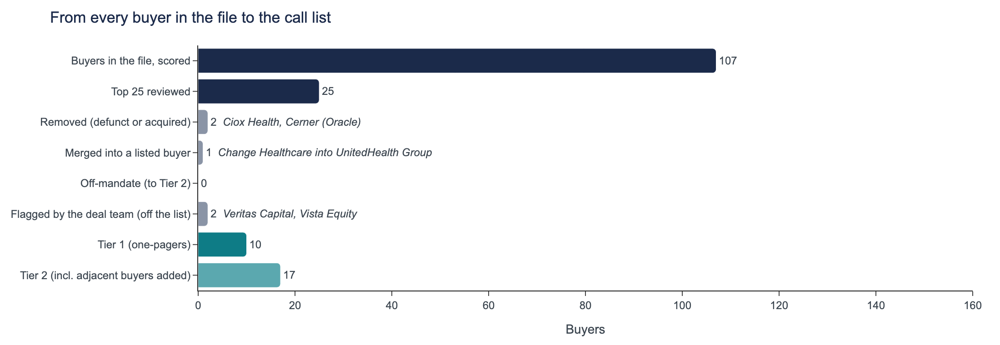
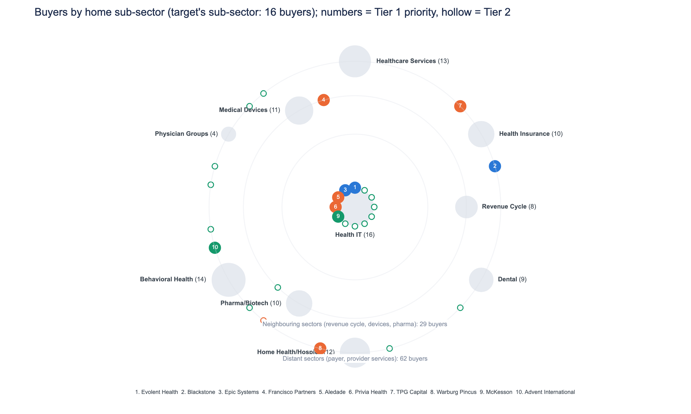

## Health IT strategics and sponsors form the buyer universe, and the comparable median is a defensible price that the leading buyers can pay.
*Health IT, $300M, National, 25.0% margin, 20.0% growth, pe-backed. Deal data through 2024 Q4.*

- Call Evolent Health first, then Blackstone and Epic Systems. All three are high conviction: Evolent and Epic already do deals in the sub-sector, and Blackstone has a platform company there.
- Anchor at the 21.4x median EBITDA multiple from 13 comparable deals. Sponsors earn 25.3% at the ask versus a 20% target, with a $356M ceiling, and Evolent and Epic closed $325M and $767M deals.
- The review removed Ciox Health and Cerner (Oracle), now inside Datavant and Oracle, and merged Change Healthcare into UnitedHealth Group; Tier 2 holds sponsors without a distinct angle and thin-record health IT strategics.
- Diversification and technology capability appear in 100% of 50 Health IT deals, and high growth in 90%, so lead the pitch with the growth story.

*Tier 1 numbered by priority; hollow markers are Tier 2. Vertical axis is a ratio scale: each step doubles.*

## Tier 1: who to call, in order
| Priority | Buyer | Type | Conviction | Why them | Can pay |
|---|---|---|---|---|---|
| 1 | Evolent Health | Strategic | High | Pure Health IT buyer; three for three closed; pays median-plus | comfortable: closed $325M |
| 2 | Blackstone | Financial sponsor | High | Add-on to its open Health IT platform; size fit | comfortable; usual deal $342M, AUM $416B |
| 3 | Epic Systems | Strategic | High | Same-sub-sector add-on; pays above the comparable median | comfortable: closed $767M |
| 4 | Francisco Partners | Financial sponsor | Medium | Add-on to an existing platform company; 25.3% IRR at the ask | comfortable; usual deal $192M |
| 5 | Aledade | Strategic | Medium | Same sub-sector, national reach; paid a top-of-range multiple before | stretch: biggest deal $271M |
| 6 | Privia Health | Strategic | Medium | Same-sub-sector strategic with a fully closed record | stretch: biggest deal $256M |
| 7 | TPG Capital | Financial sponsor | Medium | Add-on to its open Health IT platform; headroom to $356M | comfortable; usual deal $88M, AUM $303B |
| 8 | Warburg Pincus | Financial sponsor | Medium | Add-on to open Health IT platform; three own-sub-sector deals, all closed | comfortable; usual deal $106M |
| 9 | McKesson | Strategic | Low | Health IT bolt-on buyer; paid top multiple on its one deal | comfortable: closed $405M |
| 10 | Advent International | Financial sponsor | Low | Deep-pocketed sponsor with National reach; Health IT record thin | comfortable; usual deal $124M, fund $25B |

## Recommended approach
1. Lead with the 3 High-conviction buyers: Evolent Health, Blackstone, Epic Systems.
2. Approach the rest of Tier 1 in parallel (5 Medium, 2 Low), and reach out to Tier 2 at the same time to keep tension in the process.
3. Anchor on the median multiple (21.4x): margin of 25.0% is above the comparable deals' median of 22.2% but not in their top quarter, so the median is the defensible anchor; sponsors clear a 20% return at the ask on the same exit multiple (up to $356M).

*Health IT, $300M, National, 25.0% margin, 20.0% growth, pe-backed. Deal data through 2024 Q4.*

---

## Evolent Health
### Evolent Health has done three deals, all in the target's own Health IT sub-sector, all closed, at prices close to the comparable median.
*Strategic | Tier 1, priority #1 of 10 | ranked 1st of 107 buyers | likelihood 5.6% | conviction **High** | deal data through 2024 Q4*

| Deals in the file | Closed | In the target's sub-sector / adjacent | National deals | Median deal | Median EV/EBITDA paid |
|---|---|---|---|---|---|
| 3 (2018-2022) | 3 of 3 (100%) | 3 / 0 | 0 | $37M | 21.6x |

> **What sets it apart:** All 3 deals are in the target's own sub-sector, and all closed. Its 21.6x median paid is just above the 21.4x comparable median and above every financial sponsor on the list.

#### 1. Acquirer overview: A Health IT strategic with three closed deals, 2018 to 2022
- Strategic buyer with 3 deals between 2018 and 2022, all closed: 3 of 3 (100%) T:record, K:closed_share.
- All 3 deals are in the target's own sub-sector; none are adjacent or outside Health IT K:by_sub_sector, T:record.
- Ranked 1 on the priority list of 10, from 107 buyers scored, with a likelihood of 5.6% R:rank.

#### 2. Strategic fit: Sub-sector focus is the strongest factor behind this match
- Share of its deals in the target's sub-sector is the strongest factor; target margin close to what it usually buys is a strong factor S:sector_share, S:margin_fit.
- Technology Capability drove 3 of 3 deals, a motive on only 10% of deals in the file, so it is a distinct pattern M:technology_capability.
- Margin Improvement also drove 3 of 3 deals, consistent with a target running a 25.0% margin M:margin_improvement.

#### 3. Precedent activity: Three Health IT precedents at 19.8x to 22.4x, one near target size
- Frontier Health AI, $325M, 2022, Recapitalization, 19.8x EBITDA; closed, and its one deal in the comparable size band D:MA-2022-0353, K:size_band.
- Eastern EHR Solutions, $31M, 2022, Strategic Acquisition, 22.4x EBITDA, closed D:MA-2022-0458.
- Southwest EHR Solutions, $37M, 2018, Minority Investment, 21.6x EBITDA, closed D:MA-2018-0149.

| Deal | Year | Sub-sector | Size | Type | Region | EV/EBITDA | EV/Revenue | Outcome |
|---|---|---|---|---|---|---|---|---|
| Frontier Health AI | 2022 | Health IT | $325M | Recapitalization | Southwest | 19.8x | 6.66x | Closed |
| Eastern EHR Solutions | 2022 | Health IT | $31M | Strategic Acquisition | Midwest | 22.4x | 5.36x | Closed |
| Southwest EHR Solutions | 2018 | Health IT | $37M | Minority Investment | Mountain West | 21.6x | 5.09x | Closed |

#### 4. Valuation context: A median anchor of 21.4x matches Evolent's own 21.6x pricing
- 13 comparable deals, all in the same sub-sector: 19.4x at the lower quartile, 21.4x median, 23.3x at the upper quartile V:comps.
- Target margin of 25.0% is above the comps' median of 22.2% but not in their top quarter, so the 50th percentile is defensible V:comps.
- Evolent's median paid is 21.6x; synergy headroom is $14M-$23M, but buyer revenue is not researched, so capacity is unconfirmed V:comps, V:synergy.

#### 5. Risk flags
| Risk | Concern | Mitigant | Reality |
|---|---|---|---|
| **Size stretch** | Median deal of $37M is far below a $300M target; only 1 of 3 deals sat in the size band T:record, K:size_band. | Its biggest deal, Frontier Health AI at $325M, was above the target's size D:MA-2022-0353. | That $325M deal was a recapitalization, not an outright acquisition, so full-control scale is unproven D:MA-2022-0353. |
| **Ability to pay unverified** | Buyer revenue is not researched, so funding capacity cannot be tested V:synergy. | Synergy headroom of $14M-$23M supports a bid near the median multiple V:synergy. | Capacity needs confirming before the call; the profile has not been researched V:synergy. |
| **Thin recent record and competition** | Deals in recent years are a slight factor against, and no deal sits in the target's region S:recency, T:record. | 2 of its 3 deals came since 2022 K:recent. | Epic Systems and Blackstone also carry High conviction, so Evolent will face strong rivals R:rank. |

#### 6. Conviction: High
Three deals in the target's own sub-sector and a #1 place on the priority list after review support High; the absence of any deal in the target's region is neutral. T:record, R:rank, C:conviction

*Buyer profile: not researched. There are no dated, sourced facts for this buyer, so its current status, mandate and size are unchecked; everything on this page comes from the deal file.*
*D: deals in the provided CSV; K, T, V: figures computed from it; S: likelihood factors; P: dated, sourced buyer facts.*

---

## Blackstone
### Blackstone has bought three Health IT companies and runs an existing platform company in the sub-sector, making the $300M target a natural add-on.
*Financial sponsor | Tier 1, priority #2 of 10 | ranked 3rd of 107 buyers | likelihood 4.3% | conviction **High** | deal data through 2024 Q4*

| Deals in the file | Closed | In the target's sub-sector / adjacent | National deals | Median deal | Median EV/EBITDA paid | Already owns a platform company in the sub-sector |
|---|---|---|---|---|---|---|
| 25 (2015-2024) | 22 of 25 (88%) | 3 / 0 | 1 | $342M | 17.1x | yes |

> **What sets it apart:** Longest deal record on the priority list at 25 deals. Among the sponsors listed, it pays the highest median multiple (17.1x), and its $342M median deal is close to the target's size.

#### 1. Acquirer overview: Large-cap sponsor with a 25-deal, ten-year record
- 25 deals from 2015 to 2024, of which 22 closed (88%); 23 of 25 were control deals rather than minority stakes T:record, K:closed_share, K:control_share.
- Median deal of $342M, in a range from $10M to $14,354M; 11 of 25 deals sit in the $150M-$600M size band T:record, K:size_band.
- Private Equity segment holds $416.4 billion of Total Assets Under Management as of December 31, 2025 P:1.

#### 2. Strategic fit: An add-on to an open Health IT platform, backed by sub-sector precedent
- Three past deals in the target's own sub-sector, and an existing platform company there makes the target an add-on rather than a new bet T:record, A:angles.
- Platform Build is a stated motive in 9 of 25 deals, consistent with buying onto an existing platform M:platform_build.
- Past deal count is a modest factor for it; deal size and region fit are slight factors S:activity, S:not_smaller, S:geo_fit.

#### 3. Precedent activity: Three Health IT deals at 20.2x to 23.5x, all smaller than the target
- Nexus Clinical Analytics: $71M bolt-on in 2020 at 23.5x EV/EBITDA, the closest add-on precedent D:MA-2020-0384.
- Standard Revenue Cycle ($26M leveraged buyout, 2022, 20.2x) and Lake Clinical Analytics ($21M recapitalization, 2017, 21.1x) D:MA-2022-0080, D:MA-2017-0305.
- Neighbouring sector at scale: Sterling Revenue Cycle, a $458M bolt-on in 2023 at 16.2x D:MA-2023-0378.

| Deal | Year | Sub-sector | Size | Type | Region | EV/EBITDA | EV/Revenue | Outcome |
|---|---|---|---|---|---|---|---|---|
| Standard Revenue Cycle | 2022 | Health IT | $26M | Leveraged Buyout | Midwest | 20.2x | 5.68x | Closed |
| Nexus Clinical Analytics | 2020 | Health IT | $71M | Bolt-on Acquisition | National | 23.5x | 6.76x | Closed |
| Lake Clinical Analytics | 2017 | Health IT | $21M | Recapitalization | Southwest | 21.1x | 6.53x | Closed |
| Integrity Cardiovascular Systems | 2024 | Medical Devices | $1,906M | Leveraged Buyout | Southeast | 23.0x | 4.33x | Withdrawn |
| Sterling Revenue Cycle | 2023 | Revenue Cycle | $458M | Bolt-on Acquisition | Mid-Atlantic | 16.2x | 3.32x | Closed |
| Lincoln Denial Management | 2021 | Revenue Cycle | $596M | Leveraged Buyout | West Coast | 22.2x | 3.58x | Closed |

#### 4. Valuation context: Median of comparables is defensible, with headroom up to $356M
- 13 comparable deals: 19.4x at the lower quartile, 21.4x median, 23.3x at the upper quartile V:comps.
- Margin of 25.0% is above the comparables' median of 22.2% but not in their top quarter, so the 50th percentile anchors; its own median paid is 17.1x V:comps.
- At 5.0x leverage, IRR at the ask is 25.3% against a 20% target; maximum price is $356M on a $239M equity cheque V:lbo.

#### 5. Risk flags
| Risk | Concern | Mitigant | Reality |
|---|---|---|---|
| **Thin Health IT focus** | Only 3 of 25 deals are in Health IT, and its home sub-sector is Health Insurance T:record, B:buyer. | Its three Health IT deals priced at 20.2x to 23.5x, and the existing platform company gives an add-on route D:MA-2020-0384, A:angles. | Sub-sector record is real but small; all three deals were well below the target's size D:MA-2022-0080, D:MA-2017-0305. |
| **Price discipline versus comparables** | Its median paid of 17.1x is below the comparables' lower quartile of 19.4x V:comps. | IRR at the ask is 25.3% against a 20% target, with a maximum price of $356M V:lbo. | It would need to pay above its usual level, but the returns math allows it V:comps, V:lbo. |
| **Auction experience and strategic rivals** | Being used to competitive auctions counts slightly against it, and one 2024 deal was withdrawn S:bidder_exp, D:MA-2024-0347. | 22 of its 25 deals closed (88%) K:closed_share. | Execution is strong, but strategics on the priority list have paid higher median multiples S:bidder_exp, K:closed_share. |

#### 6. Conviction: High
Three deals in the target's own sub-sector, an existing platform company offering the add-on route, and position 2 on the priority list of 10 support the call T:record, A:angles, R:rank.

*Sources: P:1 https://www.sec.gov/Archives/edgar/data/1393818/000119312526082531/d48618d10k.htm (as of 2026-02-27)*
*D: deals in the provided CSV; K, T, V: figures computed from it; S: likelihood factors; P: dated, sourced buyer facts.*

---

## Epic Systems
### Epic has made all four of its deals in the target's own sub-sector and pays 22.7x, above the comparable median of 21.4x.
*Strategic | Tier 1, priority #3 of 10 | ranked 5th of 107 buyers | likelihood 4.1% | conviction **High** | deal data through 2024 Q4*

| Deals in the file | Closed | In the target's sub-sector / adjacent | National deals | Median deal | Median EV/EBITDA paid |
|---|---|---|---|---|---|
| 4 (2018-2022) | 3 of 4 (75%) | 4 / 0 | 1 | $240M | 22.7x |

> **What sets it apart:** All four deals are in the target's own sub-sector, more than any other priority-list buyer, and its 22.7x median paid exceeds every financial sponsor on the list.

#### 1. Acquirer overview: A strategic buyer focused on Health IT, with four control deals
- Four deals from 2018 to 2022, all control deals, all in Health IT and all in the target's own sub-sector T:record, K:control_share.
- Three of four closed (75%); median deal $240M, ranging from $15M to $767M K:closed_share, T:record.
- Third on the priority list of 10, from 107 buyers scored; no company profile was researched R:rank, B:buyer.

#### 2. Strategic fit: Same sub-sector, similar margin profile, and a technology-led buying pattern
- Share of deals in the target's sub-sector is the strongest factor in its likelihood; margin fit is a strong factor S:sector_share, S:margin_fit.
- Technology Capability drove 4 of 4 deals, against 10% of all deals in the file, a distinct motive M:technology_capability.
- Margin Improvement also appears in 4 of 4 deals; it has one deal in the target's National region M:margin_improvement, T:record.

#### 3. Precedent activity: Its latest and largest deals are close to the target's size
- Crest Digital Health: $440M Strategic Acquisition, 2022, National, 22.7x EBITDA, closed D:MA-2022-0213.
- Meridian Health Analytics: $767M Platform Investment, 2018, 22.0x, closed. Charter Clinical Systems: $40M Carve-out, 2019, 24.4x, closed D:MA-2018-0429, D:MA-2019-0351.
- Oak Clinical Analytics, a $15M Merger of Equals in 2021 at 18.1x, was terminated D:MA-2021-0372.

| Deal | Year | Sub-sector | Size | Type | Region | EV/EBITDA | EV/Revenue | Outcome |
|---|---|---|---|---|---|---|---|---|
| Crest Digital Health | 2022 | Health IT | $440M | Strategic Acquisition | National | 22.7x | 6.63x | Closed |
| Oak Clinical Analytics | 2021 | Health IT | $15M | Merger of Equals | Multi-Regional | 18.1x | 5.34x | Terminated |
| Charter Clinical Systems | 2019 | Health IT | $40M | Carve-out | Midwest | 24.4x | 5.93x | Closed |
| Meridian Health Analytics | 2018 | Health IT | $767M | Platform Investment | Midwest | 22.0x | 5.38x | Closed |

#### 4. Valuation context: The median is defensible, and Epic's own pricing sits above it
- Comparable range is 19.4x to 23.3x EBITDA (25th to 75th percentile), median 21.4x, across 13 same-sub-sector deals V:comps.
- Target margin of 25.0% is above the comparables' 22.2% median but not in their top quarter, so the 50th percentile is the anchor V:comps.
- Epic's median paid is 22.7x, between the comparable median and 75th percentile. Synergy headroom is $14M-$23M; buyer revenue was not researched V:comps, V:synergy.

#### 5. Risk flags
| Risk | Concern | Mitigant | Reality |
|---|---|---|---|
| **Execution record** | One of four deals terminated, so closure is 75%. | The terminated deal was the smallest, a $15M Merger of Equals in 2021. | Three of four closed, including the $440M and $767M deals K:closed_share, D:MA-2021-0372. |
| **PE-backed seller** | Having bought from this kind of seller is a modest factor against Epic. | Sub-sector share is the strongest factor and margin fit is strong. | The seller-type signal is weaker than the factors in its favour S:own_fit_s, S:sector_share. |
| **Capacity and recency** | Buyer revenue is unresearched, and only one deal has come since 2022. | It has funded a $767M deal and a $440M deal. | Ability to pay is unverified beyond the $14M-$23M synergy headroom V:synergy, K:recent, T:record. |

#### 6. Conviction: High
Four deals in the target's own sub-sector, one in its region, and third on the priority list after review, so the evidence for this buyer is consistent T:record, R:rank, C:conviction.

*Buyer profile: not researched. There are no dated, sourced facts for this buyer, so its current status, mandate and size are unchecked; everything on this page comes from the deal file.*
*D: deals in the provided CSV; K, T, V: figures computed from it; S: likelihood factors; P: dated, sourced buyer facts.*

---

## Francisco Partners
### Francisco Partners: an open-platform technology sponsor with a Health IT precedent and a 25.3% IRR at the asking price.
*Financial sponsor | Tier 1, priority #4 of 10 | ranked 7th of 107 buyers | likelihood 3.8% | conviction **Medium** | deal data through 2024 Q4*

| Deals in the file | Closed | In the target's sub-sector / adjacent | National deals | Median deal | Median EV/EBITDA paid | Already owns a platform company in the sub-sector |
|---|---|---|---|---|---|---|
| 14 (2017-2023) | 12 of 14 (86%) | 1 / 0 | 0 | $192M | 16.2x | yes |

> **What sets it apart:** Among the sponsors with an existing platform company, Francisco Partners has closed a higher share of its deals than TPG Capital and Warburg Pincus, and its median multiple paid is above both.

#### 1. Acquirer overview: Francisco Partners: a technology-focused sponsor with 14 control deals since 2017
- 14 deals from 2017 to 2023, all control deals; 12 closed (86%) T:record, K:closed_share, K:control_share.
- Describes itself as "one of the largest and most active technology-focused private equity firms in the world"; more than $75 billion raised, undated P:1, P:2.
- Only 1 deal in Health IT and 13 outside it; Physician Groups and Medical Devices lead with 3 deals each T:record, K:by_sub_sector.

#### 2. Strategic fit: Francisco Partners can add the target to an existing platform company, backed by growth and margin motives
- Growth drove 6 of 14 deals and margin improvement 5 of 14, matching the target's 20.0% growth and 25.0% margin M:high_growth, M:margin_improvement.
- Its sponsor angles are an add-on to an existing platform company in the sub-sector and size fit; 6 of 14 deals sit in the $150M-$600M band A:angles, K:size_band.
- Slight factors for: prior purchases from this kind of seller, deal size and activity; against: its low share of sub-sector deals S:own_fit_s, S:not_smaller, S:activity, S:sector_share.

#### 3. Precedent activity: One Health IT precedent, plus larger deals at 15.3x to 24.8x
- Hudson Care Analytics, same sub-sector: $16M Management Buyout, 2020, 18.9x, closed D:MA-2020-0260.
- Prime Medical Technologies ($446M Leveraged Buyout, 2021, 15.3x) and Pacific Biopharma ($724M Merger of Equals, 2021, 23.6x) both closed D:MA-2021-0297, D:MA-2021-0465.
- Coastal Gene Therapy: $9,980M Platform Investment, 2023, 24.8x, closed. Taft Device Solutions ($153M, 2022, 21.1x) is only rumored D:MA-2023-0236, D:MA-2022-0398.

| Deal | Year | Sub-sector | Size | Type | Region | EV/EBITDA | EV/Revenue | Outcome |
|---|---|---|---|---|---|---|---|---|
| Hudson Care Analytics | 2020 | Health IT | $16M | Management Buyout | Great Plains | 18.9x | 6.08x | Closed |
| Coastal Gene Therapy | 2023 | Pharma/Biotech | $9,980M | Platform Investment | Mid-Atlantic | 24.8x | 7.72x | Closed |
| Taft Device Solutions | 2022 | Medical Devices | $153M | Merger of Equals | Southwest | 21.1x | 4.69x | Rumored |
| Prime Medical Technologies | 2021 | Medical Devices | $446M | Leveraged Buyout | Mountain West | 15.3x | 5.97x | Closed |
| Pacific Biopharma | 2021 | Pharma/Biotech | $724M | Merger of Equals | Southeast | 23.6x | 8.41x | Closed |
| Highland Instruments | 2020 | Medical Devices | $142M | Management Buyout | Southwest | 20.6x | 4.93x | Closed |

#### 4. Valuation context: The median is the defensible anchor, and returns clear at the ask
- 13 comparable deals, all in the sub-sector: 19.4x at the 25th percentile, 21.4x median, 23.3x at the 75th V:comps.
- The target's 25.0% margin is above the comps' 22.2% median but not in their top quarter, so the 50th percentile is defensible V:comps.
- Francisco Partners' median paid is 16.2x; at 5.0x leverage, IRR at the ask is 25.3% against a 20% target, with maximum price $356M T:record, V:lbo.

#### 5. Risk flags
| Risk | Concern | Mitigant | Reality |
|---|---|---|---|
| **Thin Health IT record** | Only 1 of 14 deals is in Health IT, and none are in the National region T:record. | Its existing platform company in the sub-sector gives an add-on route A:angles. | Fit rests on the platform, not repeated sub-sector deals; sub-sector share counts against it S:sector_share. |
| **Price behaviour below the comps** | Its median paid of 16.2x is well below the 21.4x comp median T:record, V:comps. | IRR at the ask is 25.3% against a 20% target V:lbo. | Returns leave room to reach the median; maximum price is $356M V:lbo. |
| **Equity capacity unconfirmed** | Fund size was not researched, so equity capacity is unconfirmed R:FUND_SIZE_UNKNOWN. | More than $75 billion raised, undated, against an equity cheque of $239M P:2, V:lbo. | Capital raised is a good sign, but fund capacity needs checking before the call R:FUND_SIZE_UNKNOWN. |

#### 6. Conviction: Medium
Neutral on sub-sector depth, with only 1 deal in the target's own sub-sector for Francisco Partners; supported by an existing platform company in the sub-sector, which gives an add-on route C:conviction, A:angles.

*Sources: P:1 https://www.franciscopartners.com/about (as of 2026-10-23); P:2 https://www.franciscopartners.com/about (as of 2026-10-23)*
*D: deals in the provided CSV; K, T, V: figures computed from it; S: likelihood factors; P: dated, sourced buyer facts.*

---

## Aledade
### Aledade is a Health IT buyer whose one deal was a $271M national investment in the target's own sub-sector, at a top-of-range multiple.
*Strategic | Tier 1, priority #5 of 10 | ranked 8th of 107 buyers | likelihood 3.8% | conviction **Medium** | deal data through 2024 Q4*

| Deals in the file | Closed | In the target's sub-sector / adjacent | National deals | Median deal | Median EV/EBITDA paid |
|---|---|---|---|---|---|
| 1 (2020-2020) | 1 of 1 (100%) | 1 / 0 | 1 | $271M | 23.9x |

> **What sets it apart:** Its 23.9x median paid is above Epic and Evolent and second only to McKesson on the list. Its one deal sits in the target's size band and region.

#### 1. Acquirer overview: A Health IT strategic with one closed deal on file
- Strategic buyer with Health IT as its home sub-sector. Its profile and revenue have not been researched B:buyer, V:synergy.
- One deal on file: a 2020 minority investment that closed, and no deals since 2022 T:record, K:closed_share, K:recent.
- Fifth on the priority list of 10, with a likelihood of 3.8% across 107 buyers scored R:rank.

#### 2. Strategic fit: Same sub-sector, and that is its strongest factor
- Share of deals in the target's sub-sector is the strongest factor in its likelihood. Its single deal was in Health IT S:sector_share, K:by_sub_sector.
- Technology Capability tags its 1 of 1 deal, a tag on only 10% of deals in the file. Vertical Integration is also tagged. The sample is thin M:technology_capability, M:vertical_integration.
- Having bought in this region and a target margin close to its usual are both modest factors in its favour S:geo_fit, S:margin_fit.

#### 3. Precedent activity: One $271M national precedent, inside the target's size band
- Oak Health Informatics: $271M minority investment, 2020, at 23.9x EBITDA and 5.73x revenue. It closed D:MA-2020-0093.
- The deal falls in the $150M-$600M comparable size band, but it was a minority stake, not control (0 of 1 control deals) K:size_band, K:control_share.

| Deal | Year | Sub-sector | Size | Type | Region | EV/EBITDA | EV/Revenue | Outcome |
|---|---|---|---|---|---|---|---|---|
| Oak Health Informatics | 2020 | Health IT | $271M | Minority Investment | National | 23.9x | 5.73x | Closed |

#### 4. Valuation context: Median anchor of 21.4x; Aledade's one deal cleared the upper quartile
- 13 comparable same-sub-sector deals in the $150M-$600M band: 19.4x at the lower quartile, 21.4x median, 23.3x at the upper quartile V:comps.
- Target margin of 25.0% beats the comps' median of 22.2% but is not in the top quarter, so the 50th percentile is defensible V:comps.
- Its one deal was at 23.9x. Synergy headroom is $14M-$23M (cost synergies of 3-5% of implied opex, half realised); buyer revenue is not researched V:comps, V:synergy.

#### 5. Risk flags
| Risk | Concern | Mitigant | Reality |
|---|---|---|---|
| **Thin track record** | Only one deal on file, from 2020, with nothing since 2022 T:record, K:recent. | That deal was in the target's sub-sector, national, and in the same size band K:size_band. | One data point supports the fit but not a pattern of buying T:record. |
| **Minority, not control** | Its only deal was a minority investment, so appetite for control is unproven K:control_share. | Paying 23.9x shows it will pay full prices for Health IT assets D:MA-2020-0093. | 0 of 1 control deals; a full sale to a PE-backed seller would be new for it K:control_share. |
| **Seller type and capacity** | Having bought from this kind of seller is a slight factor against; buyer revenue is not researched S:own_fit_s, V:synergy. | Synergy headroom of $14M-$23M supports a bid near the median V:synergy. | Ability to pay is unverified until buyer revenue is researched V:synergy. |

#### 6. Conviction: Medium
Medium because it has only 1 deal in the target's own sub-sector (neutral), offset by 1 deal in the target's region (in favour). The sample is too small to go higher C:conviction, T:record.

*Buyer profile: not researched. There are no dated, sourced facts for this buyer, so its current status, mandate and size are unchecked; everything on this page comes from the deal file.*
*D: deals in the provided CSV; K, T, V: figures computed from it; S: likelihood factors; P: dated, sourced buyer facts.*

---

## Privia Health
### Both of Privia Health's deals are in the target's own Health IT sub-sector and in its size band, and both closed.
*Strategic | Tier 1, priority #6 of 10 | ranked 9th of 107 buyers | likelihood 3.8% | conviction **Medium** | deal data through 2024 Q4*

| Deals in the file | Closed | In the target's sub-sector / adjacent | National deals | Median deal | Median EV/EBITDA paid |
|---|---|---|---|---|---|
| 2 (2017-2024) | 2 of 2 (100%) | 2 / 0 | 0 | $231M | 20.5x |

> **What sets it apart:** Its whole record sits in the target's sub-sector and size band, all closed; its median deal is larger than Evolent, Francisco Partners, TPG, Warburg Pincus and Veritas.

#### 1. Acquirer overview: A Health IT strategic with a short, fully closed record since 2017
- Strategic buyer with 2 deals between 2017 and 2024; 2 of 2 (100%) closed T:record, K:closed_share.
- Median deal $231M, ranging from $205M to $256M; 2 of 2 deals sit in the comparable size band ($150M-$600M) T:record, K:size_band.
- Control deals were 1 of 2 (50%); only 1 deal has come since 2022, so the record is thin K:control_share, K:recent.

#### 2. Strategic fit: Sub-sector focus and a technology-led buying motive point to this target
- Share of its deals in the target's sub-sector is the strongest factor in its likelihood; both deals are in Health IT S:sector_share, K:by_sub_sector.
- Technology Capability drove 2 of 2 deals, yet appears on only 10% of deals in the file, so it is a distinct motive M:technology_capability.
- Target margin close to what it usually buys is a modest factor for; having bought from this kind of seller is a slight factor against S:margin_fit, S:own_fit_s.

#### 3. Precedent activity: Two Health IT deals of $205M and $256M, both closed
- Keystone Population Health: $205M minority investment, 2024, 20.2x EBITDA, 6.29x revenue D:MA-2024-0128.
- Select EHR Solutions: $256M SPAC merger, 2017, 20.9x EBITDA, 5.94x revenue D:MA-2017-0427.
- Neither deal was in the target's region; 0 deals in the National market, so the geography is untested T:record, K:by_region.

| Deal | Year | Sub-sector | Size | Type | Region | EV/EBITDA | EV/Revenue | Outcome |
|---|---|---|---|---|---|---|---|---|
| Keystone Population Health | 2024 | Health IT | $205M | Minority Investment | Mountain West | 20.2x | 6.29x | Closed |
| Select EHR Solutions | 2017 | Health IT | $256M | SPAC Merger | Southeast | 20.9x | 5.94x | Closed |

#### 4. Valuation context: Median multiple is the defensible anchor; Privia's history sits just below it
- 13 comparable deals, all in the same sub-sector: 19.4x at the lower quartile, 21.4x median, 23.3x at the upper quartile V:comps.
- Target margin of 25.0% is above the comparable median of 22.2% but not in their top quarter, so the 50th percentile is defensible V:comps.
- Privia's median paid is 20.5x, below the comparable median. Synergy headroom is $14M-$23M; buyer revenue is not researched V:comps, V:synergy.

#### 5. Risk flags
| Risk | Concern | Mitigant | Reality |
|---|---|---|---|
| **Size stretch** | The target's $300M EV exceeds Privia's biggest deal to date of $256M. | Both prior deals sit in the $150M-$600M comparable size band, so the target is within range. | Largest deal so far is $256M; this would be a new high for Privia T:record, K:size_band, X:target. |
| **Capacity unverified** | Buyer revenue is not researched and only 1 of 2 deals was a control deal. | Synergy headroom of $14M-$23M supports a bid at the median multiple. | Profile is not researched, so funding capacity stays unconfirmed until its financials are checked V:synergy, K:control_share. |
| **Outbid on price** | Its median paid of 20.5x sits under the comparable median of 21.4x. | Its two deals were at 20.2x and 20.9x, close to the median anchor. | Epic, Aledade and McKesson have paid more at the median, so Privia may be outbid V:comps, D:MA-2024-0128, D:MA-2017-0427. |

#### 6. Conviction: Medium
Two deals in the target's own sub-sector support the call, but no deal in the target's region and an unresearched profile keep it at Medium C:conviction, T:record.

*Buyer profile: not researched. There are no dated, sourced facts for this buyer, so its current status, mandate and size are unchecked; everything on this page comes from the deal file.*
*D: deals in the provided CSV; K, T, V: figures computed from it; S: likelihood factors; P: dated, sourced buyer facts.*

---

## TPG Capital
### TPG Capital is a credible add-on bidder: three Health IT deals, an existing platform company in the sub-sector, and capacity to pay up to $356M.
*Financial sponsor | Tier 1, priority #7 of 10 | ranked 10th of 107 buyers | likelihood 3.7% | conviction **Medium** | deal data through 2024 Q4*

| Deals in the file | Closed | In the target's sub-sector / adjacent | National deals | Median deal | Median EV/EBITDA paid | Already owns a platform company in the sub-sector |
|---|---|---|---|---|---|---|
| 18 (2016-2023) | 15 of 18 (83%) | 3 / 0 | 4 | $88M | 15.7x | yes |

> **What sets it apart:** Leads the priority list on National-region deals (4), pairs three own-sub-sector deals with an existing platform company, and has $303.0 billion in assets under management behind it. T:record, A:angles, P:1

#### 1. Acquirer overview: A large sponsor with 18 deals and $303.0 billion under management
- Financial sponsor with $303.0 billion in assets under management as of December 31, 2025 (TPG Inc.). P:1
- 18 deals from 2016 to 2023; 15 closed (83%) and 17 of 18 (94%) were control deals. T:record, K:closed_share, K:control_share
- Home sub-sector is Health Insurance; only 3 of 18 deals are Health IT and 15 sit outside it, so this is a selective Health IT buyer. B:buyer, A:angles, T:record

#### 2. Strategic fit: An add-on to an existing platform company, backed by growth and technology motives
- Three deals in the target's own sub-sector and an existing platform company in it make the target an add-on rather than a new bet. T:record, A:angles
- Growth drove 10 of 18 deals, in line with the target's 20.0% growth; Technology Capability featured in 3 of 18 against 10% of all deals in the file. M:high_growth, M:technology_capability
- Past purchases in this or a neighbouring region are a modest factor in its favour, with 4 National deals; having bought from this kind of seller counts slightly against. S:geo_fit, T:record, S:own_fit_s

#### 3. Precedent activity: Three Health IT precedents from $22M to $149M, paid 19.6x to 23.5x
- Select Health Data ($149M carve-out, 2018) closed at 23.3x; Paramount Care Management Tech ($22M bolt-on, 2021) closed at 23.5x. D:MA-2018-0003, D:MA-2021-0113
- Eastern Digital Health ($28M platform investment, 2021, 19.6x) was withdrawn. D:MA-2021-0380
- Neighbouring sectors: Independence Denial Management ($34M platform investment, 2022, 16.4x) and Cardinal Bio ($1,388M management buyout, 2022, 29.7x), both closed. D:MA-2022-0112, D:MA-2022-0172

| Deal | Year | Sub-sector | Size | Type | Region | EV/EBITDA | EV/Revenue | Outcome |
|---|---|---|---|---|---|---|---|---|
| Paramount Care Management Tech | 2021 | Health IT | $22M | Bolt-on Acquisition | Southwest | 23.5x | 5.38x | Closed |
| Eastern Digital Health | 2021 | Health IT | $28M | Platform Investment | Mid-Atlantic | 19.6x | 5.88x | Withdrawn |
| Select Health Data | 2018 | Health IT | $149M | Carve-out | Southeast | 23.3x | 5.09x | Closed |
| Independence Denial Management | 2022 | Revenue Cycle | $34M | Platform Investment | Great Plains | 16.4x | 4.51x | Closed |
| Cardinal Bio | 2022 | Pharma/Biotech | $1,388M | Management Buyout | Mid-Atlantic | 29.7x | 6.70x | Closed |
| Meridian Physician Partners | 2023 | Physician Groups | $7M | Strategic Acquisition | Mountain West | 12.3x | 1.59x | Closed |

#### 4. Valuation context: Target sits at the median; TPG can pay up to $356M
- 13 same-sub-sector comparables: 21.4x median, 19.4x at the lower quartile and 23.3x at the upper quartile; the 25.0% margin supports the 50th percentile. V:comps
- TPG's own median paid is 15.7x, below that median, though its Health IT precedents reached 23.5x and 23.3x. V:comps, D:MA-2021-0113, D:MA-2018-0003
- At 5.0x leverage and a $239M equity cheque, IRR at the ask is 25.3% against a 20% target; maximum price is $356M. V:lbo

#### 5. Risk flags
| Risk | Concern | Mitigant | Reality |
|---|---|---|---|
| **Size stretch** | Median deal of $88M is under half the $300M EV. T:record | It has done a $1,388M deal, and 6 of 18 deals sit in the comparable size band. T:record, K:size_band | Capacity is proven, but the target is large for its Health IT record. T:record, V:lbo |
| **Price discipline** | Median multiple paid of 15.7x is well below the comparable median of 21.4x. V:comps | Its Health IT precedents closed at 23.5x and 23.3x. D:MA-2021-0113, D:MA-2018-0003 | A bid near the median is within its demonstrated range and the LBO's $356M ceiling. V:lbo |
| **Execution record** | Eastern Digital Health, a Health IT deal, was withdrawn in 2021. D:MA-2021-0380 | 15 of 18 deals closed (83%), including Select Health Data and Paramount Care Management Tech. K:closed_share, D:MA-2021-0113, D:MA-2018-0003 | Closure record is sound; Health IT is a minority of its book. K:closed_share, A:angles |

#### 6. Conviction: Medium
Three own-sub-sector deals and an existing platform company support the case, but a median deal of $88M, under half the $300M EV, holds conviction at Medium. C:conviction, T:record, A:angles

*Sources: P:1 https://www.sec.gov/Archives/edgar/data/1880661/000188066126000011/tpg-20251231.htm (as of 2026-02-17)*
*D: deals in the provided CSV; K, T, V: figures computed from it; S: likelihood factors; P: dated, sourced buyer facts.*

---

## Warburg Pincus
### Warburg Pincus: open-platform sponsor with three closed Health IT deals, an add-on route and a 25.3% IRR at the $300M ask.
*Financial sponsor | Tier 1, priority #8 of 10 | ranked 12th of 107 buyers | likelihood 3.5% | conviction **Medium** | deal data through 2024 Q4*

| Deals in the file | Closed | In the target's sub-sector / adjacent | National deals | Median deal | Median EV/EBITDA paid | Already owns a platform company in the sub-sector |
|---|---|---|---|---|---|---|
| 23 (2016-2024) | 16 of 23 (70%) | 3 / 0 | 3 | $106M | 15.6x | yes |

> **What sets it apart:** Three own-sub-sector deals, level with Blackstone, Evolent Health and TPG Capital and behind only Epic Systems; all closed, and an existing platform company gives Warburg Pincus an add-on route.

#### 1. Acquirer overview: A generalist sponsor, active since 2016, with a thin Health IT record
- Warburg Pincus, a financial sponsor, made 23 deals from 2016 to 2024; 16 closed (70%) and 21 of 23 (91%) were control deals T:record, K:closed_share, K:control_share.
- Home Health/Hospice is its largest sub-sector with 5 deals; Health IT has 3, and 20 deals sit outside Health IT K:by_sub_sector, T:record.
- Warburg Pincus sits at position 8 on the priority list of 10, with a likelihood of 3.5%. Fund size has not been researched R:rank, R:FUND_SIZE_UNKNOWN.

#### 2. Strategic fit: An add-on to an open Health IT platform, with a technology angle
- Three deals in the target's own sub-sector and an existing platform company there make the target an add-on for Warburg Pincus rather than a new bet T:record, A:angles.
- Technology Capability drove 3 of its 23 deals, against 10% across the file, and Platform Build 5 of 23, a fit for a platform add-on M:technology_capability, M:platform_build.
- Deal count, regional record and deal size are slight factors for; the share of deals closed is a modest factor against S:activity, S:geo_fit, S:not_smaller, S:close_rate_s.

#### 3. Precedent activity: Three own-sub-sector Health IT deals, all closed, at 19.4x to 25.7x
- Apex EHR Solutions ($186M, 2023, Platform Investment) closed at 25.7x D:MA-2023-0481.
- Universal Health AI ($219M, 2022, Management Buyout) closed at 23.3x; Keystone EHR Solutions ($382M, 2021, Platform Investment) at 19.4x D:MA-2022-0252, D:MA-2021-0441.
- Outside Health IT, Global Pharmaceuticals ($2,124M, 2021) closed at 28.8x, while Delta BioTech ($432M, 2018) was withdrawn D:MA-2021-0482, D:MA-2018-0413.

| Deal | Year | Sub-sector | Size | Type | Region | EV/EBITDA | EV/Revenue | Outcome |
|---|---|---|---|---|---|---|---|---|
| Apex EHR Solutions | 2023 | Health IT | $186M | Platform Investment | Mountain West | 25.7x | 5.65x | Closed |
| Universal Health AI | 2022 | Health IT | $219M | Management Buyout | Mid-Atlantic | 23.3x | 5.85x | Closed |
| Keystone EHR Solutions | 2021 | Health IT | $382M | Platform Investment | Great Plains | 19.4x | 5.42x | Closed |
| Global Pharmaceuticals | 2021 | Pharma/Biotech | $2,124M | Merger of Equals | Multi-Regional | 28.8x | 8.38x | Closed |
| Green Revenue Cycle | 2020 | Revenue Cycle | $79M | Merger of Equals | Southwest | 21.6x | 4.95x | Withdrawn |
| Delta BioTech | 2018 | Pharma/Biotech | $432M | SPAC Merger | Multi-Regional | 22.4x | 7.70x | Withdrawn |

#### 4. Valuation context: Anchor at the 50th percentile; the ask clears the 20% return hurdle
- 13 comparable deals: 19.4x to 23.3x, median 21.4x. Margin of 25.0% beats their 22.2% median but not the top quarter, so the median anchors V:comps.
- Its overall median paid is 15.6x, below the comparable median, yet its three Health IT deals paid 19.4x to 25.7x V:comps, D:MA-2023-0481, D:MA-2022-0252, D:MA-2021-0441.
- Return at the $300M ask is 25.3% against a 20% target; maximum price is $356M on a $239M equity cheque. Fund size unconfirmed V:lbo, R:FUND_SIZE_UNKNOWN.

#### 5. Risk flags
| Risk | Concern | Mitigant | Reality |
|---|---|---|---|
| **Size stretch** | Warburg Pincus's median deal of $106M is under half the $300M EV T:record, C:conviction. | Its biggest deal is $2,124M, and 8 of 23 deals sit in the $150M-$600M band T:record, K:size_band. | Its Health IT deals ran $186M to $382M, so $300M is within reach D:MA-2023-0481, D:MA-2021-0441. |
| **Closing record** | Only 16 of 23 deals closed (70%), a modest factor against K:closed_share, S:close_rate_s. | All three Health IT deals closed D:MA-2023-0481, D:MA-2022-0252, D:MA-2021-0441. | Withdrawals were in neighbouring sectors, such as Green Revenue Cycle and Delta BioTech D:MA-2020-0201, D:MA-2018-0413. |
| **Capacity unconfirmed** | Fund size not researched, so equity capacity is unconfirmed R:FUND_SIZE_UNKNOWN. | The $239M equity cheque and 25.3% IRR at the ask suggest a workable bid V:lbo. | Confirm fund headroom before the call; maximum price is $356M V:lbo. |

#### 6. Conviction: Medium
Three own-sub-sector deals and an open-platform add-on route support Warburg Pincus, but its median deal of $106M is under half the $300M EV, which holds conviction at Medium C:conviction, T:record.

*Buyer profile: not researched. There are no dated, sourced facts for this buyer, so its current status, mandate and size are unchecked; everything on this page comes from the deal file.*
*D: deals in the provided CSV; K, T, V: figures computed from it; S: likelihood factors; P: dated, sourced buyer facts.*

---

## McKesson
### McKesson paid 25.1x for a $405M bolt-on in the target's own sub-sector, but with only one deal on record this is a lower-conviction call.
*Strategic | Tier 1, priority #9 of 10 | ranked 11th of 107 buyers | likelihood 3.7% | conviction **Low** | deal data through 2024 Q4*

| Deals in the file | Closed | In the target's sub-sector / adjacent | National deals | Median deal | Median EV/EBITDA paid |
|---|---|---|---|---|---|
| 1 (2017-2017) | 1 of 1 (100%) | 1 / 0 | 0 | $405M | 25.1x |

> **What sets it apart:** Its one deal carries the highest multiple (25.1x) and the largest median deal ($405M) on the priority list, so it has shown it can pay up. The record is a single deal, though. T:record, B:buyer

#### 1. Acquirer overview: A strategic with one Health IT bolt-on on record
- McKesson is a strategic buyer whose home sub-sector is Health IT, the same as the target. B:buyer
- One deal in the file, closed in 2017, in the target's own sub-sector. No deals since 2022. T:record, K:closed_share, K:recent
- Company profile and buyer revenue are not researched, so this view rests on deal history only. V:synergy

#### 2. Strategic fit: Own sub-sector focus and margin match drive the fit
- Share of deals in the target's sub-sector is the strongest factor. Target margin close to what it usually buys is a strong factor. S:sector_share, S:margin_fit
- Its one deal was tagged Technology Capability, which sits on only 10% of deals in the file, and Platform Build. M:technology_capability, M:platform_build
- The target is not bigger than any deal it has done, a slight positive. Having bought from this kind of seller is a slight negative. S:not_bigger, S:own_fit_s

#### 3. Precedent activity: One precedent: a larger same-sub-sector bolt-on at a high multiple
- Southeast Medical Informatics: $405M Bolt-on Acquisition, 2017, Health IT. It closed at 25.1x EV/EBITDA and 5.40x EV/revenue. D:MA-2017-0106
- The deal falls in the comparable size band of $150M-$600M, where the $300M target also sits. K:size_band
- That deal was in the Southwest. McKesson has no deal in the target's National region. T:record, K:by_region

| Deal | Year | Sub-sector | Size | Type | Region | EV/EBITDA | EV/Revenue | Outcome |
|---|---|---|---|---|---|---|---|---|
| Southeast Medical Informatics | 2017 | Health IT | $405M | Bolt-on Acquisition | Southwest | 25.1x | 5.40x | Closed |

#### 4. Valuation context: Median is the anchor; McKesson's past multiple sits above the range
- 13 comparable deals, all in the same sub-sector: 19.4x at the lower quartile, 21.4x median, 23.3x at the upper quartile. V:comps
- Target margin of 25.0% beats the comps' median of 22.2% but is not in their top quarter, so the 50th percentile is defensible. V:comps
- McKesson paid 25.1x on its one deal, above the upper quartile. Synergy headroom is $14M-$23M, but buyer revenue is not researched. V:comps, V:synergy

#### 5. Risk flags
| Risk | Concern | Mitigant | Reality |
|---|---|---|---|
| **Thin track record** | One deal, in 2017, and none since 2022, is a narrow base for judging appetite. | That deal was a same-sub-sector bolt-on larger than this target. | The record is real but single, so intent needs a direct call. T:record, K:recent |
| **Ability to pay unverified** | Buyer revenue is not researched, so capacity for a $300M deal is unconfirmed. | Synergy headroom of $14M-$23M supports a bid, and the target is smaller than its past deal. | Headroom is an estimate and does not replace balance-sheet evidence. V:synergy, S:not_bigger |
| **Crowded process** | Evolent Health, Blackstone and Epic Systems each have more sub-sector deals than McKesson's one. | McKesson's 25.1x is above every peer's median paid multiple. | It ranks 9th of 10 on the priority list, with a likelihood of 3.7%. R:rank, T:record |

#### 6. Conviction: Low
Only 1 deal in the target's own sub-sector and none in the target's region, both neutral. It ranks 9th of 10 on the priority list with a likelihood of 3.7%. C:conviction, R:rank

*Buyer profile: not researched. There are no dated, sourced facts for this buyer, so its current status, mandate and size are unchecked; everything on this page comes from the deal file.*
*D: deals in the provided CSV; K, T, V: figures computed from it; S: likelihood factors; P: dated, sourced buyer facts.*

---

## Advent International
### Advent offers a fund of about $25 billion and 5 National deals, but a thin Health IT record makes it a secondary call.
*Financial sponsor | Tier 1, priority #10 of 10 | ranked 13th of 107 buyers | likelihood 3.5% | conviction **Low** | deal data through 2024 Q4*

| Deals in the file | Closed | In the target's sub-sector / adjacent | National deals | Median deal | Median EV/EBITDA paid | Already owns a platform company in the sub-sector |
|---|---|---|---|---|---|---|
| 18 (2016-2024) | 15 of 18 (83%) | 1 / 0 | 5 | $124M | 15.5x | no |

> **What sets it apart:** Advent has done more deals in the target's National region than any other buyer on the priority list (5), and its return at the ask clears the 20% hurdle.

#### 1. Acquirer overview: A large-fund sponsor with a broad, mostly non-Health IT record
- 18 deals from 2016 to 2024, 15 closed (83%), and 17 of 18 were control deals T:record, K:closed_share, K:control_share.
- Home sub-sector is Behavioral Health; 17 of 18 deals were outside Health IT, with Dental, Health Insurance and Revenue Cycle at 3 each B:buyer, T:record, K:by_sub_sector.
- Advent Global Private Equity X, about $25 billion (2022 vintage), gives it capacity for a $300M target P:1.

#### 2. Strategic fit: Credible on region and size, weak on sub-sector focus
- Margin Improvement drove 7 of 18 deals, and the target's 25.0% margin suits that playbook M:margin_improvement, X:target.
- Past buying in this or a neighbouring region is a modest factor for; its low share of deals in the target's sub-sector is a slight factor against S:geo_fit, S:sector_share.
- Only 1 of 18 deals was Health IT, and Advent has no existing platform company, so the target would be a new bet, not an add-on A:angles.

#### 3. Precedent activity: One Health IT precedent, withdrawn; neighbouring deals show appetite at scale
- Cascade Health Informatics (Health IT, $125M, Bolt-on, 2018) was priced at 22.6x but withdrawn D:MA-2018-0206.
- Vantage Therapeutics ($315M, SPAC Merger, 2021, National) closed at 19.5x, close to the target's $300M size D:MA-2021-0203.
- Star Practice Management ($106M, Recapitalization, 2022) closed at 20.3x; 4 of 18 deals sit in the $150M-$600M size band D:MA-2022-0419, K:size_band.

| Deal | Year | Sub-sector | Size | Type | Region | EV/EBITDA | EV/Revenue | Outcome |
|---|---|---|---|---|---|---|---|---|
| Cascade Health Informatics | 2018 | Health IT | $125M | Bolt-on Acquisition | Southwest | 22.6x | 5.42x | Withdrawn |
| Star Practice Management | 2022 | Revenue Cycle | $106M | Recapitalization | Southwest | 20.3x | 3.68x | Closed |
| Liberty RCM | 2022 | Revenue Cycle | $54M | SPAC Merger | West Coast | 15.0x | 3.86x | Closed |
| Vantage Therapeutics | 2021 | Pharma/Biotech | $315M | SPAC Merger | National | 19.5x | 8.36x | Closed |
| Regional Cardiovascular Systems | 2021 | Medical Devices | $3,691M | Merger of Equals | Southeast | 20.2x | 4.60x | Closed |
| Beacon Cardiovascular Systems | 2020 | Medical Devices | $104M | Recapitalization | Great Plains | 20.4x | 4.41x | Closed |

#### 4. Valuation context: Median anchor of 21.4x is affordable, though above Advent's usual price
- 13 same-sub-sector comparables show 19.4x at the lower quartile, 21.4x median and 23.3x at the upper quartile V:comps.
- The 50th percentile is defensible: the 25.0% margin beats the 22.2% median but misses the top quarter; Advent's own median paid is 15.5x V:comps.
- At 5.0x leverage and a $239M equity cheque, IRR at the ask is 25.3% against a 20% target; maximum price is $356M V:lbo.

#### 5. Risk flags
| Risk | Concern | Mitigant | Reality |
|---|---|---|---|
| **Size and focus stretch** | Median deal of $124M is under half the $300M EV, and Health IT is 1 of 18 deals T:record. | Its biggest deal was $5,537M, and 4 of 18 deals sit in the comparable size band T:record, K:size_band. | Size is feasible, but this would be a new sub-sector bet with no existing platform company A:angles. |
| **Pricing habit below the market** | Advent's median paid of 15.5x trails the comparables' 21.4x median T:record, V:comps. | It paid 20.3x for Star Practice Management and 19.5x for Vantage Therapeutics D:MA-2022-0419, D:MA-2021-0203. | A bid near the median is possible, but the one Health IT deal at 22.6x was withdrawn D:MA-2018-0206. |
| **Crowded process** | Advent ranks 10th of 10 on the priority list, 13th overall, at a 3.5% likelihood R:rank. | Past buying in this or a neighbouring region is a modest factor in its favour S:geo_fit. | Buyers with deeper Health IT records will likely lead the process R:rank. |

#### 6. Conviction: Low
Only 1 deal sits in the target's own sub-sector, there is no existing platform company, and the $124M median deal is under half the $300M EV, so the case rests on capacity and return rather than fit C:conviction, T:record.

*Sources: P:1 https://en.wikipedia.org/wiki/Advent_International (as of 2022-05-24); P:2 https://en.wikipedia.org/wiki/Advent_International (as of 2025-11-25)*
*D: deals in the provided CSV; K, T, V: figures computed from it; S: likelihood factors; P: dated, sourced buyer facts.*

---

# The bench: Tier 2 buyers, by what holds them back
*Deal data through 2024 Q4.*

### Sponsors without a distinct angle
*What would promote one: Evidence that the sponsor already owns a platform company in the target's sub-sector (bought in the last five years), so this business could be bolted on, or a recent deal in the target's region.*
| Buyer | Type | Record | Why not Tier 1 |
|---|---|---|---|
| Welsh Carson | Financial sponsor | 23 deals, median $172M | Only 1 deal(s) in the target's own sub-sector; no existing platform company in the sub-sector |
| General Atlantic | Financial sponsor | 14 deals, median $158M | Only 0 deal(s) in the target's own sub-sector; no existing platform company in the sub-sector |
| GTCR | Financial sponsor | 14 deals, median $173M | Only 0 deal(s) in the target's own sub-sector; no existing platform company in the sub-sector |
| Nordic Capital | Financial sponsor | 24 deals, median $77M | Only 0 deal(s) in the target's own sub-sector; no existing platform company in the sub-sector |
| Hellman & Friedman | Financial sponsor | 15 deals, median $187M | Only 1 deal(s) in the target's own sub-sector; no existing platform company in the sub-sector |
| Bain Capital | Financial sponsor | 24 deals, median $103M | No existing platform company in the sub-sector; median deal $103M is under half the $300M EV |
| KKR | Financial sponsor | 17 deals, median $160M | Only 0 deal(s) in the target's own sub-sector; no existing platform company in the sub-sector |
| New Mountain Capital | Financial sponsor | 21 deals, median $122M | No existing platform company in the sub-sector; median deal $122M is under half the $300M EV |

### Health IT strategics with thin or large-only records
*What would promote one: A closed deal near the target's size, or a stated plan to expand into the target's region.*
| Buyer | Type | Record | Why not Tier 1 |
|---|---|---|---|
| Netsmart Technologies | Strategic | 2 deals, median $143M | Thin record: 2 deals |
| Veeva Systems | Strategic | 3 deals, median $149M | Only 3 deal(s) in the target's own sub-sector; no deal in the target's region |
| Definitive Healthcare | Strategic | 1 deal, median $19M | Thin record: 1 deal |
| Arcadian Telepsychiatry | Strategic | 1 deal, median $31M | Thin record: 1 deal |
| Phreesia | Strategic | 1 deal, median $40M | Thin record: 1 deal |
| WellSky | Strategic | 1 deal, median $47M | No completed deal in the file |
| Qualifacts | Strategic | 1 deal, median $126M | No completed deal in the file |

### Adjacent-sector buyers considered
*What would promote one: A cited, dated strategy to own Health IT.*
| Buyer | Type | Record | Why not Tier 1 |
|---|---|---|---|
| Gilead Sciences | Strategic | 2 deals, median $150M | Home sub-sector is Pharma/Biotech (neighbouring sector (revenue cycle, devices or pharma)); no cited Health IT strategy |
| LifeStance Health | Strategic | 4 deals, median $91M | Home sub-sector is Behavioral Health (outside Health IT); no cited Health IT strategy |

## Sponsor scorecard: the file barely separates sponsors, so compare them side by side
| Sponsor | Tier | Health IT deals | Already owns a platform company in the sub-sector | Median deal | Median EV/EBITDA paid | Minority deals | Capital | Angles |
|---|---|---|---|---|---|---|---|---|
| Blackstone | 1 | 3 of 25 | yes | $342M | 17.2x | 2 | Private Equity segment: $416.4 billion of Total Assets Under Management as of December 31, 2025 | Add-on to an existing platform company in the sub-sector, size fit |
| Francisco Partners | 1 | 1 of 14 | yes | $192M | 16.2x | 0 | not researched | Add-on to an existing platform company in the sub-sector, size fit |
| TPG Capital | 1 | 3 of 18 | yes | $88M | 15.7x | 1 | $303.0 billion in assets under management as of December 31, 2025 (TPG Inc.) | Add-on to an existing platform company in the sub-sector |
| Warburg Pincus | 1 | 3 of 23 | yes | $106M | 15.6x | 2 | not researched | Add-on to an existing platform company in the sub-sector |
| Advent International | 1 | 1 of 18 | no | $124M | 15.5x | 1 | Advent Global Private Equity X, about $25 billion (2022 vintage; PEI: 'close world's second-largest PE fund') | none |
| Welsh Carson | 2 | 1 of 23 | no | $172M | 16.2x | 2 | "Raises Over $5 Billion in Its Largest Private Equity Fund to Date" (PR Newswire headline) | Size fit |
| General Atlantic | 2 | 0 of 14 | no | $158M | 16.5x | 0 | AUM US$125.3 billion (infobox, citing SEC Form ADV; body text says over $118 billion as of September 2025) | Size fit |
| GTCR | 2 | 0 of 14 | no | $173M | 15.2x | 2 | Fund XIV, $11.5 billion (year only) | Size fit |
| Nordic Capital | 2 | 0 of 24 | no | $77M | 12.5x | 2 | Fund XI closed at its EUR 9 billion hard cap (about $11 billion); cites the PR Newswire release | none |
| Hellman & Friedman | 2 | 1 of 15 | no | $187M | 16.1x | 1 | not researched | Size fit |
| Bain Capital | 2 | 2 of 24 | no | $103M | 14.7x | 5 | not researched | Minority / partial-liquidity option |
| KKR | 2 | 0 of 17 | no | $160M | 15.7x | 1 | Private Equity business line: $229 billion of AUM as of December 31, 2025 | Size fit |
| New Mountain Capital | 2 | 2 of 21 | no | $122M | 12.8x | 0 | not researched | none |

---

# Appendix: how we built the list
*Deal data through 2024 Q4.*

### From the whole file to the call list

### Learning from the deal team's flags
Flagged: Veritas Capital (off-mandate), Vista Equity (off-mandate).

- **Suggested, not applied:** 2 technology investors flagged off-mandate: apply the mandate rule to all technology investors for Health IT targets? Check against history: in the file, the rule would have caught the real buyer in 2 of 50 Health IT deals. Accept with `python -m acquirer_engine rules --accept 1` or on the app's method page.

### Buyer motives and the evidence for them
| Motive | What does that mean? | Source | Evidence in the file (CSV tags) | Tier 1 buyers who show it most |
|---|---|---|---|---|
| Cost synergies and scale | Combine with similar businesses to cut costs and buy better | M&A guide: consolidation / economies of scale | Cost Synergies, Scale, Margin Improvement: 86% of 50 Health IT deals | Evolent Health (100%), Epic Systems (100%) |
| Revenue synergies | Sell more to the combined customer base, or take share in a fragmented market | M&A guide: acquire customers or distribution; gain market share | Cross-sell, Market Share: 40% of 50 Health IT deals | Warburg Pincus (48%), Blackstone (44%) |
| Geographic expansion | Enter or deepen a region | M&A guide: geographic expansion | Geographic Expansion: 84% of 50 Health IT deals | Francisco Partners (100%), Evolent Health (100%) |
| Vertical integration | Own the next step in the chain (e.g. a payer buying care delivery) | M&A guide: synergies along the value chain | Vertical Integration: 20% of 50 Health IT deals | Evolent Health (33%), Blackstone (24%) |
| Diversification | Add a new service line, capability or growth market | M&A guide: product expansion or diversification; key technologies | Diversification, Technology Capability: 100% of 50 Health IT deals | Evolent Health (100%), Epic Systems (100%) |
| Platform build and add-ons | A sponsor buys a platform, then bolts on smaller deals | LBO guide: add-on acquisitions | Platform Build: 32% of 50 Health IT deals | Blackstone (36%), TPG Capital (28%) |
| Growth | Buy into above-market growth | LBO guide: fast-growing, fragmented markets | High Growth: 90% of 50 Health IT deals | Epic Systems (100%), Evolent Health (67%) |

### Review log: model rank vs final tier, with the reason for every move
| Model rank | Buyer | Final tier | Reason code | Note | Source |
|---|---|---|---|---|---|
| 1 | Evolent Health | Tier 1 |  |  |  |
| 2 | Ciox Health | Removed | STATUS_ACQUIRED | Now part of Datavant: Merged with Datavant in a $7 billion deal | https://en.wikipedia.org/wiki/Datavant, as of 2021-06-09 |
| 3 | Blackstone | Tier 1 |  |  |  |
| 4 | Change Healthcare | Merged | ENTITY_DUPLICATE | Now part of UnitedHealth Group: Acquired by UnitedHealth Group (combined with Optum) for $13.9 billion in cash | https://www.sec.gov/Archives/edgar/data/731766/000073176623000008/unh-20221231.htm, accession 0000731766-23-000008, as of 2022-10-03 |
| 5 | Epic Systems | Tier 1 |  |  |  |
| 6 | Veritas Capital | Flagged | USER_FLAG | Flagged by the deal team: off-mandate (tech-only fund) | deal-team flag, 2026-10-23T15:29:10 |
| 7 | Francisco Partners | Tier 1 |  |  |  |
| 8 | Aledade | Tier 1 |  |  |  |
| 9 | Privia Health | Tier 1 |  |  |  |
| 10 | TPG Capital | Tier 1 |  |  |  |
| 11 | McKesson | Tier 1 |  |  |  |
| 12 | Warburg Pincus | Tier 1 |  |  |  |
| 13 | Advent International | Tier 1 |  |  |  |
| 14 | Cerner (Oracle) | Removed | STATUS_ACQUIRED | Now part of Oracle: Oracle completed its acquisition of Cerner (now Oracle Health) | https://www.sec.gov/Archives/edgar/data/1341439/000119312522169835/d290344d8k.htm, accession 0001193125-22-169835, as of 2022-06-08 |
| 15 | Welsh Carson | Tier 2 |  |  |  |
| 16 | General Atlantic | Tier 2 |  |  |  |
| 17 | GTCR | Tier 2 |  |  |  |
| 18 | Nordic Capital | Tier 2 |  |  |  |
| 19 | Hellman & Friedman | Tier 2 |  |  |  |
| 20 | Bain Capital | Tier 2 |  |  |  |
| 21 | Vista Equity | Flagged | USER_FLAG | Flagged by the deal team: off-mandate | deal-team flag, 2026-10-23T15:29:11 |
| 22 | KKR | Tier 2 |  |  |  |
| 23 | Netsmart Technologies | Tier 2 |  |  |  |
| 24 | New Mountain Capital | Tier 2 |  |  |  |
| 25 | Veeva Systems | Tier 2 |  |  |  |
| 32 | Gilead Sciences | Tier 2 | ADJACENCY_COVERAGE | Best-ranked strategic from a neighbouring sector (revenue cycle, devices or pharma), shown so adjacent buyers are visibly considered | deal file |
| 47 | LifeStance Health | Tier 2 | ADJACENCY_COVERAGE | Best-ranked strategic from outside Health IT, shown so adjacent buyers are visibly considered | deal file |
| 53 | Atrium Health | Merged | ENTITY_DUPLICATE | Now part of Advocate Health: Combined with Advocate Aurora Health to form Advocate Health | https://en.wikipedia.org/wiki/Advocate_Health, as of 2022-12-02 |
| 59 | Steward Health Care | Removed | STATUS_DEFUNCT | Status: Filed for Chapter 11 bankruptcy; hospitals since sold or closed and the company liquidated | https://en.wikipedia.org/wiki/Steward_Health_Care, as of 2024-05-06 |
| 83 | Amedisys | Merged | ENTITY_DUPLICATE | Now part of UnitedHealth Group: UnitedHealth Group completed its acquisition of Amedisys (merger agreed June 2023) | https://www.sec.gov/Archives/edgar/data/896262/000110465925078145/tm2523306d1_8k.htm, accession 0001104659-25-078145, as of 2025-08-14 |
| 99 | Kindred at Home | Merged | ENTITY_DUPLICATE | Now part of CenterWell Home Health: Fully acquired by Humana; now operates as CenterWell Home Health (Humana's home health business) | https://www.sec.gov/Archives/edgar/data/49071/000004907123000011/hum-20221231.htm, accession 0000049071-23-000011, as of 2021-08-17 |

*Deal data through 2024 Q4. Method: every buyer in the file is scored by a model per buyer type (sponsor or strategic) on banker signals computed only from earlier deals, tested on 127 deals from 2022-24 it never saw (actual buyer in its top 20 for 91% of them). A banker review then removes defunct and merged buyers and moves off-mandate investors, using dated, sourced profiles (see Sources). Conviction comes from named data signals; the LLM writes the pages from fact packs, and every number is checked against them. The quick LBO is set by the target (its EBITDA, growth and today's debt terms), so it is the same for every sponsor; differences in sponsor capacity come from fund size and usual deal size. Glossary: an existing platform company means the sponsor already owns a platform company in the target's sub-sector (bought in the last five years), so this business could be bolted on.*

# Sources
*Deal data through 2024 Q4. Real-world facts below come from dated, sourced buyer profiles; every deal figure comes from the provided CSV.*

**Not researched** (no sourced profile facts; deal-file evidence only): Evolent Health, Epic Systems, Aledade, Privia Health, Warburg Pincus, McKesson, Hellman & Friedman, Bain Capital, Netsmart Technologies, New Mountain Capital, Veeva Systems, Definitive Healthcare, Arcadian Telepsychiatry, Phreesia, WellSky, Qualifacts, Gilead Sciences, LifeStance Health.

| Buyer | Fact | Value | As of | Source |
|---|---|---|---|---|
| Advent International | fund_size | Advent Global Private Equity X, about $25 billion (2022 vintage; PEI: 'close world's second-largest PE fund') | 2022-05-24 | https://en.wikipedia.org/wiki/Advent_International |
| Advent International | aum | Approximately $100 billion AUM as of November 2025 | 2025-11-25 | https://en.wikipedia.org/wiki/Advent_International |
| Advocate Health | merger | Created when Advocate Aurora Health and Atrium Health merged | 2022-12-02 | https://en.wikipedia.org/wiki/Advocate_Health |
| Advocate Health | footprint | Nonprofit system headquartered in Charlotte, NC; facilities in 6 states: Alabama, Illinois, Georgia, North Carolina, South Carolina, Wisconsin | 2026-10-23 | https://en.wikipedia.org/wiki/Advocate_Health |
| Advocate Health | size | 69 hospitals (2024) | 2024-12-31 | https://en.wikipedia.org/wiki/Advocate_Health |
| Amedisys | merger | UnitedHealth Group completed its acquisition of Amedisys (merger agreed June 2023) | 2025-08-14 | https://www.sec.gov/Archives/edgar/data/896262/000110465925078145/tm2523306d1_8k.htm (accession 0001104659-25-078145) |
| Ardent Health Services | revenue | Annual revenue $6,324M (fiscal year ending 2025-12-31) | 2026-03-16 | https://data.sec.gov/api/xbrl/companyfacts/CIK0001756655.json (accession 0001628280-26-018174) |
| Ascension Health | revenue | Revenue US$28.3 billion (2023) | 2023-12-31 | https://en.wikipedia.org/wiki/Ascension_(healthcare_system) |
| Ascension Health | footprint | 90 hospitals (2025), down from 142 in 2021; 17 states and DC as of July 1, 2025; Midwest sites in Wisconsin, Indiana and Michigan | 2025-07-01 | https://en.wikipedia.org/wiki/Ascension_(healthcare_system) |
| Ascension Health | divestiture | Prime Healthcare acquired eight Chicago-area Ascension hospitals | 2025-03-01 | https://en.wikipedia.org/wiki/Ascension_(healthcare_system) |
| Atrium Health | merger | Combined with Advocate Aurora Health to form Advocate Health | 2022-12-02 | https://en.wikipedia.org/wiki/Advocate_Health |
| Blackstone | aum | Private Equity segment: $416.4 billion of Total Assets Under Management as of December 31, 2025 | 2026-02-27 | https://www.sec.gov/Archives/edgar/data/1393818/000119312526082531/d48618d10k.htm (accession 0001193125-26-082531) |
| Bon Secours Mercy Health | merger | Bon Secours finalized its merger with Mercy Health | 2018-09-07 | https://en.wikipedia.org/wiki/Bon_Secours_Mercy_Health |
| Bon Secours Mercy Health | footprint | 51 hospitals; headquartered in Cincinnati, OH; hospitals in Ohio, Kentucky, South Carolina, Virginia and Ireland | 2026-10-23 | https://en.wikipedia.org/wiki/Bon_Secours_Mercy_Health |
| CHRISTUS Health | footprint | More than 60 hospitals and long-term care facilities; headquartered in Irving, TX; Texas, Arkansas, Louisiana, New Mexico, plus Chile, Mexico and Colombia | 2026-10-23 | https://en.wikipedia.org/wiki/Christus_Health |
| CenterWell Home Health | parent | Home health business of Humana (formerly Kindred at Home, fully acquired on August 17, 2021) | 2023-02-16 | https://www.sec.gov/Archives/edgar/data/49071/000004907123000011/hum-20221231.htm (accession 0000049071-23-000011) |
| CenterWell Home Health | revenue | Parent Humana: annual revenue $129,664M (fiscal year ending 2025-12-31) | 2026-02-19 | https://data.sec.gov/api/xbrl/companyfacts/CIK0000049071.json (accession 0000049071-26-000009) |
| Cerner (Oracle) | merger | Oracle completed its acquisition of Cerner (now Oracle Health) | 2022-06-08 | https://www.sec.gov/Archives/edgar/data/1341439/000119312522169835/d290344d8k.htm (accession 0001193125-22-169835) |
| Change Healthcare | merger | Acquired by UnitedHealth Group (combined with Optum) for $13.9 billion in cash | 2022-10-03 | https://www.sec.gov/Archives/edgar/data/731766/000073176623000008/unh-20221231.htm (accession 0000731766-23-000008) |
| Ciox Health | merger | Merged with Datavant in a $7 billion deal | 2021-06-09 | https://en.wikipedia.org/wiki/Datavant |
| Francisco Partners | mandate | "One of the largest and most active technology-focused private equity firms in the world" | 2026-10-23 | https://www.franciscopartners.com/about |
| Francisco Partners | capital_raised | More than $75 billion of capital raised (undated on the page) | 2026-10-23 | https://www.franciscopartners.com/about |
| GTCR | fund_size | Fund XIV, $11.5 billion (year only) | 2023-12-31 | https://en.wikipedia.org/wiki/GTCR |
| GTCR | mandate | Targets financial services and technology, healthcare, and growth business services | 2026-10-23 | https://en.wikipedia.org/wiki/GTCR |
| General Atlantic | mandate | Growth equity firm; invests across Technology, Consumer, Financial Services, Healthcare and Life Sciences | 2025-09-30 | https://en.wikipedia.org/wiki/General_Atlantic |
| General Atlantic | aum | AUM US$125.3 billion (infobox, citing SEC Form ADV; body text says over $118 billion as of September 2025) | 2026-03-31 | https://en.wikipedia.org/wiki/General_Atlantic |
| HCA Healthcare | revenue | Annual revenue $75,600M (fiscal year ending 2025-12-31) | 2026-02-10 | https://data.sec.gov/api/xbrl/companyfacts/CIK0000860730.json (accession 0001193125-26-044769) |
| Intermountain Health | merger | Completed a merger with SCL Health, extending into Colorado, Kansas and Montana | 2022-04-01 | https://en.wikipedia.org/wiki/Intermountain_Health |
| Intermountain Health | footprint | 33 hospitals in Utah, Colorado, Idaho and Montana; headquartered in Salt Lake City; left Kansas in 2024 | 2026-10-23 | https://en.wikipedia.org/wiki/Intermountain_Health |
| KKR | aum | Private Equity business line: $229 billion of AUM as of December 31, 2025 | 2026-02-27 | https://www.sec.gov/Archives/edgar/data/1404912/000140491226000007/kkr-20251231.htm (accession 0001404912-26-000007) |
| Kindred at Home | merger | Fully acquired by Humana; now operates as CenterWell Home Health (Humana's home health business) | 2021-08-17 | https://www.sec.gov/Archives/edgar/data/49071/000004907123000011/hum-20221231.htm (accession 0000049071-23-000011) |
| Mass General Brigham | revenue | Annual revenue $20.6 billion in 2024 (infobox says $22.6 billion; flagged in the source as needing a citation) | 2024-12-31 | https://en.wikipedia.org/wiki/Mass_General_Brigham |
| Mass General Brigham | footprint | Hospitals mainly in Massachusetts, plus Wentworth-Douglass Hospital in New Hampshire (acquired 2017) | 2026-10-23 | https://en.wikipedia.org/wiki/Mass_General_Brigham |
| Nordic Capital | mandate | Healthcare is one of four core industries (with Technology & Payments, Financial Services, Services & Industrial Technology) | 2026-10-23 | https://en.wikipedia.org/wiki/Nordic_Capital |
| Nordic Capital | fund_size | Fund XI closed at its EUR 9 billion hard cap (about $11 billion); cites the PR Newswire release | 2022-10-31 | https://en.wikipedia.org/wiki/Nordic_Capital |
| Steward Health Care | status | Filed for Chapter 11 bankruptcy; hospitals since sold or closed and the company liquidated | 2024-05-06 | https://en.wikipedia.org/wiki/Steward_Health_Care |
| TPG Capital | aum | $303.0 billion in assets under management as of December 31, 2025 (TPG Inc.) | 2026-02-17 | https://www.sec.gov/Archives/edgar/data/1880661/000188066126000011/tpg-20251231.htm (accession 0001880661-26-000011) |
| UPMC | revenue | Revenue US$27.7 billion (2023) | 2023-12-31 | https://en.wikipedia.org/wiki/University_of_Pittsburgh_Medical_Center |
| UPMC | footprint | Hospitals in Pennsylvania, Maryland and New York; Washington Health System merged with UPMC in 2024 | 2024-12-31 | https://en.wikipedia.org/wiki/University_of_Pittsburgh_Medical_Center |
| Veritas Capital | mandate | "Investing at the intersection of technology and government": technology or technology-enabled solutions to government and commercial customers | 2026-10-23 | https://www.veritascapital.com/ |
| Veritas Capital | aum | $50B+ AUM across 3 strategies, including committed capital | 2026-06-30 | https://www.veritascapital.com/ |
| Vista Equity | mandate | "A leading technology investor" managing "a diversified portfolio of software companies" | 2026-06-30 | https://www.vistaequitypartners.com/about/ |
| Welsh Carson | mandate | Focuses on investing in technology and healthcare; US$8 billion of capital raised devoted to healthcare (2016 figure) | 2019-07-31 | https://en.wikipedia.org/wiki/Welsh,_Carson,_Anderson_%26_Stowe |
| Welsh Carson | fund_size | "Raises Over $5 Billion in Its Largest Private Equity Fund to Date" (PR Newswire headline) | 2023-07-12 | https://www.prnewswire.com/news/welsh%2C-carson%2C-anderson-%26-stowe/ |