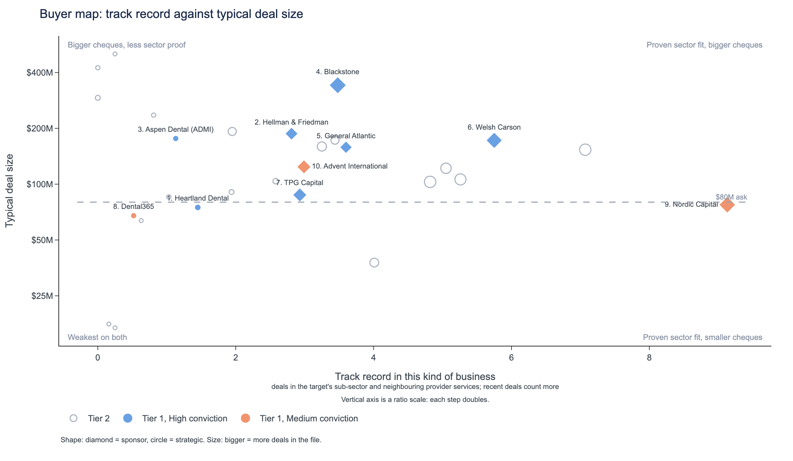
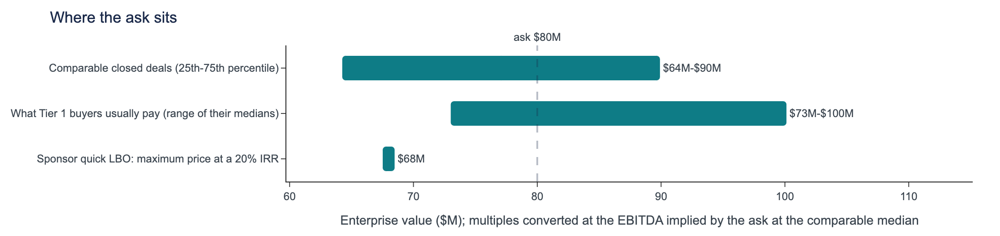
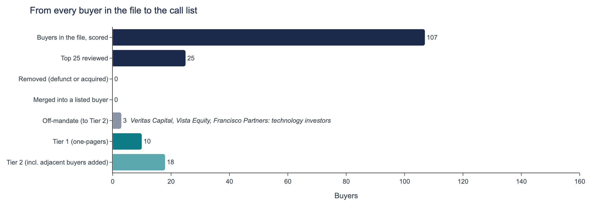
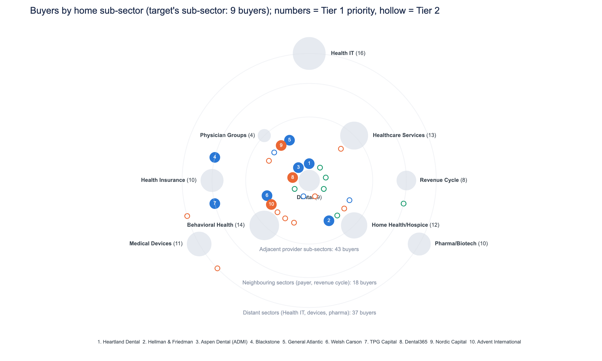

## Dental strategics and healthcare-focused sponsors form the buyer universe for this Southeast dental practice; upper-quartile pricing at 15.4x EV/EBITDA is defensible.
*Dental, $80M, Southeast, 18.0% margin, 8.0% growth, private. Deal data through 2024 Q4.*

- Call Heartland Dental and Aspen Dental (ADMI) first, since both have closed larger deals in the target's own sub-sector; the order among the seven sponsors is close to a tie, with the winner in the top 3 only 28% of the time against 20% at random .
- Upper-quartile pricing at 15.4x EV/EBITDA is defensible because the target's 18.0% margin beats the comparable median of 12.4%; strategics can pay it comfortably, while sponsors would be stretching .
- The review removed and merged no one; Veritas Capital, Vista Equity and Francisco Partners stay in Tier 2 until their appetite for tech-enabled services is confirmed before outreach .
- Most buyers in provider deals share one motive, geographic expansion, cited in 90% of 284 provider deals, so lead the pitch with the target's Southeast footprint .

*Tier 1 numbered by priority; hollow markers are Tier 2. Vertical axis is a ratio scale: each step doubles.*

## Tier 1: who to call, in order
| Priority | Buyer | Type | Conviction | Why them | Can pay |
|---|---|---|---|---|---|
| 1 | Heartland Dental | Strategic | High | Dental specialist; closes every deal; pays near upper quartile | comfortable: closed $409M |
| 2 | Hellman & Friedman | Financial sponsor | High | Southeast dental precedent, existing platform company add-on route, pays above upper quartile | stretch; usual deal $187M |
| 3 | Aspen Dental (ADMI) | Strategic | High | Dental bolt-on to an established platform; full closing record | comfortable: closed $392M |
| 4 | Blackstone | Financial sponsor | High | Add-on to its open dental platform; pays above-range multiples | stretch; usual deal $342M, AUM $416B |
| 5 | General Atlantic | Financial sponsor | High | Add-on to open dental platform; pays above upper quartile | stretch; usual deal $158M, AUM $125B |
| 6 | Welsh Carson | Financial sponsor | High | Add-on to its dental platform; pays above upper-quartile multiples | stretch; usual deal $172M, fund $5B |
| 7 | TPG Capital | Financial sponsor | High | Add-on to an existing platform company; right-sized provider buyer | stretch; usual deal $88M, AUM $303B |
| 8 | Dental365 | Strategic | Medium | Pure dental buyer with a 100% close record | stretch: biggest deal $73M |
| 9 | Nordic Capital | Financial sponsor | Medium | Provider specialist sponsor; size fits; must stretch on price | stretch; usual deal $77M, fund $11B |
| 10 | Advent International | Financial sponsor | Medium | Repeat dental investor, Southeast-active, pays 15.5x median | stretch; usual deal $124M, fund $25B |

## Recommended approach
1. Lead with the 7 High-conviction buyers: Heartland Dental, Hellman & Friedman, Aspen Dental (ADMI), Blackstone, General Atlantic, Welsh Carson, TPG Capital.
2. Approach the rest of Tier 1 in parallel (3 Medium, 0 Low), and reach out to Tier 2 at the same time to keep tension in the process.
3. Anchor on the 75th-percentile multiple (15.4x), justified by the target's margin; sponsors fall short of a 20% return at the ask (maximum $68M), so strategics and add-on buyers set the price.

*Dental, $80M, Southeast, 18.0% margin, 8.0% growth, private. Deal data through 2024 Q4.*

---

## Heartland Dental
### Heartland Dental is a dental-only strategic that closed all four of its deals, ranks first on the priority list, and pays near upper-quartile multiples.
*Strategic | Tier 1, priority #1 of 10 | ranked 1st of 107 buyers | likelihood 5.5% | conviction **High** | deal data through 2024 Q4*

| Deals in the file | Closed | In the target's sub-sector / adjacent | In the Southeast | Median deal | Median EV/EBITDA paid |
|---|---|---|---|---|---|
| 4 (2017-2022) | 4 of 4 (100%) | 4 / 0 | 1 | $75M | 15.3x |

> **What sets it apart:** It has more deals in the target's own sub-sector than any other buyer on the priority list, and all closed. Its 15.3x median paid sits just under the comparable upper quartile. T:record, K:closed_share, V:comps

#### 1. Acquirer overview: A dental-only strategic buyer with a clean closing record
- Strategic buyer with dental as its home sub-sector. All 4 deals are in dental; none are in adjacent provider sub-sectors. B:buyer, T:record
- All 4 deals closed between 2017 and 2022, all as control deals. Median deal size is $75M. K:closed_share, K:control_share, T:record
- Company profile and buyer revenue were not researched, so its scale is unconfirmed. V:synergy

#### 2. Strategic fit: The target sits squarely in its dental buying pattern
- Share of deals in the target's sub-sector is the strongest factor in its likelihood. Margin fit and close rate are modest positives. S:sector_share, S:margin_fit, S:close_rate_s
- Cost synergies and scale drove 2 of 4 deals, against 21% of all deals in the file, so this is a distinct motive. M:cost_synergies
- It has one Southeast deal, Valley Dental Network (2021). Geographic expansion tags 4 of 4 deals but also 90% of the file, so it does not set it apart. D:MA-2021-0356, M:geographic_expansion

#### 3. Precedent activity: Four dental precedents, from $16M to $409M
- Madison Dental Solutions: $119M management buyout, 2022, at 16.1x EV/EBITDA. D:MA-2022-0084
- Eastern Orthodontics: $409M management buyout, 2021, at 16.0x. Valley Dental Network: $31M recapitalization, 2021, Southeast, at 10.7x. D:MA-2021-0434, D:MA-2021-0356
- Only 1 of its 4 deals falls in the comparable size band of $40M-$160M. K:size_band

| Deal | Year | Sub-sector | Size | Type | Region | EV/EBITDA | EV/Revenue | Outcome |
|---|---|---|---|---|---|---|---|---|
| Madison Dental Solutions | 2022 | Dental | $119M | Management Buyout | Mid-Atlantic | 16.1x | 3.60x | Closed |
| Eastern Orthodontics | 2021 | Dental | $409M | Management Buyout | Mid-Atlantic | 16.0x | 2.20x | Closed |
| Valley Dental Network | 2021 | Dental | $31M | Recapitalization | Southeast | 10.7x | 3.26x | Closed |
| Platinum Dental Care | 2017 | Dental | $16M | Carve-out | Northeast | 14.6x | 2.38x | Closed |

#### 4. Valuation context: Its 15.3x median supports pricing near the 75th percentile
- 63 comparable deals show 11.0x at the lower quartile, 13.7x at the median and 15.4x at the upper quartile. V:comps
- The target's 18.0% margin is above the comparable median of 12.4%, which supports upper-quartile pricing. V:comps, X:target
- Its own median paid is 15.3x. Cost-synergy headroom is $5M-$9M; buyer revenue is not researched, so capacity to pay needs confirming. V:comps, V:synergy

#### 5. Risk flags
| Risk | Concern | Mitigant | Reality |
|---|---|---|---|
| **Thin recent activity** | Only one deal since 2022, and its last deal was in 2022. | All 4 deals closed, and recency is only a slight factor against it. | Appetite looks proven but not current; confirm it is still buying. K:recent, S:recency, K:closed_share |
| **Capacity unverified** | Buyer revenue is not researched, and only 1 of 4 deals is in the comparable size band. | Median deal of $75M is close to the target's $80M EV; synergy headroom is $5M-$9M. | Fit on size looks reasonable; ability to fund is unconfirmed. V:synergy, T:record, K:size_band |
| **Low Southeast precedent price** | Its only Southeast deal was struck at 10.7x, below the 11.0x comparable lower quartile. | Its median paid across all deals is 15.3x. | The target's margin supports upper-quartile pricing; the buyer must accept it. D:MA-2021-0356, V:comps |

#### 6. Conviction: High
Four deals in the target's own sub-sector, none in adjacent ones, one deal in the target's region, and a first-place position among the highest-scored buyers after review. C:conviction, T:record, R:rank

*Buyer profile: not researched. There are no dated, sourced facts for this buyer, so its current status, mandate and size are unchecked; everything on this page comes from the deal file.*
*D: deals in the provided CSV; K, T, V: figures computed from it; S: likelihood factors; P: dated, sourced buyer facts.*

---

## Hellman & Friedman
### Hellman & Friedman: a Southeast dental buyout precedent and an existing platform company add-on route make it the second-ranked buyer for this $80M target.
*Financial sponsor | Tier 1, priority #2 of 10 | ranked 2nd of 107 buyers | likelihood 5.4% | conviction **High** | deal data through 2024 Q4*

| Deals in the file | Closed | In the target's sub-sector / adjacent | In the Southeast | Median deal | Median EV/EBITDA paid | Already owns a platform company in the sub-sector |
|---|---|---|---|---|---|---|
| 15 (2015-2024) | 12 of 15 (80%) | 2 / 6 | 6 | $187M | 16.1x | yes |

> **What sets it apart:** Hellman & Friedman has the most Southeast deals of any buyer on the priority list (6 of 15), plus an existing platform company route in the sub-sector and capacity for larger deals. T:record, A:angles

#### 1. Acquirer overview: Active sponsor with a provider focus and a mostly closed record
- Hellman & Friedman is a financial sponsor with 15 deals from 2015 to 2024; 12 closed (80%), and 14 of 15 were control deals. T:record, K:closed_share, K:control_share
- Median deal $187M, ranging from $9M to $994M; 5 deals since 2022 across 8 active years. T:record, K:recent, K:years_active
- 8 of 15 deals are provider services (2 dental, 6 adjacent). Fund size and firm profile not researched. A:angles, T:record, R:FUND_SIZE_UNKNOWN

#### 2. Strategic fit: A Southeast dental add-on for a sponsor that has bought there
- Buying in this or a neighbouring region is a modest factor in its likelihood of 5.4%; 6 of its 15 deals are in the Southeast. S:geo_fit, R:rank, T:record
- Hellman & Friedman bought Maple Dental Care ($428M, 2020) in the Southeast, in the target's own sub-sector. D:MA-2020-0286
- Margin Improvement drove 5 of 15 deals; its existing platform company in the sub-sector makes the target an add-on. M:margin_improvement, A:angles

#### 3. Precedent activity: Two dental deals and a recent Southeast bolt-on
- Maple Dental Care: $428M Leveraged Buyout, Southeast, 2020, at 13.0x EV/EBITDA, closed. D:MA-2020-0286
- Great Medical Associates (physician groups): $299M Bolt-on Acquisition, Southeast, 2024, at 13.3x; Harbor PACE: $81M, 2019, at 16.1x. D:MA-2024-0002, D:MA-2019-0271
- Core Oral Health: $12M dental Recapitalization, West Coast, 2022, at 16.1x. Only 3 of 15 deals sit in the $40M-$160M size band. D:MA-2022-0428, K:size_band

| Deal | Year | Sub-sector | Size | Type | Region | EV/EBITDA | EV/Revenue | Outcome |
|---|---|---|---|---|---|---|---|---|
| Core Oral Health | 2022 | Dental | $12M | Recapitalization | West Coast | 16.1x | 2.13x | Closed |
| Maple Dental Care | 2020 | Dental | $428M | Leveraged Buyout | Southeast | 13.0x | 3.42x | Closed |
| Great Medical Associates | 2024 | Physician Groups | $299M | Bolt-on Acquisition | Southeast | 13.3x | 1.38x | Closed |
| Meridian Medical Associates | 2022 | Physician Groups | $27M | SPAC Merger | Southwest | 15.9x | 2.27x | Withdrawn |
| Harbor PACE | 2019 | Home Health/Hospice | $81M | Strategic Acquisition | Midwest | 16.1x | 2.02x | Closed |
| Silver Palliative Care | 2018 | Home Health/Hospice | $121M | Carve-out | West Coast | 15.4x | 1.90x | Closed |

#### 4. Valuation context: Upper-quartile pricing is defensible and within this buyer's habits
- 63 comparable deals show 11.0x at the lower quartile, 13.7x median and 15.4x at the upper quartile. V:comps
- Target margin of 18.0% beats the comps' 12.4% median and exceeds 92% of comps, supporting the 75th percentile. V:comps
- Its median paid of 16.1x sits above the 15.4x upper quartile; at 5.0x leverage the equity cheque is $53M. V:comps, V:lbo

#### 5. Risk flags
| Risk | Concern | Mitigant | Reality |
|---|---|---|---|
| **Return at the asking price** | IRR at the ask is 14.0%, against a 20% target. V:lbo | A platform exit at 13.7x leaves the maximum price at $68M, no higher. V:lbo | The $68M ceiling is below the $80M EV, so a price or structure gap must be bridged. V:lbo, X:target |
| **Size and capacity** | Median deal is $187M and only 3 of 15 deals fall in the $40M-$160M band. T:record, K:size_band | It has done deals as small as $9M, and Harbor PACE at $81M. T:record, D:MA-2019-0271 | Fund size not researched, so equity capacity is unconfirmed. R:FUND_SIZE_UNKNOWN |
| **Completion record** | Share of deals that closed is a slight factor against: 12 of 15 (80%). S:close_rate_s, K:closed_share | Both its Southeast precedents, Maple Dental Care and Great Medical Associates, closed. D:MA-2020-0286, D:MA-2024-0002 | Meridian Medical Associates (2022) was withdrawn; a diligence point, not a bar. D:MA-2022-0056 |

#### 6. Conviction: High
Two deals in the target's own sub-sector, six in adjacent provider sub-sectors, an existing platform company add-on route and a #2 position on the priority list support High. C:conviction, R:rank

*Buyer profile: not researched. There are no dated, sourced facts for this buyer, so its current status, mandate and size are unchecked; everything on this page comes from the deal file.*
*D: deals in the provided CSV; K, T, V: figures computed from it; S: likelihood factors; P: dated, sourced buyer facts.*

---

## Aspen Dental (ADMI)
### Aspen Dental is a dental-only buyer with 3 closed dental deals, one in the Southeast, and the target fits its bolt-on and platform-build pattern.
*Strategic | Tier 1, priority #3 of 10 | ranked 3rd of 107 buyers | likelihood 5.3% | conviction **High** | deal data through 2024 Q4*

| Deals in the file | Closed | In the target's sub-sector / adjacent | In the Southeast | Median deal | Median EV/EBITDA paid |
|---|---|---|---|---|---|
| 3 (2020-2022) | 3 of 3 (100%) | 3 / 0 | 1 | $176M | 13.2x |

> **What sets it apart:** Aspen Dental's median deal of $176M is the largest among the dental-only strategics on the list, and all of its deals closed, including one in the Southeast.

#### 1. Acquirer overview: A dental specialist that has closed every deal it started
- Aspen Dental did 3 deals from 2020 to 2022, all in dental and all closed (3 of 3, 100%) T:record, K:closed_share.
- Ranked 3rd on the priority list of 10 and 3rd overall among 107 buyers scored, at a likelihood of 5.3% R:rank.
- Company profile and buyer revenue not researched, so the parent's scale is unconfirmed B:buyer, V:synergy.

#### 2. Strategic fit: Same sub-sector, same-region precedent, platform-build motive
- Share of its deals in dental is the strongest factor in its likelihood; margin fit and close rate are modest positives S:sector_share, S:margin_fit, S:close_rate_s.
- Platform Build in 2 of 3 deals, a motive on only 23% of deals in the file, points to add-on appetite M:platform_build.
- Aspen Dental bought Strategic Oral Health in the Southeast in 2020, so the target's region is not new to it D:MA-2020-0159.

#### 3. Precedent activity: Three dental deals, one bolt-on, all larger than the target
- Quality Orthodontics: $176M bolt-on, 2022, at 12.4x. Pacific Oral Health: $168M management buyout, 2020, at 13.2x D:MA-2022-0229, D:MA-2020-0247.
- Strategic Oral Health: $392M platform investment in the Southeast, 2020, at 17.0x D:MA-2020-0159.
- None of the three falls in the comparable size band of $40M-$160M K:size_band.

| Deal | Year | Sub-sector | Size | Type | Region | EV/EBITDA | EV/Revenue | Outcome |
|---|---|---|---|---|---|---|---|---|
| Quality Orthodontics | 2022 | Dental | $176M | Bolt-on Acquisition | National | 12.4x | 2.27x | Closed |
| Pacific Oral Health | 2020 | Dental | $168M | Management Buyout | West Coast | 13.2x | 1.97x | Closed |
| Strategic Oral Health | 2020 | Dental | $392M | Platform Investment | Southeast | 17.0x | 1.82x | Closed |

#### 4. Valuation context: Upper-quartile pricing is defensible; its own history sits lower
- 63 comparable deals, 12 in dental: 11.0x at the lower quartile, 13.7x median, 15.4x at the upper quartile V:comps.
- Target margin of 18.0% beats the comps' median of 12.4% and sits above 92% of comps, supporting the 75th percentile V:comps.
- Aspen Dental's median paid is 13.2x; synergy headroom of $5M-$9M gives room to stretch toward the 75th. Buyer revenue not researched V:comps, V:synergy.

#### 5. Risk flags
| Risk | Concern | Mitigant | Reality |
|---|---|---|---|
| **Size stretch** | All three precedents are above the target's size; the smallest was $168M against an $80M target. | Quality Orthodontics was a bolt-on, the same deal type as this target. | No deal in the $40M-$160M band; small-deal appetite is unproven K:size_band, T:record, D:MA-2022-0229. |
| **Price discipline** | Its median paid of 13.2x is below the comparable median of 13.7x and the upper quartile of 15.4x. | It paid 17.0x for Strategic Oral Health, and synergy headroom is $5M-$9M. | Upper-quartile pricing needs a stretch beyond its usual multiple T:record, V:comps, D:MA-2020-0159, V:synergy. |
| **Thin recent activity** | Only 1 deal since 2022, and its last was in 2022; recency counts slightly against it. | Every deal it started has closed, 3 of 3. | Current appetite is unconfirmed; the buyer's profile was not researched K:recent, S:recency, K:closed_share, T:record. |

#### 6. Conviction: High
Three deals in the target's own sub-sector and none in adjacent ones, one deal in the Southeast, and a rank of 3rd among the highest-scored buyers after review support the call C:conviction, R:rank.

*Buyer profile: not researched. There are no dated, sourced facts for this buyer, so its current status, mandate and size are unchecked; everything on this page comes from the deal file.*
*D: deals in the provided CSV; K, T, V: figures computed from it; S: likelihood factors; P: dated, sourced buyer facts.*

---

## Blackstone
### Existing platform company in the sub-sector, two prior dental deals and the highest median multiple on the priority list make Blackstone a natural add-on buyer.
*Financial sponsor | Tier 1, priority #4 of 10 | ranked 4th of 107 buyers | likelihood 5.2% | conviction **High** | deal data through 2024 Q4*

| Deals in the file | Closed | In the target's sub-sector / adjacent | In the Southeast | Median deal | Median EV/EBITDA paid | Already owns a platform company in the sub-sector |
|---|---|---|---|---|---|---|
| 25 (2015-2024) | 22 of 25 (88%) | 2 / 7 | 1 | $342M | 17.1x | yes |

> **What sets it apart:** Pays the highest median multiple on the priority list (17.1x), with 7 adjacent provider deals, an existing platform company and a median deal size above every peer line. T:record, A:angles

#### 1. Acquirer overview: A large sponsor with a ten-year, mostly closed record
- Financial sponsor with 25 deals from 2015 to 2024; 22 of 25 (88%) closed T:record, K:closed_share.
- Home sub-sector is Health Insurance (6 deals); median deal is $342M and median EV/EBITDA paid is 17.1x B:buyer, K:by_sub_sector, T:record.
- Private Equity segment: $416.4 billion of Total Assets Under Management as of December 31, 2025 P:1.

#### 2. Strategic fit: An add-on to an existing platform company, backed by dental and provider deals
- Platform Build in 9 of 25 deals; its existing platform company in the sub-sector makes the target an add-on rather than a new bet M:platform_build, A:angles.
- Deals in this or neighbouring sub-sectors are a modest factor in its likelihood: 2 in dental and 7 in adjacent provider sub-sectors S:sector_rel, T:record.
- Against: dental is a small share of its deals (a slight factor against) and only 1 deal is in the Southeast S:sector_share, T:record.

#### 3. Precedent activity: Two dental buyouts in 2021, both at 13.5x
- Crest Oral Health: $558M leveraged buyout, 2021, 13.5x EV/EBITDA, closed D:MA-2021-0164.
- North Smile Group: $222M management buyout, 2021, 13.5x, closed. Both dental deals date from 2021 D:MA-2021-0453.
- Adjacent: Evergreen Care Solutions, $299M bolt-on, 2021, 14.6x; Tri Home Health, $75M minority investment, 2022, 14.8x D:MA-2021-0195, D:MA-2022-0319.

| Deal | Year | Sub-sector | Size | Type | Region | EV/EBITDA | EV/Revenue | Outcome |
|---|---|---|---|---|---|---|---|---|
| Crest Oral Health | 2021 | Dental | $558M | Leveraged Buyout | Northeast | 13.5x | 3.47x | Closed |
| North Smile Group | 2021 | Dental | $222M | Management Buyout | Mountain West | 13.5x | 2.76x | Closed |
| Great Substance Use | 2023 | Behavioral Health | $10M | Strategic Acquisition | Multi-Regional | 9.0x | 1.54x | Rumored |
| Tri Home Health | 2022 | Home Health/Hospice | $75M | Minority Investment | Southwest | 14.8x | 2.41x | Closed |
| Peak Medical Management | 2021 | Healthcare Services | $342M | SPAC Merger | Midwest | 10.0x | 1.52x | Closed |
| Evergreen Care Solutions | 2021 | Healthcare Services | $299M | Bolt-on Acquisition | Southwest | 14.6x | 2.45x | Closed |

#### 4. Valuation context: Upper-quartile pricing is defensible, but the return at the ask falls short
- Comparable deals (63) span 11.0x at the 25th percentile to 15.4x at the 75th, median 13.7x V:comps.
- The 75th percentile is defensible: the target's 18.0% margin sits above the comps' median of 12.4%. Blackstone's own median paid is 17.1x V:comps.
- At 5.0x leverage and 8.5% interest, the equity cheque is $53M and IRR at the ask is 14.0% against a 20% target V:lbo.

#### 5. Risk flags
| Risk | Concern | Mitigant | Reality |
|---|---|---|---|
| **Return at the asking price** | IRR at the ask of 14.0% is below the 20% target V:lbo. | A platform exit at 13.7x is available through its existing platform company V:lbo, A:angles. | Maximum price is $68M on either exit, below the $80M EV V:lbo. |
| **Size stretch** | Median deal is $342M; only 5 of 25 deals fall in the $40M-$160M comparable band T:record, K:size_band. | Smallest deal is $10M, and deal size is a slight factor in its favour T:record, S:not_smaller. | The target is small for Blackstone; it fits as an add-on T:record, A:angles. |
| **Thin dental and Southeast record** | Only 2 dental deals and 1 Southeast deal; 16 deals are outside provider services T:record. | 7 adjacent provider deals and an existing platform company in the sub-sector T:record, A:angles. | Dental's small share of its deals is a slight factor against its likelihood S:sector_share. |

#### 6. Conviction: High
Basis: 2 deals in the target's own sub-sector and 7 in adjacent provider sub-sectors, plus an existing platform company in the sub-sector (add-on route). Offsetting this, the return at the ask is below target C:conviction, V:lbo.

*Sources: P:1 https://www.sec.gov/Archives/edgar/data/1393818/000119312526082531/d48618d10k.htm (as of 2026-02-27)*
*D: deals in the provided CSV; K, T, V: figures computed from it; S: likelihood factors; P: dated, sourced buyer facts.*

---

## General Atlantic
### Open-platform growth investor with a deep provider record: the target fits as a dental add-on at upper-quartile pricing.
*Financial sponsor | Tier 1, priority #5 of 10 | ranked 5th of 107 buyers | likelihood 5.2% | conviction **High** | deal data through 2024 Q4*

| Deals in the file | Closed | In the target's sub-sector / adjacent | In the Southeast | Median deal | Median EV/EBITDA paid | Already owns a platform company in the sub-sector |
|---|---|---|---|---|---|---|
| 14 (2019-2024) | 13 of 14 (93%) | 1 / 8 | 2 | $158M | 16.5x | yes |

> **What sets it apart:** Among sponsors on the list with an existing platform company, it closes most reliably (13 of 14) and pays a 16.5x median, near the top of the range.

#### 1. Acquirer overview: Provider-focused growth investor with a clean closing record
- Growth equity firm investing across Technology, Consumer, Financial Services, Healthcare and Life Sciences; AUM US$125.3 billion per its infobox P:1, P:2.
- 14 deals from 2019 to 2024, 13 closed (93%), all control; 9 of 14 in provider services T:record, K:closed_share, K:control_share, A:angles.
- Ranks 5th on the priority list, with a likelihood of 5.2% among 107 buyers scored R:rank.

#### 2. Strategic fit: An add-on to its open dental platform, backed by provider breadth
- Existing platform company in the sub-sector makes the target an add-on rather than a new bet; it is a provider specialist A:angles.
- Deals in this or neighbouring sub-sectors are a modest factor in its favour: 1 in the target's own sub-sector, 8 in adjacent provider sub-sectors S:sector_rel, T:record.
- Distinct motives: Market Share in 5 of 14 deals (19% across the file) and Scale in 5 of 14 (23%) M:market_share, M:scale.

#### 3. Precedent activity: A dental buyout and a Southeast physician-group deal anchor its record
- Clearwater Dental Network: $206M leveraged buyout, 2020, 12.7x EBITDA, its only dental deal D:MA-2020-0095.
- Crest Medical Practice: $121M leveraged buyout in the Southeast, 2023, 11.5x D:MA-2023-0499.
- Metro Counseling, $75M SPAC merger, 2021, 14.0x; Harbor Home Health Partners, $15M strategic acquisition, 2022, 16.9x D:MA-2021-0349, D:MA-2022-0273.

| Deal | Year | Sub-sector | Size | Type | Region | EV/EBITDA | EV/Revenue | Outcome |
|---|---|---|---|---|---|---|---|---|
| Clearwater Dental Network | 2020 | Dental | $206M | Leveraged Buyout | Northeast | 12.7x | 2.37x | Closed |
| Crest Medical Practice | 2023 | Physician Groups | $121M | Leveraged Buyout | Southeast | 11.5x | 2.31x | Closed |
| Harbor Home Health Partners | 2022 | Home Health/Hospice | $15M | Strategic Acquisition | Midwest | 16.9x | 1.56x | Closed |
| Oak Health | 2021 | Healthcare Services | $1,708M | Merger of Equals | Southeast | 18.8x | 2.65x | Closed |
| Frontier Clinics | 2021 | Physician Groups | $7M | Platform Investment | National | 14.4x | 2.23x | Terminated |
| Metro Counseling | 2021 | Behavioral Health | $75M | SPAC Merger | Great Plains | 14.0x | 2.40x | Closed |

#### 4. Valuation context: Upper-quartile pricing is defensible, but the ask outruns its return threshold
- Comparable range over 63 deals: 11.0x at the lower quartile, 13.7x median, 15.4x at the 75th percentile; the 75th is defensible V:comps.
- Margin of 18.0% against a comps median of 12.4%, above 92% of comps, supports upper-quartile pricing; its own median paid is 16.5x V:comps.
- At 5.0x leverage the equity cheque is $53M; IRR at the ask is 14.0% against a 20% target; maximum price is $68M V:lbo.

#### 5. Risk flags
| Risk | Concern | Mitigant | Reality |
|---|---|---|---|
| **Return at the asking price** | IRR at the ask of 14.0% is below the 20% target V:lbo. | Existing platform company add-on route and a 16.5x median paid show willingness to pay up A:angles, V:comps. | A platform exit at 13.7x still caps the price at $68M; expect a gap to the ask V:lbo. |
| **Thin dental record** | Only 1 of its 14 deals is in dental; sub-sector share is a slight factor against S:sector_share, T:record. | 8 adjacent provider deals and an existing platform company in the sub-sector offer the add-on route T:record, A:angles. | Its one dental deal, Clearwater, closed at 12.7x, under the 13.7x comparable median D:MA-2020-0095, V:comps. |
| **Competitive process** | Strategic dental buyers such as Heartland Dental and Aspen Dental (ADMI) are on the same priority list R:rank. | A close rate of 13 of 14 and a 16.5x median paid make it a credible bidder K:closed_share, V:comps. | Those strategics have more dental-specific deals; General Atlantic must win on certainty and price S:sector_share. |

#### 6. Conviction: High
Rests on 1 deal in the target's own sub-sector, 8 in adjacent provider sub-sectors, and an existing platform company in the sub-sector, which gives an add-on route C:conviction, A:angles.

*Sources: P:1 https://en.wikipedia.org/wiki/General_Atlantic (as of 2025-09-30); P:2 https://en.wikipedia.org/wiki/General_Atlantic (as of 2026-03-31)*
*D: deals in the provided CSV; K, T, V: figures computed from it; S: likelihood factors; P: dated, sourced buyer facts.*

---

## Welsh Carson
### Welsh Carson: an add-on to an open dental platform, backed by a deep provider record, paying a 16.2x median against a 15.4x upper quartile.
*Financial sponsor | Tier 1, priority #6 of 10 | ranked 6th of 107 buyers | likelihood 5.1% | conviction **High** | deal data through 2024 Q4*

| Deals in the file | Closed | In the target's sub-sector / adjacent | In the Southeast | Median deal | Median EV/EBITDA paid | Already owns a platform company in the sub-sector |
|---|---|---|---|---|---|---|
| 23 (2017-2023) | 18 of 23 (78%) | 2 / 14 | 3 | $172M | 16.2x | yes |

> **What sets it apart:** Most adjacent provider deals of any open-platform sponsor on the priority list (14), plus an existing platform company in dental, so the target is an add-on rather than a new bet.

#### 1. Acquirer overview: A provider-focused sponsor with a seven-year, mostly control record
- Financial sponsor with 23 deals from 2017 to 2023; 18 closed (78%), and 21 of 23 were control deals T:record, K:closed_share, K:control_share.
- Provider services dominate: 16 of 23 deals, including 2 in dental and 14 in adjacent provider sub-sectors A:angles, T:record.
- Invests in technology and healthcare, and raised over $5 billion in its largest fund to date in 2023 P:1, P:2.

#### 2. Strategic fit: An add-on to an open dental platform, backed by provider depth
- Deals in this or neighbouring sub-sectors are a modest factor in its likelihood, and its existing platform company makes the target an add-on S:sector_rel, A:angles.
- Cross-sell is a distinct motive: 8 of 23 deals, against 21% of all deals in the file. Margin Improvement appears in 7 of 23 M:cross_sell, M:margin_improvement.
- Southeast presence: 3 deals in the target's region, including Southeast Home Health in 2022 T:record, D:MA-2022-0107.

#### 3. Precedent activity: Two dental deals closed, plus larger adjacent provider transactions
- Alliance DSO: $57M leveraged buyout, 2023, at 16.1x. Prime Dental Solutions: $14M carve-out, 2021, at 11.8x. Both closed D:MA-2023-0354, D:MA-2021-0262.
- Southeast Home Health: $114M SPAC merger, 2022, at 16.3x. Woodland PACE: $204M management buyout, 2021, at 17.6x D:MA-2022-0107, D:MA-2021-0025.
- 6 of its 23 deals sit in the comparable size band of $40M-$160M, and 8 have come since 2022 K:size_band, K:recent.

| Deal | Year | Sub-sector | Size | Type | Region | EV/EBITDA | EV/Revenue | Outcome |
|---|---|---|---|---|---|---|---|---|
| Alliance DSO | 2023 | Dental | $57M | Leveraged Buyout | Mid-Atlantic | 16.1x | 3.63x | Closed |
| Prime Dental Solutions | 2021 | Dental | $14M | Carve-out | National | 11.8x | 3.63x | Closed |
| Clearwater Mental Health | 2023 | Behavioral Health | $398M | Recapitalization | Midwest | 16.8x | 1.98x | Withdrawn |
| Southeast Home Health | 2022 | Home Health/Hospice | $114M | SPAC Merger | Southeast | 16.3x | 2.45x | Closed |
| Delta Multispecialty Group | 2022 | Physician Groups | $38M | Recapitalization | Southwest | 8.3x | 2.08x | Withdrawn |
| Woodland PACE | 2021 | Home Health/Hospice | $204M | Management Buyout | Great Plains | 17.6x | 2.78x | Closed |

#### 4. Valuation context: Upper-quartile pricing is defensible, but returns cap the bid at $68M
- 63 comparable deals: lower quartile 11.0x, median 13.7x, upper quartile 15.4x V:comps.
- Upper quartile is defensible: 18.0% margin against a 12.4% comp median, above 92% of comps. Its own median paid is 16.2x V:comps, T:record.
- At 5.0x leverage and 8.5% interest, IRR at the ask is 14.0% against a 20% target; maximum price is $68M on either exit V:lbo.

#### 5. Risk flags
| Risk | Concern | Mitigant | Reality |
|---|---|---|---|
| **Return at the asking price** | IRR at the ask of 14.0% is below the 20% target V:lbo. | A platform exit at 13.7x was tested as an alternative route V:lbo. | Maximum price stays $68M on either exit, below the $80M target EV V:lbo, X:target. |
| **Completion record** | Only 18 of 23 deals closed (78%), a slight factor against it K:closed_share, S:close_rate_s. | Both of its dental deals closed D:MA-2023-0354, D:MA-2021-0262. | Two recapitalizations were withdrawn: Clearwater Mental Health and Delta Multispecialty Group D:MA-2023-0166, D:MA-2022-0024. |
| **Competitive process** | Other open-platform sponsors on the priority list, including Blackstone, General Atlantic and TPG Capital, are also credible bidders. | Its 14 adjacent provider deals are the most among open-platform sponsors on the list T:record. | Only 2 dental deals, so Heartland Dental and Advent International have deeper dental records T:record. |

#### 6. Conviction: High
Basis: 2 deals in the target's own sub-sector, 14 in adjacent provider sub-sectors, and an existing platform company add-on route. The 14.0% IRR at the ask and 78% completion rate are the main qualifiers T:record, A:angles, V:lbo, K:closed_share.

*Sources: P:1 https://en.wikipedia.org/wiki/Welsh,_Carson,_Anderson_%26_Stowe (as of 2019-07-31); P:2 https://www.prnewswire.com/news/welsh%2C-carson%2C-anderson-%26-stowe/ (as of 2023-07-12)*
*D: deals in the provided CSV; K, T, V: figures computed from it; S: likelihood factors; P: dated, sourced buyer facts.*

---

## TPG Capital
### TPG Capital is an open-platform sponsor with 2 dental deals and 7 adjacent provider deals, and its $88M median deal fits the $80M target.
*Financial sponsor | Tier 1, priority #7 of 10 | ranked 7th of 107 buyers | likelihood 5.1% | conviction **High** | deal data through 2024 Q4*

| Deals in the file | Closed | In the target's sub-sector / adjacent | In the Southeast | Median deal | Median EV/EBITDA paid | Already owns a platform company in the sub-sector |
|---|---|---|---|---|---|---|
| 18 (2016-2023) | 15 of 18 (83%) | 2 / 7 | 3 | $88M | 15.7x | yes |

> **What sets it apart:** Among open-platform sponsors on the list, TPG Capital's $88M median deal is the closest to the $80M target; Blackstone, Hellman & Friedman, General Atlantic and Welsh Carson all run far larger medians. T:record, A:angles

#### 1. Acquirer overview: A $303.0 billion sponsor with a broad, mostly closed record
- TPG Capital is a financial sponsor with $303.0 billion in assets under management as of December 31, 2025. B:buyer, P:1
- 18 deals from 2016 to 2023; 15 of 18 (83%) closed and 17 of 18 (94%) were control deals. T:record, K:closed_share, K:control_share
- 9 deals sit outside provider services and its home sub-sector is Health Insurance, so dental is not its main focus. T:record, B:buyer

#### 2. Strategic fit: An add-on to an existing platform company, backed by a provider record
- Having bought from this kind of seller is the strongest factor in its likelihood, a modest one. Sector relevance and deal count are slight factors. S:own_fit_s, S:sector_rel, S:activity
- Platform Build in 5 of 18 deals and High Growth in 10 of 18 point to buying and scaling assets. M:platform_build, M:high_growth
- Its existing platform company makes the target an add-on; 2 own sub-sector deals and 7 adjacent provider deals support the fit. A:angles, T:record

#### 3. Precedent activity: Two dental precedents, plus a Southeast provider deal
- Granite Dental Network: $203M Platform Investment, 2021, at 12.2x. D:MA-2021-0439
- Integrity Oral Health: $57M SPAC Merger, 2018, at 16.8x, the highest multiple among its dental precedents. D:MA-2018-0420
- Quality Medical Group: $187M Minority Investment in the Southeast, 2022, at 11.2x; 3 of its deals are in the target's region. D:MA-2022-0350, T:record

| Deal | Year | Sub-sector | Size | Type | Region | EV/EBITDA | EV/Revenue | Outcome |
|---|---|---|---|---|---|---|---|---|
| Granite Dental Network | 2021 | Dental | $203M | Platform Investment | West Coast | 12.2x | 1.77x | Closed |
| Integrity Oral Health | 2018 | Dental | $57M | SPAC Merger | Northeast | 16.8x | 3.23x | Closed |
| Meridian Physician Partners | 2023 | Physician Groups | $7M | Strategic Acquisition | Mountain West | 12.3x | 1.59x | Closed |
| Quality Medical Group | 2022 | Healthcare Services | $187M | Minority Investment | Southeast | 11.2x | 2.99x | Closed |
| Liberty Addiction Treatment | 2021 | Behavioral Health | $118M | Leveraged Buyout | National | 8.8x | 2.33x | Closed |
| Quantum Counseling | 2019 | Behavioral Health | $12M | Platform Investment | Mid-Atlantic | 15.7x | 1.57x | Closed |

#### 4. Valuation context: Upper-quartile pricing is defensible; the bid must clear the return gap
- Comparable deals (63) show 11.0x at the lower quartile, 13.7x median and 15.4x at the upper quartile. V:comps
- The 75th percentile is defensible: the 18.0% margin sits above the comps' 12.4% median, and above 92% of comps. V:comps
- TPG Capital's own median paid is 15.7x, in line with the upper quartile. Ability to pay: 5.0x leverage at 8.5%, an equity cheque of $53M. V:comps, V:lbo

#### 5. Risk flags
| Risk | Concern | Mitigant | Reality |
|---|---|---|---|
| **Return at the asking price** | IRR at the ask of 14.0% is below the 20% target. V:lbo | A platform exit at 13.7x leaves the maximum price at $68M. V:lbo | The gap is on returns, not capital, given $303.0 billion under management. V:lbo, P:1 |
| **Growth fit runs against** | Target growth is not close to what it usually buys, a slight factor against. S:growth_fit | High Growth is a motive in 10 of 18 deals. M:high_growth | The factor is slight; the target's 8.0% growth and 18.0% margin remain the pitch. S:growth_fit, X:target |
| **Crowded process, mid-list rank** | TPG Capital ranks 7 on the priority list of 10, with a likelihood of 5.1%. R:rank | Conviction is High on its sub-sector record and existing platform company. C:conviction | Other open-platform sponsors, such as Blackstone and Hellman & Friedman, are also on the list, so expect competition. R:rank, A:angles |

#### 6. Conviction: High
Rests on 2 deals in the target's own sub-sector, 7 in adjacent provider sub-sectors, and an existing platform company offering the add-on route. The return at the ask is the main hurdle. C:conviction, A:angles, V:lbo

*Sources: P:1 https://www.sec.gov/Archives/edgar/data/1880661/000188066126000011/tpg-20251231.htm (as of 2026-02-17)*
*D: deals in the provided CSV; K, T, V: figures computed from it; S: likelihood factors; P: dated, sourced buyer facts.*

---

## Dental365
### Dental365 is a dental-only buyer: all three of its deals were in the target's own sub-sector and all closed, though it has been inactive since 2018.
*Strategic | Tier 1, priority #8 of 10 | ranked 8th of 107 buyers | likelihood 4.8% | conviction **Medium** | deal data through 2024 Q4*

| Deals in the file | Closed | In the target's sub-sector / adjacent | In the Southeast | Median deal | Median EV/EBITDA paid |
|---|---|---|---|---|---|
| 3 (2016-2018) | 3 of 3 (100%) | 3 / 0 | 0 | $68M | 14.5x |

> **What sets it apart:** Dental365 has all 3 deals in the target's own sub-sector and none elsewhere, with every deal closed. Only Heartland and Aspen match that completion record; Dental365's $68M median deal is close to the target's size.

#### 1. Acquirer overview: Dental365 is a dental-only buyer with a short, fully closed record
- Dental365 is a strategic buyer with 3 deals between 2016 and 2018, all closed, all control deals, all in the target's sub-sector T:record, K:closed_share, K:control_share.
- Deals ranged from $22M to $73M with a median of $68M; 2 of 3 fall in the comparable size band of $40M-$160M T:record, K:size_band.
- Dental365 has done no deals since 2022. Its profile and revenue were not researched K:recent, V:synergy.

#### 2. Strategic fit: Sub-sector focus is the strongest factor behind Dental365's ranking
- Share of deals in the target's sub-sector is the strongest factor; a target margin close to what Dental365 usually buys is a modest factor S:sector_share, S:margin_fit.
- Growth was the motive in 2 of 3 Dental365 deals (High Growth), against 41% of all deals in the file; this suits the target's 8.0% growth M:high_growth, X:target.
- Dental365 ranks 8th on the priority list of 10, with a likelihood of 4.8% across 107 buyers scored; it has no Southeast deal to date R:rank, T:record.

#### 3. Precedent activity: Dental365's three dental precedents run 14.0x to 16.1x, latest in 2018
- Crown Dental Care: $73M Strategic Acquisition in the Midwest, 2018, at 14.5x EBITDA, the closest in size to the target D:MA-2018-0442.
- Peak Dental Management: $68M Management Buyout, 2016, at 16.1x, the highest multiple Dental365 has paid D:MA-2016-0178.
- Keystone Oral Health: $22M Leveraged Buyout, 2018, at 14.0x; well below the target's size D:MA-2018-0011.

| Deal | Year | Sub-sector | Size | Type | Region | EV/EBITDA | EV/Revenue | Outcome |
|---|---|---|---|---|---|---|---|---|
| Crown Dental Care | 2018 | Dental | $73M | Strategic Acquisition | Midwest | 14.5x | 1.92x | Closed |
| Keystone Oral Health | 2018 | Dental | $22M | Leveraged Buyout | National | 14.0x | 2.54x | Closed |
| Peak Dental Management | 2016 | Dental | $68M | Management Buyout | Multi-Regional | 16.1x | 3.35x | Closed |

#### 4. Valuation context: Target supports upper-quartile pricing; Dental365's history sits just below
- Comparable range is 11.0x to 15.4x EV/EBITDA, median 13.7x, across 63 deals in the $40M-$160M band V:comps.
- Target margin of 18.0% beats the comps median of 12.4% and exceeds 92% of comps, so the 75th percentile is defensible V:comps.
- Dental365's median paid is 14.5x. Cost synergy headroom is $5M-$9M, but its revenue was not researched, so ability to pay is unconfirmed V:comps, V:synergy.

#### 5. Risk flags
| Risk | Concern | Mitigant | Reality |
|---|---|---|---|
| **Dormant acquirer** | Dental365 has not dealt since 2018, and none since 2022; deals in recent years count slightly against it K:recent, S:recency. | All 3 deals closed, so execution is proven when it does transact K:closed_share. | Current appetite is unverified and should be tested early on the call T:record. |
| **No Southeast footprint** | Dental365 has no prior deal in the target's region; its deals were Multi-Regional, National and Midwest T:record, K:by_region. | Geographic expansion motivated 2 of 3 deals, though the tag is common across the file M:geographic_expansion. | The target would be Dental365's first Southeast position, not an extension of an existing one T:record. |
| **Unconfirmed capacity** | Dental365's revenue was not researched, so funding an $80M deal cannot be assessed V:synergy, X:target. | Its largest deal was $73M and its median paid of 14.5x is within the comparable range T:record, V:comps. | Synergy headroom of $5M-$9M helps, but financing capacity remains open V:synergy. |

#### 6. Conviction: Medium
Three Dental365 deals in the target's own sub-sector and none in adjacent provider sub-sectors support the fit, but no deal in the target's region leaves that factor neutral C:conviction.

*Buyer profile: not researched. There are no dated, sourced facts for this buyer, so its current status, mandate and size are unchecked; everything on this page comes from the deal file.*
*D: deals in the provided CSV; K, T, V: figures computed from it; S: likelihood factors; P: dated, sourced buyer facts.*

---

## Nordic Capital
### Nordic Capital: provider-focused sponsor with two prior dental bolt-ons and a $77M median deal, but its 12.5x median price trails the market.
*Financial sponsor | Tier 1, priority #9 of 10 | ranked 9th of 107 buyers | likelihood 4.7% | conviction **Medium** | deal data through 2024 Q4*

| Deals in the file | Closed | In the target's sub-sector / adjacent | In the Southeast | Median deal | Median EV/EBITDA paid | Already owns a platform company in the sub-sector |
|---|---|---|---|---|---|---|
| 24 (2016-2024) | 21 of 24 (88%) | 2 / 20 | 1 | $77M | 12.5x | no |

> **What sets it apart:** Nordic Capital has the most adjacent provider deals (20) on the priority list, and a $77M median deal closer to the target's $80M than any other sponsor's. T:record

#### 1. Acquirer overview: Provider-heavy sponsor with a steady, high-closing record
- Nordic Capital is a financial sponsor with 24 deals from 2016 to 2024; 21 of 24 (88%) closed and 22 of 24 (92%) were control deals. T:record, K:closed_share, K:control_share
- It has done 2 dental deals and 20 in adjacent provider sub-sectors; physician groups lead with 10. Provider deals are 22 of 24. T:record, K:by_sub_sector, A:angles
- Healthcare is one of Nordic Capital's four core industries; Fund XI closed at its EUR 9 billion hard cap (about $11 billion). P:1, P:2

#### 2. Strategic fit: Dental experience plus size fit, but no existing platform company
- Platform Build is a motive in 7 of 24 Nordic Capital deals, giving a basis for a dental add-on thesis. M:platform_build
- Signals for: modest factors on sub-sector relevance and deal count, and a slight factor that $80M is not below its usual range. S:sector_rel, S:activity, S:not_smaller
- Against: a slight factor on region, with only 1 Southeast deal in its record. It has no existing platform company in the sub-sector. S:geo_fit, K:by_region, A:angles

#### 3. Precedent activity: Two prior dental bolt-ons, both far larger than this target
- Highland Dental Solutions, 2022: $222M bolt-on at 11.6x EV/EBITDA, closed. D:MA-2022-0103
- Horizon Dental Management, 2020: $249M bolt-on at 16.4x, closed, showing Nordic Capital will pay up in dental. D:MA-2020-0386
- Principal Physician Group, 2024: $76M recapitalization at 15.9x, closed; this is its closest deal in size to the target. D:MA-2024-0431

| Deal | Year | Sub-sector | Size | Type | Region | EV/EBITDA | EV/Revenue | Outcome |
|---|---|---|---|---|---|---|---|---|
| Highland Dental Solutions | 2022 | Dental | $222M | Bolt-on Acquisition | Mountain West | 11.6x | 3.41x | Closed |
| Horizon Dental Management | 2020 | Dental | $249M | Bolt-on Acquisition | Mid-Atlantic | 16.4x | 3.04x | Closed |
| Harbor Health Network | 2024 | Healthcare Services | $35M | Carve-out | National | 11.6x | 2.70x | Closed |
| Principal Physician Group | 2024 | Physician Groups | $76M | Recapitalization | Midwest | 15.9x | 2.40x | Closed |
| Hudson Behavioral Services | 2023 | Behavioral Health | $16M | Merger of Equals | West Coast | 15.8x | 3.02x | Pending |
| Alliance Primary Care | 2023 | Physician Groups | $389M | Leveraged Buyout | West Coast | 13.4x | 1.24x | Closed |

#### 4. Valuation context: Upper-quartile pricing is defensible, but this buyer pays less
- 63 comparable deals show 11.0x at the low end, a 13.7x median and 15.4x at the 75th percentile. V:comps
- The 75th percentile is defensible: the target's 18.0% margin is above the comps' median of 12.4%, and above 92% of comps. V:comps
- Nordic Capital's own median is 12.5x. At 5.0x leverage and an equity cheque of $53M, IRR at the ask is 14.0% against a 20% target. V:comps, V:lbo

#### 5. Risk flags
| Risk | Concern | Mitigant | Reality |
|---|---|---|---|
| **Price gap** | Its returns do not clear at the $80M ask. | The 18.0% margin supports upper-quartile pricing in the comparable set. | IRR at the ask is 14.0% against 20%; maximum price is $68M on either exit. V:lbo, V:comps |
| **No open dental platform** | Nordic Capital has no existing platform company in the sub-sector to absorb the target. | It has completed two dental bolt-ons and shows a platform-build motive. | Existing platform company is no; both dental deals were bolt-ons, the only two dental deals in its record. A:angles, D:MA-2022-0103, D:MA-2020-0386 |
| **Southeast and priority** | Little regional footprint, and low standing on the list. | Its size fit and provider record are strong, and 21 of 24 deals closed. | One Southeast deal; position 9 on a priority list of 10, with a 4.7% likelihood. K:by_region, R:rank, K:closed_share |

#### 6. Conviction: Medium
Nordic Capital has 2 deals in the target's own sub-sector and 20 in adjacent provider sub-sectors, offset by no existing platform company in the sub-sector. The return shortfall at the ask keeps it a lower-priority call. C:conviction, T:record, V:lbo

*Sources: P:1 https://en.wikipedia.org/wiki/Nordic_Capital (as of 2026-10-23); P:2 https://en.wikipedia.org/wiki/Nordic_Capital (as of 2022-10-31)*
*D: deals in the provided CSV; K, T, V: figures computed from it; S: likelihood factors; P: dated, sourced buyer facts.*

---

## Advent International
### Sponsor with three prior dental deals and the most Southeast deals on the priority list; fits the $80M target, but returns at the ask are tight.
*Financial sponsor | Tier 1, priority #10 of 10 | ranked 11th of 107 buyers | likelihood 4.5% | conviction **Medium** | deal data through 2024 Q4*

| Deals in the file | Closed | In the target's sub-sector / adjacent | In the Southeast | Median deal | Median EV/EBITDA paid | Already owns a platform company in the sub-sector |
|---|---|---|---|---|---|---|
| 18 (2016-2024) | 15 of 18 (83%) | 3 / 5 | 4 | $124M | 15.5x | no |

> **What sets it apart:** Most Southeast deals on the priority list (4, against 3 at the next most active). Its median paid of 15.5x is above Heartland Dental, Aspen Dental and Dental365, though below the largest sponsors.

#### 1. Acquirer overview: Global sponsor: 18 deals since 2016, 83% closed
- Financial sponsor with 18 deals from 2016 to 2024; 15 of 18 (83%) closed and 17 of 18 (94%) were control deals T:record, K:closed_share, K:control_share.
- Median deal is $124M, and 8 of 18 deals sit in the $40M-$160M comparable size band. 10 deals were outside provider services T:record, K:size_band.
- Flagship fund of about $25 billion (2022 vintage); approximately $100 billion AUM as of November 2025 P:1, P:2.

#### 2. Strategic fit: Prior dental platform investor, already active in the Southeast
- 3 deals in the target's own sub-sector and 5 in adjacent provider sub-sectors; sector relevance is only a slight factor in its likelihood T:record, S:sector_rel.
- Margin Improvement was a motive in 7 of 18 deals, which suits a target with an 18.0% margin M:margin_improvement, X:target.
- 4 deals in the Southeast, the target's region; an $80M deal is not smaller than its usual range, a slight factor T:record, S:not_smaller.

#### 3. Precedent activity: Two dental platform entries, one of them in the Southeast
- Metro Dental Care: $46M Platform Investment, Southeast, 2018, at 15.1x. Global Dental Care: $14M Platform Investment, 2016, at 17.0x D:MA-2018-0091, D:MA-2016-0302.
- Summit DSO: $303M Merger of Equals, 2018, at 11.7x. All three dental deals closed D:MA-2018-0184.
- Recent provider deals: Crest Care Partners ($304M, 2024, Southeast, 9.3x) and Crown Addiction Treatment ($123M, 2023, 14.6x) D:MA-2024-0120, D:MA-2023-0108.

| Deal | Year | Sub-sector | Size | Type | Region | EV/EBITDA | EV/Revenue | Outcome |
|---|---|---|---|---|---|---|---|---|
| Summit DSO | 2018 | Dental | $303M | Merger of Equals | Midwest | 11.7x | 3.05x | Closed |
| Metro Dental Care | 2018 | Dental | $46M | Platform Investment | Southeast | 15.1x | 2.34x | Closed |
| Global Dental Care | 2016 | Dental | $14M | Platform Investment | Great Plains | 17.0x | 2.47x | Closed |
| Crest Care Partners | 2024 | Healthcare Services | $304M | Recapitalization | Southeast | 9.3x | 3.36x | Closed |
| Crown Addiction Treatment | 2023 | Behavioral Health | $123M | Recapitalization | Mountain West | 14.6x | 3.23x | Closed |
| Principal Counseling | 2021 | Behavioral Health | $163M | Minority Investment | Great Plains | 13.2x | 1.85x | Closed |

#### 4. Valuation context: 75th percentile is defensible; its 15.5x median supports it
- 63 comparable deals, 12 in the same sub-sector: 11.0x at the 25th percentile, 13.7x median, 15.4x at the 75th percentile V:comps.
- The 18.0% margin is above the comps' median of 12.4%, supporting upper-quartile pricing. Advent's own median paid is 15.5x V:comps.
- At 5.0x leverage and 8.5% interest, equity cheque is $53M. IRR at the ask is 14.0% against a 20% target; maximum price is $68M V:lbo.

#### 5. Risk flags
| Risk | Concern | Mitigant | Reality |
|---|---|---|---|
| **Return at the asking price** | IRR at the ask of 14.0% is below its 20% target V:lbo. | Its own median paid of 15.5x shows it pays upper-quartile multiples V:comps. | Maximum price is $68M on both exit cases, against an $80M EV, so a platform exit does not close the gap V:lbo, X:target. |
| **No open dental platform** | Advent has no existing platform company in the sub-sector, so the target would not be a clear add-on A:angles. | It made two Platform Investments in dental, in 2016 and 2018 D:MA-2016-0302, D:MA-2018-0091. | Its dental deals are all from 2016 and 2018; the target would need a new platform thesis T:record, A:angles. |
| **Crowded process, low rank** | It is 10th on the priority list with a likelihood of 4.5%, and auction experience is a slight factor against R:rank, S:bidder_exp. | Control deals are 17 of 18 and 15 of 18 closed K:control_share, K:closed_share. | Heartland Dental and Aspen Dental have each closed every deal and have a dental-only record, so Advent must win on price. |

#### 6. Conviction: Medium
Three own-sub-sector and five adjacent provider deals support the fit. Medium because there is no existing platform company in the sub-sector and the return at the ask is 14.0% against 20%. C:conviction, V:lbo

*Sources: P:1 https://en.wikipedia.org/wiki/Advent_International (as of 2022-05-24); P:2 https://en.wikipedia.org/wiki/Advent_International (as of 2025-11-25)*
*D: deals in the provided CSV; K, T, V: figures computed from it; S: likelihood factors; P: dated, sourced buyer facts.*

---

# The bench: Tier 2 buyers, by what holds them back
*Deal data through 2024 Q4.*

### Technology investors the file shows in provider services
*What would promote one: Confirmation, on a first call, that the firm wants tech-enabled provider services, or a dated statement of a provider-services strategy.*
| Buyer | Type | Record | Why not Tier 1 |
|---|---|---|---|
| Veritas Capital | Financial sponsor | 16 deals, median $38M | The file credits Veritas Capital with 10 provider deals; the firm describes itself as "Investing at the intersection of technology and government": technology or technology-enabled solutions to government and commercial customers. Confirm appetite for tech-enabled services before outreach. |
| Vista Equity | Financial sponsor | 24 deals, median $153M | The file credits Vista Equity with 19 provider deals; the firm describes itself as "A leading technology investor" managing "a diversified portfolio of software companies". Confirm appetite for tech-enabled services before outreach. |
| Francisco Partners | Financial sponsor | 14 deals, median $192M | The file credits Francisco Partners with 7 provider deals; the firm describes itself as "One of the largest and most active technology-focused private equity firms in the world". Confirm appetite for tech-enabled services before outreach. |

### Sponsors without a distinct angle
*What would promote one: Evidence that the sponsor already owns a platform company in the target's sub-sector (bought in the last five years), so this business could be bolted on, or a recent deal in the target's region.*
| Buyer | Type | Record | Why not Tier 1 |
|---|---|---|---|
| GTCR | Financial sponsor | 14 deals, median $173M | Credible, but no stand-out angle against the Tier 1 sponsors |
| Bain Capital | Financial sponsor | 24 deals, median $103M | Credible, but no stand-out angle against the Tier 1 sponsors |
| Warburg Pincus | Financial sponsor | 23 deals, median $106M | No existing platform company in the sub-sector |
| New Mountain Capital | Financial sponsor | 21 deals, median $122M | No existing platform company in the sub-sector |
| KKR | Financial sponsor | 17 deals, median $160M | No existing platform company in the sub-sector |

### Health systems and provider strategics with thin or large-only records
*What would promote one: A closed deal near the target's size, or a stated plan to expand into the target's region.*
| Buyer | Type | Record | Why not Tier 1 |
|---|---|---|---|
| MB2 Dental | Strategic | 1 deal, median $504M | Only 1 deal, all above $160M |
| InterDent | Strategic | 2 deals, median $85M | Thin record: 2 deals |
| Pacific Dental Services | Strategic | 1 deal, median $17M | Thin record: 1 deal |
| Dental Care Alliance | Strategic | 1 deal, median $64M | No completed deal in the file |
| Smile Brands | Strategic | 1 deal, median $18M | No completed deal in the file |
| VNS Health | Strategic | 6 deals, median $104M | Buys in Home Health/Hospice, not the target's own sub-sector |
| Advocate Health | Strategic | 2 deals, median $236M | Thin record: 2 deals |
| LifeStance Health | Strategic | 4 deals, median $91M | Buys in Behavioral Health, not the target's own sub-sector |

### Adjacent-sector buyers considered
*What would promote one: A cited, dated strategy to own provider services.*
| Buyer | Type | Record | Why not Tier 1 |
|---|---|---|---|
| AdvancedMD | Strategic | 4 deals, median $292M | Home sub-sector is Revenue Cycle (neighbouring sector (payer or revenue cycle)); no cited provider strategy |
| Align Technology | Strategic | 2 deals, median $425M | Home sub-sector is Medical Devices (outside provider services); no cited provider strategy |

## Sponsor scorecard: the file barely separates sponsors, so compare them side by side
| Sponsor | Tier | Provider deals | Already owns a platform company in the sub-sector | Median deal | Median EV/EBITDA paid | Minority deals | Capital | Angles |
|---|---|---|---|---|---|---|---|---|
| Hellman & Friedman | 1 | 8 of 15 | yes | $187M | 16.1x | 1 | not researched | Add-on to an existing platform company in the sub-sector, capacity for larger deals |
| Blackstone | 1 | 9 of 25 | yes | $342M | 17.2x | 2 | Private Equity segment: $416.4 billion of Total Assets Under Management as of December 31, 2025 | Add-on to an existing platform company in the sub-sector, capacity for larger deals |
| General Atlantic | 1 | 9 of 14 | yes | $158M | 16.5x | 0 | AUM US$125.3 billion (infobox, citing SEC Form ADV; body text says over $118 billion as of September 2025) | Add-on to an existing platform company in the sub-sector, provider specialist, size fit |
| Welsh Carson | 1 | 16 of 23 | yes | $172M | 16.2x | 2 | "Raises Over $5 Billion in Its Largest Private Equity Fund to Date" (PR Newswire headline) | Add-on to an existing platform company in the sub-sector, provider specialist, capacity for larger deals |
| TPG Capital | 1 | 9 of 18 | yes | $88M | 15.7x | 1 | $303.0 billion in assets under management as of December 31, 2025 (TPG Inc.) | Add-on to an existing platform company in the sub-sector, size fit |
| Nordic Capital | 1 | 22 of 24 | no | $77M | 12.5x | 2 | Fund XI closed at its EUR 9 billion hard cap (about $11 billion); cites the PR Newswire release | Provider specialist, size fit |
| Veritas Capital | 2 | 10 of 16 | no | $38M | 13.7x | 2 | $50B+ AUM across 3 strategies, including committed capital | Provider specialist |
| Advent International | 1 | 8 of 18 | no | $124M | 15.5x | 1 | Advent Global Private Equity X, about $25 billion (2022 vintage; PEI: 'close world's second-largest PE fund') | Size fit |
| Vista Equity | 2 | 19 of 24 | no | $153M | 13.5x | 2 | not researched | Provider specialist, size fit |
| GTCR | 2 | 9 of 14 | yes | $173M | 15.2x | 2 | Fund XIV, $11.5 billion (year only) | Add-on to an existing platform company in the sub-sector, provider specialist, capacity for larger deals |
| Bain Capital | 2 | 15 of 24 | yes | $103M | 14.7x | 5 | not researched | Add-on to an existing platform company in the sub-sector, provider specialist, minority / partial-liquidity option, size fit |
| Warburg Pincus | 2 | 15 of 23 | no | $106M | 15.6x | 2 | Over $100 billion in assets under management as of March 2026, investing across sectors including health care and technology | Provider specialist, size fit |
| New Mountain Capital | 2 | 15 of 21 | no | $122M | 12.8x | 0 | not researched | Provider specialist, size fit |
| Francisco Partners | 2 | 7 of 14 | no | $192M | 16.2x | 0 | not researched | Capacity for larger deals |
| KKR | 2 | 11 of 17 | no | $160M | 15.7x | 1 | Private Equity business line: $229 billion of AUM as of December 31, 2025 | Provider specialist, size fit |

---

# Appendix: how we built the list
*Deal data through 2024 Q4.*

### From the whole file to the call list

### Buyer motives and the evidence for them
| Motive | What does that mean? | Source | Evidence in the file (CSV tags) | Tier 1 buyers who show it most |
|---|---|---|---|---|
| Cost synergies and scale | Combine with similar businesses to cut costs and buy better | M&A guide: consolidation / economies of scale | Cost Synergies, Scale, Margin Improvement: 35% of 284 provider deals | Blackstone (76%), Heartland Dental (75%) |
| Revenue synergies | Sell more to the combined customer base, or take share in a fragmented market | M&A guide: acquire customers or distribution; gain market share | Cross-sell, Market Share: 41% of 284 provider deals | Welsh Carson (52%), General Atlantic (50%) |
| Geographic expansion | Enter or deepen a region | M&A guide: geographic expansion | Geographic Expansion: 90% of 284 provider deals | Heartland Dental (100%), Blackstone (96%) |
| Vertical integration | Own the next step in the chain (e.g. a payer buying care delivery) | M&A guide: synergies along the value chain | Vertical Integration: 16% of 284 provider deals | Dental365 (33%), Heartland Dental (25%) |
| Diversification | Add a new service line, capability or growth market | M&A guide: product expansion or diversification; key technologies | Diversification, Technology Capability: 20% of 284 provider deals | Hellman & Friedman (40%), TPG Capital (39%) |
| Platform build and add-ons | A sponsor buys a platform, then bolts on smaller deals | LBO guide: add-on acquisitions | Platform Build: 23% of 284 provider deals | Aspen Dental (ADMI) (67%), Blackstone (36%) |
| Growth | Buy into above-market growth | LBO guide: fast-growing, fragmented markets | High Growth: 35% of 284 provider deals | Dental365 (67%), Aspen Dental (ADMI) (67%) |

### Review log: model rank vs final tier, with the reason for every move
| Model rank | Buyer | Final tier | Reason code | Note | Source |
|---|---|---|---|---|---|
| 1 | Heartland Dental | Tier 1 |  |  |  |
| 2 | Hellman & Friedman | Tier 1 |  |  |  |
| 3 | Aspen Dental (ADMI) | Tier 1 |  |  |  |
| 4 | Blackstone | Tier 1 |  |  |  |
| 5 | General Atlantic | Tier 1 |  |  |  |
| 6 | Welsh Carson | Tier 1 |  |  |  |
| 7 | TPG Capital | Tier 1 |  |  |  |
| 8 | Dental365 | Tier 1 |  |  |  |
| 9 | Nordic Capital | Tier 1 |  |  |  |
| 10 | Veritas Capital | Tier 2 | MANDATE_MISMATCH | Mandate: "Investing at the intersection of technology and government": technology or technology-enabled solutions to government and commercial customers | https://www.veritascapital.com/, as of 2026-10-23 |
| 11 | Advent International | Tier 1 |  |  |  |
| 12 | Vista Equity | Tier 2 | MANDATE_MISMATCH | Mandate: "A leading technology investor" managing "a diversified portfolio of software companies" | https://www.vistaequitypartners.com/about/, as of 2026-06-30 |
| 13 | MB2 Dental | Tier 2 |  |  |  |
| 14 | GTCR | Tier 2 |  |  |  |
| 15 | Bain Capital | Tier 2 |  |  |  |
| 16 | Warburg Pincus | Tier 2 |  |  |  |
| 17 | New Mountain Capital | Tier 2 |  |  |  |
| 18 | InterDent | Tier 2 |  |  |  |
| 19 | Francisco Partners | Tier 2 | MANDATE_MISMATCH | Mandate: "One of the largest and most active technology-focused private equity firms in the world" | https://www.franciscopartners.com/about, as of 2026-10-23 |
| 20 | Pacific Dental Services | Tier 2 |  |  |  |
| 21 | KKR | Tier 2 |  |  |  |
| 22 | Dental Care Alliance | Tier 2 |  |  |  |
| 23 | Smile Brands | Tier 2 |  |  |  |
| 24 | VNS Health | Tier 2 |  |  |  |
| 25 | Advocate Health | Tier 2 |  |  |  |
| 27 | Steward Health Care | Removed | STATUS_DEFUNCT | Status: Filed for Chapter 11 bankruptcy; hospitals since sold or closed and the company liquidated | https://en.wikipedia.org/wiki/Steward_Health_Care, as of 2024-05-06 |
| 28 | AdvancedMD | Tier 2 | ADJACENCY_COVERAGE | Best-ranked strategic from a neighbouring sector (payer or revenue cycle), shown so adjacent buyers are visibly considered | deal file |
| 30 | LifeStance Health | Tier 2 | OBVIOUS_BUYER | Recent similar-size provider deal in the target's region | deal file |
| 35 | Align Technology | Tier 2 | ADJACENCY_COVERAGE | Best-ranked strategic from outside provider services, shown so adjacent buyers are visibly considered | deal file |
| 44 | Ciox Health | Removed | STATUS_ACQUIRED | Now part of Datavant: Merged with Datavant in a $7 billion deal | https://en.wikipedia.org/wiki/Datavant, as of 2021-06-09 |
| 50 | Atrium Health | Merged | ENTITY_DUPLICATE | Now part of Advocate Health: Combined with Advocate Aurora Health to form Advocate Health | https://en.wikipedia.org/wiki/Advocate_Health, as of 2022-12-02 |
| 55 | Amedisys | Merged | ENTITY_DUPLICATE | Now part of UnitedHealth Group: UnitedHealth Group completed its acquisition of Amedisys (merger agreed June 2023) | https://www.sec.gov/Archives/edgar/data/896262/000110465925078145/tm2523306d1_8k.htm, accession 0001104659-25-078145, as of 2025-08-14 |
| 60 | Change Healthcare | Merged | ENTITY_DUPLICATE | Now part of UnitedHealth Group: Acquired by UnitedHealth Group (combined with Optum) for $13.9 billion in cash | https://www.sec.gov/Archives/edgar/data/731766/000073176623000008/unh-20221231.htm, accession 0000731766-23-000008, as of 2022-10-03 |
| 79 | Kindred at Home | Merged | ENTITY_DUPLICATE | Now part of CenterWell Home Health: Fully acquired by Humana; now operates as CenterWell Home Health (Humana's home health business) | https://www.sec.gov/Archives/edgar/data/49071/000004907123000011/hum-20221231.htm, accession 0000049071-23-000011, as of 2021-08-17 |
| 84 | Cerner (Oracle) | Removed | STATUS_ACQUIRED | Now part of Oracle: Oracle completed its acquisition of Cerner (now Oracle Health) | https://www.sec.gov/Archives/edgar/data/1341439/000119312522169835/d290344d8k.htm, accession 0001193125-22-169835, as of 2022-06-08 |

*Deal data through 2024 Q4. Method: every buyer in the file is scored by a model per buyer type (sponsor or strategic) on banker signals computed only from earlier deals, tested on 127 deals from 2022-24 it never saw (actual buyer in its top 20 for 91% of them). A banker review then removes defunct and merged buyers and moves off-mandate investors, using dated, sourced profiles (see Sources). Conviction comes from named data signals; the LLM writes the pages from fact packs, and every number is checked against them. The quick LBO is set by the target (its EBITDA, growth and today's debt terms), so it is the same for every sponsor; differences in sponsor capacity come from fund size and usual deal size. Glossary: an existing platform company means the sponsor already owns a platform company in the target's sub-sector (bought in the last five years), so this business could be bolted on.*

# Sources
*Deal data through 2024 Q4. Real-world facts below come from dated, sourced buyer profiles; every deal figure comes from the provided CSV.*

**Not researched** (no sourced profile facts; deal-file evidence only): Heartland Dental, Hellman & Friedman, Aspen Dental (ADMI), Dental365, MB2 Dental, Bain Capital, New Mountain Capital, InterDent, Pacific Dental Services, Dental Care Alliance, Smile Brands, VNS Health, AdvancedMD, Align Technology, LifeStance Health.

| Buyer | Fact | Value | As of | Source |
|---|---|---|---|---|
| Advent International | fund_size | Advent Global Private Equity X, about $25 billion (2022 vintage; PEI: 'close world's second-largest PE fund') | 2022-05-24 | https://en.wikipedia.org/wiki/Advent_International |
| Advent International | aum | Approximately $100 billion AUM as of November 2025 | 2025-11-25 | https://en.wikipedia.org/wiki/Advent_International |
| Advocate Health | merger | Created when Advocate Aurora Health and Atrium Health merged | 2022-12-02 | https://en.wikipedia.org/wiki/Advocate_Health |
| Advocate Health | footprint | Nonprofit system headquartered in Charlotte, NC; facilities in 6 states: Alabama, Illinois, Georgia, North Carolina, South Carolina, Wisconsin | 2026-10-23 | https://en.wikipedia.org/wiki/Advocate_Health |
| Advocate Health | size | 69 hospitals (2024) | 2024-12-31 | https://en.wikipedia.org/wiki/Advocate_Health |
| Aledade | status | Private; became a Public Benefit Corporation in 2023, "a deliberate legal step that binds our decisions to the interests of patients, practices and society" | 2026-10-23 | https://aledade.com/about/ |
| Aledade | mandate | "a physician-led value-based care company" that "partners with clinicians", founded "to support primary care organizations, protect clinical autonomy": a partnership model, not an owner of practices | 2026-10-23 | https://aledade.com/about/ |
| Aledade | footprint | Aledade partners located in 46 states and the District of Columbia | 2026-10-23 | https://aledade.com/why-aledade/ |
| Aledade | size | Aledade ACOs generated more than $1B in shared savings in 2024 (CMS ACO Public Use File) | 2026-10-23 | https://aledade.com/about/ |
| Amedisys | merger | UnitedHealth Group completed its acquisition of Amedisys (merger agreed June 2023) | 2025-08-14 | https://www.sec.gov/Archives/edgar/data/896262/000110465925078145/tm2523306d1_8k.htm (accession 0001104659-25-078145) |
| Ardent Health Services | revenue | Annual revenue $6,324M (fiscal year ending 2025-12-31) | 2026-03-16 | https://data.sec.gov/api/xbrl/companyfacts/CIK0001756655.json (accession 0001628280-26-018174) |
| Ascension Health | revenue | Revenue US$28.3 billion (2023) | 2023-12-31 | https://en.wikipedia.org/wiki/Ascension_(healthcare_system) |
| Ascension Health | footprint | 90 hospitals (2025), down from 142 in 2021; 17 states and DC as of July 1, 2025; Midwest sites in Wisconsin, Indiana and Michigan | 2025-07-01 | https://en.wikipedia.org/wiki/Ascension_(healthcare_system) |
| Ascension Health | divestiture | Prime Healthcare acquired eight Chicago-area Ascension hospitals | 2025-03-01 | https://en.wikipedia.org/wiki/Ascension_(healthcare_system) |
| Atrium Health | merger | Combined with Advocate Aurora Health to form Advocate Health | 2022-12-02 | https://en.wikipedia.org/wiki/Advocate_Health |
| Blackstone | aum | Private Equity segment: $416.4 billion of Total Assets Under Management as of December 31, 2025 | 2026-02-27 | https://www.sec.gov/Archives/edgar/data/1393818/000119312526082531/d48618d10k.htm (accession 0001193125-26-082531) |
| Bon Secours Mercy Health | merger | Bon Secours finalized its merger with Mercy Health | 2018-09-07 | https://en.wikipedia.org/wiki/Bon_Secours_Mercy_Health |
| Bon Secours Mercy Health | footprint | 51 hospitals; headquartered in Cincinnati, OH; hospitals in Ohio, Kentucky, South Carolina, Virginia and Ireland | 2026-10-23 | https://en.wikipedia.org/wiki/Bon_Secours_Mercy_Health |
| CHRISTUS Health | footprint | More than 60 hospitals and long-term care facilities; headquartered in Irving, TX; Texas, Arkansas, Louisiana, New Mexico, plus Chile, Mexico and Colombia | 2026-10-23 | https://en.wikipedia.org/wiki/Christus_Health |
| CenterWell Home Health | parent | Home health business of Humana (formerly Kindred at Home, fully acquired on August 17, 2021) | 2023-02-16 | https://www.sec.gov/Archives/edgar/data/49071/000004907123000011/hum-20221231.htm (accession 0000049071-23-000011) |
| CenterWell Home Health | revenue | Parent Humana: annual revenue $129,664M (fiscal year ending 2025-12-31) | 2026-02-19 | https://data.sec.gov/api/xbrl/companyfacts/CIK0000049071.json (accession 0000049071-26-000009) |
| Cerner (Oracle) | merger | Oracle completed its acquisition of Cerner (now Oracle Health) | 2022-06-08 | https://www.sec.gov/Archives/edgar/data/1341439/000119312522169835/d290344d8k.htm (accession 0001193125-22-169835) |
| Change Healthcare | merger | Acquired by UnitedHealth Group (combined with Optum) for $13.9 billion in cash | 2022-10-03 | https://www.sec.gov/Archives/edgar/data/731766/000073176623000008/unh-20221231.htm (accession 0000731766-23-000008) |
| Ciox Health | merger | Merged with Datavant in a $7 billion deal | 2021-06-09 | https://en.wikipedia.org/wiki/Datavant |
| Epic Systems | mandate | Epic on its own site: "We are a software factory (no acquisitions)" | 2026-10-23 | https://www.epic.com/about/ |
| Epic Systems | status | Privately held, founded 1979 by Judith Faulkner; never took venture capital or private equity; "they have never acquired another company, and Faulkner has stated they will never go public" | 2026-10-23 | https://en.wikipedia.org/wiki/Judith_Faulkner |
| Epic Systems | revenue | Revenue $6.7B (2025, as reported by Forbes) | 2026-10-23 | https://en.wikipedia.org/wiki/Epic_Systems |
| Epic Systems | size | About 14,000 employees (2025); the largest electronic health records vendor by market share; more than 325 million patients have an Epic record | 2026-10-23 | https://en.wikipedia.org/wiki/Epic_Systems |
| Evolent Health | status | Independent public company (NYSE EVH); no merger agreement in its 8-Ks since 2025. A February 2025 cooperation agreement with the activist investor Engaged Capital refreshed the board | 2025-02-04 | https://www.sec.gov/Archives/edgar/data/1628908/000162890825000010/ (accession 0001628908-25-000010) |
| Evolent Health | revenue | Annual revenue $1,876M (fiscal year ending 2025-12-31) | 2026-02-25 | https://data.sec.gov/api/xbrl/companyfacts/CIK0001628908.json (accession 0001628908-26-000015) |
| Evolent Health | mandate | 10-K: "we may continue to acquire or invest in companies, businesses, products or technologies that complement our current products and services, enhance our market coverage or technical capabilities or offer growth opportunities" | 2026-02-25 | https://www.sec.gov/Archives/edgar/data/1628908/000162890826000015/evh-20251231.htm (accession 0001628908-26-000015) |
| Evolent Health | acquisition_8k | Completed the acquisition of National Imaging Associates (Magellan Specialty Health) for about $386.7M in cash plus 8,474,576 shares (8-K Item 2.01) | 2023-01-23 | https://www.sec.gov/Archives/edgar/data/1628908/000119312523012645/d331612d8k.htm (accession 0001193125-23-012645) |
| Evolent Health | divestiture | Sold its accountable care business (Evolent Care Partners) to Privia Health for $100M plus up to $13M contingent; closed 2025-12-05 (8-K Item 8.01) | 2025-12-08 | https://www.sec.gov/Archives/edgar/data/1628908/000162890825000145/ (accession 0001628908-25-000145) |
| Francisco Partners | mandate | "One of the largest and most active technology-focused private equity firms in the world" | 2026-10-23 | https://www.franciscopartners.com/about |
| Francisco Partners | capital_raised | More than $75 billion of capital raised (undated on the page) | 2026-10-23 | https://www.franciscopartners.com/about |
| GTCR | fund_size | Fund XIV, $11.5 billion (year only) | 2023-12-31 | https://en.wikipedia.org/wiki/GTCR |
| GTCR | mandate | Targets financial services and technology, healthcare, and growth business services | 2026-10-23 | https://en.wikipedia.org/wiki/GTCR |
| General Atlantic | mandate | Growth equity firm; invests across Technology, Consumer, Financial Services, Healthcare and Life Sciences | 2025-09-30 | https://en.wikipedia.org/wiki/General_Atlantic |
| General Atlantic | aum | AUM US$125.3 billion (infobox, citing SEC Form ADV; body text says over $118 billion as of September 2025) | 2026-03-31 | https://en.wikipedia.org/wiki/General_Atlantic |
| HCA Healthcare | revenue | Annual revenue $75,600M (fiscal year ending 2025-12-31) | 2026-02-10 | https://data.sec.gov/api/xbrl/companyfacts/CIK0000860730.json (accession 0001193125-26-044769) |
| Intermountain Health | merger | Completed a merger with SCL Health, extending into Colorado, Kansas and Montana | 2022-04-01 | https://en.wikipedia.org/wiki/Intermountain_Health |
| Intermountain Health | footprint | 33 hospitals in Utah, Colorado, Idaho and Montana; headquartered in Salt Lake City; left Kansas in 2024 | 2026-10-23 | https://en.wikipedia.org/wiki/Intermountain_Health |
| KKR | aum | Private Equity business line: $229 billion of AUM as of December 31, 2025 | 2026-02-27 | https://www.sec.gov/Archives/edgar/data/1404912/000140491226000007/kkr-20251231.htm (accession 0001404912-26-000007) |
| Kindred at Home | merger | Fully acquired by Humana; now operates as CenterWell Home Health (Humana's home health business) | 2021-08-17 | https://www.sec.gov/Archives/edgar/data/49071/000004907123000011/hum-20221231.htm (accession 0000049071-23-000011) |
| Mass General Brigham | revenue | Annual revenue $20.6 billion in 2024 (infobox says $22.6 billion; flagged in the source as needing a citation) | 2024-12-31 | https://en.wikipedia.org/wiki/Mass_General_Brigham |
| Mass General Brigham | footprint | Hospitals mainly in Massachusetts, plus Wentworth-Douglass Hospital in New Hampshire (acquired 2017) | 2026-10-23 | https://en.wikipedia.org/wiki/Mass_General_Brigham |
| McKesson | revenue | Annual revenue $403,430M (fiscal year ending 2026-03-31) | 2026-05-08 | https://data.sec.gov/api/xbrl/companyfacts/CIK0000927653.json (accession 0000927653-26-000069) |
| McKesson | size | 10-K: acquired an 80% interest in PRISM Vision for $875M in cash and a 70% controlling interest in Core Ventures for $2.5B in cash (physician practices retained the rest) | 2026-05-08 | https://www.sec.gov/Archives/edgar/data/927653/000092765326000069/mck-20260331.htm (accession 0000927653-26-000069) |
| McKesson | mandate | 10-K: a "separation strategy" for its Medical-Surgical Solutions segment, with Apollo Funds agreeing on 2026-04-20 to buy about a 13% minority interest for about $1.25B | 2026-05-08 | https://www.sec.gov/Archives/edgar/data/927653/000092765326000069/mck-20260331.htm (accession 0000927653-26-000069) |
| McKesson | footprint | 10-K: "We operate in highly competitive markets across North America" | 2026-05-08 | https://www.sec.gov/Archives/edgar/data/927653/000092765326000069/mck-20260331.htm (accession 0000927653-26-000069) |
| Nordic Capital | mandate | Healthcare is one of four core industries (with Technology & Payments, Financial Services, Services & Industrial Technology) | 2026-10-23 | https://en.wikipedia.org/wiki/Nordic_Capital |
| Nordic Capital | fund_size | Fund XI closed at its EUR 9 billion hard cap (about $11 billion); cites the PR Newswire release | 2022-10-31 | https://en.wikipedia.org/wiki/Nordic_Capital |
| Privia Health | revenue | Annual revenue $2,123M (fiscal year ending 2025-12-31) | 2026-02-27 | https://data.sec.gov/api/xbrl/companyfacts/CIK0001759655.json (accession 0001759655-26-000010) |
| Privia Health | mandate | 10-K, "Disciplined and Strategic Acquisitions and Investments": "the opportunity to acquire minority or majority ownership of provider groups or clinically integrated networks in existing and new markets" | 2026-02-27 | https://www.sec.gov/Archives/edgar/data/1759655/000175965526000010/prva-20251231.htm (accession 0001759655-26-000010) |
| Privia Health | acquisition_8k | Bought Evolent Health's accountable care business for $100M in cash plus up to $13M; closed 2025-12-05 (8-K Item 8.01) | 2025-12-08 | https://www.sec.gov/Archives/edgar/data/1759655/000175965525000113/ (accession 0001759655-25-000113) |
| Privia Health | footprint | 10-K: 1,226 employees in 43 states and the District of Columbia (as of 2025-12-31) | 2026-02-27 | https://www.sec.gov/Archives/edgar/data/1759655/000175965526000010/prva-20251231.htm (accession 0001759655-26-000010) |
| Steward Health Care | status | Filed for Chapter 11 bankruptcy; hospitals since sold or closed and the company liquidated | 2024-05-06 | https://en.wikipedia.org/wiki/Steward_Health_Care |
| TPG Capital | aum | $303.0 billion in assets under management as of December 31, 2025 (TPG Inc.) | 2026-02-17 | https://www.sec.gov/Archives/edgar/data/1880661/000188066126000011/tpg-20251231.htm (accession 0001880661-26-000011) |
| UPMC | revenue | Revenue US$27.7 billion (2023) | 2023-12-31 | https://en.wikipedia.org/wiki/University_of_Pittsburgh_Medical_Center |
| UPMC | footprint | Hospitals in Pennsylvania, Maryland and New York; Washington Health System merged with UPMC in 2024 | 2024-12-31 | https://en.wikipedia.org/wiki/University_of_Pittsburgh_Medical_Center |
| Veritas Capital | mandate | "Investing at the intersection of technology and government": technology or technology-enabled solutions to government and commercial customers | 2026-10-23 | https://www.veritascapital.com/ |
| Veritas Capital | aum | $50B+ AUM across 3 strategies, including committed capital | 2026-06-30 | https://www.veritascapital.com/ |
| Vista Equity | mandate | "A leading technology investor" managing "a diversified portfolio of software companies" | 2026-06-30 | https://www.vistaequitypartners.com/about/ |
| Warburg Pincus | aum | Over $100 billion in assets under management as of March 2026, investing across sectors including health care and technology | 2026-10-23 | https://en.wikipedia.org/wiki/Warburg_Pincus |
| Warburg Pincus | fund_size | Warburg Pincus Global Growth fund closed at $14.8 billion (late 2018) | 2018-12-31 | https://en.wikipedia.org/wiki/Warburg_Pincus |
| Warburg Pincus | capital_raised | Has raised 22 private equity funds, which with its other funds have invested over $130 billion in more than 1,100 companies across 45 countries | 2026-10-23 | https://en.wikipedia.org/wiki/Warburg_Pincus |
| Warburg Pincus | mandate | A growth investor across sectors (retail, industrial, energy, financial services, health care, technology, media, real estate); in December 2025 agreed with Permira to buy the software company Clearwater Analytics for $8.4 billion | 2026-10-23 | https://en.wikipedia.org/wiki/Warburg_Pincus |
| Welsh Carson | mandate | Focuses on investing in technology and healthcare; US$8 billion of capital raised devoted to healthcare (2016 figure) | 2019-07-31 | https://en.wikipedia.org/wiki/Welsh,_Carson,_Anderson_%26_Stowe |
| Welsh Carson | fund_size | "Raises Over $5 Billion in Its Largest Private Equity Fund to Date" (PR Newswire headline) | 2023-07-12 | https://www.prnewswire.com/news/welsh%2C-carson%2C-anderson-%26-stowe/ |