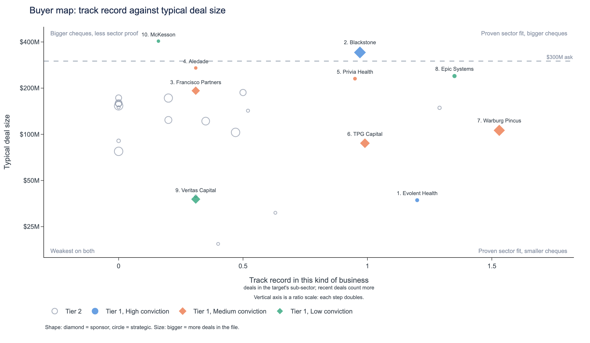
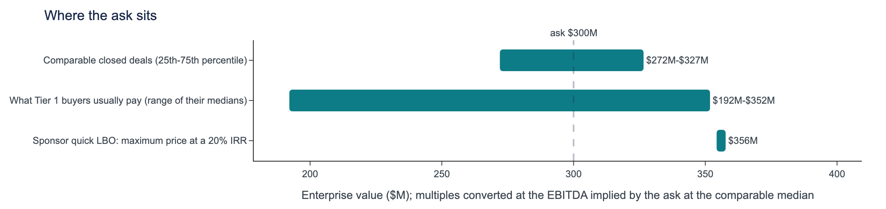
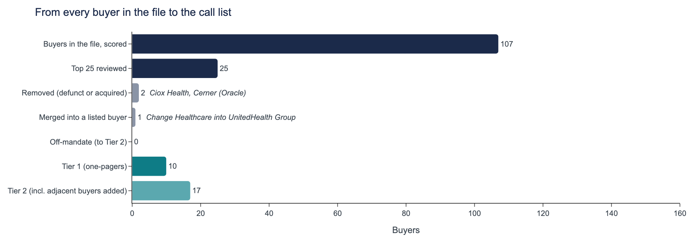
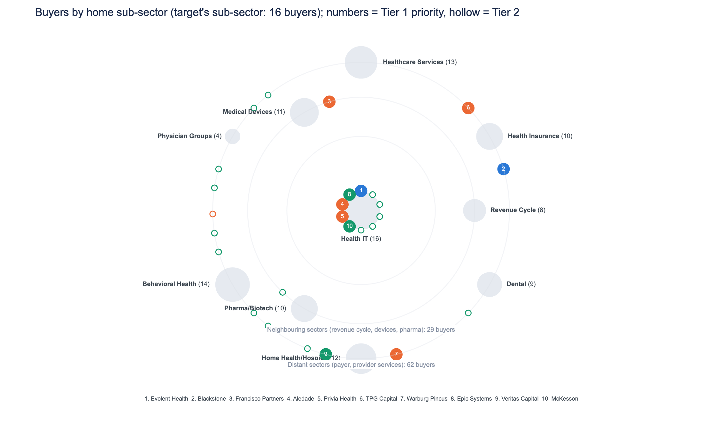

## Health IT strategics and platform-backed sponsors form the buyer universe for this national target; median pricing at 21.4x EV/EBITDA is defensible.
*Health IT, $300M, National, 25.0% margin, 20.0% growth, pe-backed. Deal data through 2024 Q4.*

- Call Evolent Health first, with 3 deals in the sub-sector and a closed $325M; the order among sponsors such as Blackstone is close to a tie, with back-tests at 28% against 20% random .
- A median multiple of 21.4x EV/EBITDA is defensible because the 25.0% margin is above the comparable median but not top quarter; Evolent Health, Blackstone, Francisco Partners and Epic Systems can pay it comfortably .
- The review removed Ciox Health and Cerner (Oracle) because they now sit inside Datavant and Oracle, and merged Change Healthcare into UnitedHealth Group .
- Most buyers share diversification and technology capability as a motive, seen in 100% of 50 Health IT deals, so frame the pitch around it .

*Tier 1 numbered by priority; hollow markers are Tier 2. Vertical axis is a ratio scale: each step doubles.*

## Tier 1: who to call, in order
| Priority | Buyer | Type | Conviction | Why them | Can pay |
|---|---|---|---|---|---|
| 1 | Evolent Health | Strategic | High | Same-sub-sector Health IT add-on; pays near the comparable median | comfortable: closed $325M |
| 2 | Blackstone | Financial sponsor | High | Add-on to its open Health IT platform; size fit | comfortable; usual deal $342M, AUM $416B |
| 3 | Francisco Partners | Financial sponsor | Medium | Add-on to open Health IT platform; returns clear at asking price | comfortable; usual deal $192M |
| 4 | Aledade | Strategic | Medium | Same-sub-sector buyer with a national footprint; paid up before | stretch: biggest deal $271M |
| 5 | Privia Health | Strategic | Medium | Repeat Health IT buyer in the target's size band; pays near median | stretch: biggest deal $256M |
| 6 | TPG Capital | Financial sponsor | Medium | Add-on to an existing platform company; most National-region deals on the list | comfortable; usual deal $88M, AUM $303B |
| 7 | Warburg Pincus | Financial sponsor | Medium | Add-on to open Health IT platform; three sub-sector deals | comfortable; usual deal $106M, AUM $100B |
| 8 | Epic Systems | Strategic | Low | Deepest own-sub-sector record, but says it does not acquire | comfortable: closed $767M |
| 9 | Veritas Capital | Financial sponsor | Low | Technology mandate sponsor; closes deals; clears 20% IRR at ask | comfortable; usual deal $38M, AUM $50B |
| 10 | McKesson | Strategic | Low | Health IT bolt-on precedent; paid highest multiple on the list | comfortable: closed $405M |

## Recommended approach
1. Lead with the 2 High-conviction buyers: Evolent Health, Blackstone.
2. Approach the rest of Tier 1 in parallel (5 Medium, 3 Low), and reach out to Tier 2 at the same time to keep tension in the process.
3. Anchor on the median multiple (21.4x): margin of 25.0% is above the comparable deals' median of 22.2% but not in their top quarter, so the median is the defensible anchor; sponsors clear a 20% return at the ask on the same exit multiple (up to $356M).

*Health IT, $300M, National, 25.0% margin, 20.0% growth, pe-backed. Deal data through 2024 Q4.*

---

## Evolent Health
### Top-ranked buyer: all three of its deals are in the target's own Health IT sub-sector, and it pays near the comparable median.
*Strategic | Tier 1, priority #1 of 10 | ranked 1st of 107 buyers | likelihood 5.6% | conviction **High** | deal data through 2024 Q4*

| Deals in the file | Closed | In the target's sub-sector / adjacent | National deals | Median deal | Median EV/EBITDA paid |
|---|---|---|---|---|---|
| 3 (2018-2022) | 3 of 3 (100%) | 3 / 0 | 0 | $37M | 21.6x |

> **What sets it apart:** Every one of its deals is in the target's own sub-sector and all closed (3 of 3), at a 21.6x median paid, above the sponsor bidders on the priority list.

#### 1. Acquirer overview: Independent public Health IT operator with a fully closed record
- Independent public company (NYSE EVH) with annual revenue of $1,876M (fiscal year ending 2025-12-31) P:1, P:2.
- Three deals between 2018 and 2022, all closed (3 of 3, 100%), all in Health IT, one of them a minority stake T:record, K:closed_share.
- Board refreshed under a cooperation agreement with activist Engaged Capital; accountable care business sold to Privia Health, closed 2025-12-05 P:1, P:5.

#### 2. Strategic fit: The target sits squarely in the sub-sector where Evolent buys
- Share of deals in the target's sub-sector is the strongest factor; margin close to what it usually buys is a strong factor S:sector_share, S:margin_fit.
- Technology Capability motive in 3 of 3 deals, against 10% of all deals in the file; Margin Improvement also in 3 of 3 M:technology_capability, M:margin_improvement.
- 10-K says it may buy companies that "complement our current products and services, enhance our market coverage or technical capabilities" P:3.

#### 3. Precedent activity: Three Health IT deals, all closed, led by a $325M recapitalization
- Frontier Health AI: $325M recapitalization, 2022, 19.8x EBITDA and 6.66x revenue D:MA-2022-0353.
- Eastern EHR Solutions: $31M strategic acquisition, 2022, 22.4x D:MA-2022-0458. Southwest EHR Solutions: $37M minority investment, 2018, 21.6x D:MA-2018-0149.
- Only 1 of 3 deals falls in the $150M-$600M comparable size band K:size_band.

| Deal | Year | Sub-sector | Size | Type | Region | EV/EBITDA | EV/Revenue | Outcome |
|---|---|---|---|---|---|---|---|---|
| Frontier Health AI | 2022 | Health IT | $325M | Recapitalization | Southwest | 19.8x | 6.66x | Closed |
| Eastern EHR Solutions | 2022 | Health IT | $31M | Strategic Acquisition | Midwest | 22.4x | 5.36x | Closed |
| Southwest EHR Solutions | 2018 | Health IT | $37M | Minority Investment | Mountain West | 21.6x | 5.09x | Closed |

#### 4. Valuation context: Median multiple is the defensible anchor, and Evolent already pays there
- 13 comparable same-sub-sector deals run from 19.4x to 23.3x EV/EBITDA, with a median of 21.4x V:comps.
- Target margin of 25.0% is above the comps' median of 22.2% but not in their top quarter, so the 50th percentile is defensible V:comps.
- Evolent's own median paid is 21.6x; cost synergies give headroom of $14M-$23M, set against $1,876M of revenue V:comps, V:synergy, P:2.

#### 5. Risk flags
| Risk | Concern | Mitigant | Reality |
|---|---|---|---|
| **Size stretch** | Median deal is $37M, and only 1 of 3 deals sits in the comparable size band. | Frontier Health AI at $325M in 2022 shows it can write a cheque this size. | Its biggest deal is $325M, close to the target's $300M, but it is a single precedent T:record, K:size_band, D:MA-2022-0353. |
| **Quiet since 2022** | Deals in recent years is a slight factor against, and it has no deal in the target's region. | Its 10-K keeps acquisitions open, and its 8-Ks show no merger agreement since 2025. | Two deals since 2022; the activist-driven board refresh may temper appetite S:recency, K:recent, T:record, P:1, P:3. |
| **Competitive process** | The priority list includes open-platform sponsors and strategics such as Privia Health. | As a strategic owner it can pay on cost synergies, with headroom of $14M-$23M. | Ranked first on the priority list of 10, at a likelihood of 5.6% across 107 buyers scored R:rank, V:synergy. |

#### 6. Conviction: High
Three deals in the target's own sub-sector and the number one position on the priority list support High; having no deal in the target's region is neutral C:conviction, T:record, R:rank.

*Sources: P:1 https://www.sec.gov/Archives/edgar/data/1628908/000162890825000010/ (as of 2025-02-04); P:2 https://data.sec.gov/api/xbrl/companyfacts/CIK0001628908.json (as of 2026-02-25); P:3 https://www.sec.gov/Archives/edgar/data/1628908/000162890826000015/evh-20251231.htm (as of 2026-02-25); P:4 https://www.sec.gov/Archives/edgar/data/1628908/000119312523012645/d331612d8k.htm (as of 2023-01-23); P:5 https://www.sec.gov/Archives/edgar/data/1628908/000162890825000145/ (as of 2025-12-08)*
*D: deals in the provided CSV; K, T, V: figures computed from it; S: likelihood factors; P: dated, sourced buyer facts.*

---

## Blackstone
### Blackstone has bought three Health IT companies and runs an existing platform company in the sub-sector, making the $300M target a natural add-on.
*Financial sponsor | Tier 1, priority #2 of 10 | ranked 3rd of 107 buyers | likelihood 4.3% | conviction **High** | deal data through 2024 Q4*

| Deals in the file | Closed | In the target's sub-sector / adjacent | National deals | Median deal | Median EV/EBITDA paid | Already owns a platform company in the sub-sector |
|---|---|---|---|---|---|---|
| 25 (2015-2024) | 22 of 25 (88%) | 3 / 0 | 1 | $342M | 17.1x | yes |

> **What sets it apart:** Longest deal record on the priority list at 25 deals. Among the sponsors listed, it pays the highest median multiple (17.1x), and its $342M median deal is close to the target's size.

#### 1. Acquirer overview: Large-cap sponsor with a 25-deal, ten-year record
- 25 deals from 2015 to 2024, of which 22 closed (88%); 23 of 25 were control deals rather than minority stakes T:record, K:closed_share, K:control_share.
- Median deal of $342M, in a range from $10M to $14,354M; 11 of 25 deals sit in the $150M-$600M size band T:record, K:size_band.
- Private Equity segment holds $416.4 billion of Total Assets Under Management as of December 31, 2025 P:1.

#### 2. Strategic fit: An add-on to an open Health IT platform, backed by sub-sector precedent
- Three past deals in the target's own sub-sector, and an existing platform company there makes the target an add-on rather than a new bet T:record, A:angles.
- Platform Build is a stated motive in 9 of 25 deals, consistent with buying onto an existing platform M:platform_build.
- Past deal count is a modest factor for it; deal size and region fit are slight factors S:activity, S:not_smaller, S:geo_fit.

#### 3. Precedent activity: Three Health IT deals at 20.2x to 23.5x, all smaller than the target
- Nexus Clinical Analytics: $71M bolt-on in 2020 at 23.5x EV/EBITDA, the closest add-on precedent D:MA-2020-0384.
- Standard Revenue Cycle ($26M leveraged buyout, 2022, 20.2x) and Lake Clinical Analytics ($21M recapitalization, 2017, 21.1x) D:MA-2022-0080, D:MA-2017-0305.
- Neighbouring sector at scale: Sterling Revenue Cycle, a $458M bolt-on in 2023 at 16.2x D:MA-2023-0378.

| Deal | Year | Sub-sector | Size | Type | Region | EV/EBITDA | EV/Revenue | Outcome |
|---|---|---|---|---|---|---|---|---|
| Standard Revenue Cycle | 2022 | Health IT | $26M | Leveraged Buyout | Midwest | 20.2x | 5.68x | Closed |
| Nexus Clinical Analytics | 2020 | Health IT | $71M | Bolt-on Acquisition | National | 23.5x | 6.76x | Closed |
| Lake Clinical Analytics | 2017 | Health IT | $21M | Recapitalization | Southwest | 21.1x | 6.53x | Closed |
| Integrity Cardiovascular Systems | 2024 | Medical Devices | $1,906M | Leveraged Buyout | Southeast | 23.0x | 4.33x | Withdrawn |
| Sterling Revenue Cycle | 2023 | Revenue Cycle | $458M | Bolt-on Acquisition | Mid-Atlantic | 16.2x | 3.32x | Closed |
| Lincoln Denial Management | 2021 | Revenue Cycle | $596M | Leveraged Buyout | West Coast | 22.2x | 3.58x | Closed |

#### 4. Valuation context: Median of comparables is defensible, with headroom up to $356M
- 13 comparable deals: 19.4x at the lower quartile, 21.4x median, 23.3x at the upper quartile V:comps.
- Margin of 25.0% is above the comparables' median of 22.2% but not in their top quarter, so the 50th percentile anchors; its own median paid is 17.1x V:comps.
- At 5.0x leverage, IRR at the ask is 25.3% against a 20% target; maximum price is $356M on a $239M equity cheque V:lbo.

#### 5. Risk flags
| Risk | Concern | Mitigant | Reality |
|---|---|---|---|
| **Thin Health IT focus** | Only 3 of 25 deals are in Health IT, and its home sub-sector is Health Insurance T:record, B:buyer. | Its three Health IT deals priced at 20.2x to 23.5x, and the existing platform company gives an add-on route D:MA-2020-0384, A:angles. | Sub-sector record is real but small; all three deals were well below the target's size D:MA-2022-0080, D:MA-2017-0305. |
| **Price discipline versus comparables** | Its median paid of 17.1x is below the comparables' lower quartile of 19.4x V:comps. | IRR at the ask is 25.3% against a 20% target, with a maximum price of $356M V:lbo. | It would need to pay above its usual level, but the returns math allows it V:comps, V:lbo. |
| **Auction experience and strategic rivals** | Being used to competitive auctions counts slightly against it, and one 2024 deal was withdrawn S:bidder_exp, D:MA-2024-0347. | 22 of its 25 deals closed (88%) K:closed_share. | Execution is strong, but strategics on the priority list have paid higher median multiples S:bidder_exp, K:closed_share. |

#### 6. Conviction: High
Three deals in the target's own sub-sector, an existing platform company offering the add-on route, and position 2 on the priority list of 10 support the call T:record, A:angles, R:rank.

*Sources: P:1 https://www.sec.gov/Archives/edgar/data/1393818/000119312526082531/d48618d10k.htm (as of 2026-02-27)*
*D: deals in the provided CSV; K, T, V: figures computed from it; S: likelihood factors; P: dated, sourced buyer facts.*

---

## Francisco Partners
### Francisco Partners can add the target to its open Health IT platform, and returns clear its 20% target at the ask.
*Financial sponsor | Tier 1, priority #3 of 10 | ranked 7th of 107 buyers | likelihood 3.8% | conviction **Medium** | deal data through 2024 Q4*

| Deals in the file | Closed | In the target's sub-sector / adjacent | National deals | Median deal | Median EV/EBITDA paid | Already owns a platform company in the sub-sector |
|---|---|---|---|---|---|---|
| 14 (2017-2023) | 12 of 14 (86%) | 1 / 0 | 0 | $192M | 16.2x | yes |

> **What sets it apart:** Francisco Partners closes 86% of its deals, ahead of TPG Capital and Warburg Pincus, with more than $75 billion raised; its sub-sector record is thinner than most peers'.

#### 1. Acquirer overview: Francisco Partners is a large technology sponsor that closes most deals
- Francisco Partners, a financial sponsor, made 14 deals from 2017 to 2023; 12 closed (86%), all control deals T:record, K:closed_share, K:control_share.
- Calls itself "One of the largest and most active technology-focused private equity firms in the world"; raised more than $75 billion, undated P:1, P:2.
- Median deal is $192M, and 6 of 14 deals fall in the $150M-$600M band around the target's $300M T:record, K:size_band.

#### 2. Strategic fit: The target is an add-on to Francisco Partners' existing platform company
- Francisco Partners' existing platform company in the sub-sector makes the target an add-on, not a new bet; size fit is the second angle A:angles.
- High Growth is a motive in 6 of 14 of its deals, matching the target's 20.0% growth M:high_growth.
- Slight factors favour it (bought from similar sellers, deal size, deal count); low share of deals in the sub-sector counts against S:own_fit_s, S:not_smaller, S:activity, S:sector_share.

#### 3. Precedent activity: One Francisco Partners deal in the target's sub-sector, larger ones nearby
- Hudson Care Analytics: $16M management buyout, 2020, 18.9x, closed. It is its only Health IT deal D:MA-2020-0260, T:record.
- Prime Medical Technologies (devices): $446M leveraged buyout, 2021, 15.3x, closed D:MA-2021-0297.
- Pacific Biopharma (pharma): $724M merger of equals, 2021, 23.6x, closed. A high multiple paid in a neighbouring sector D:MA-2021-0465.

| Deal | Year | Sub-sector | Size | Type | Region | EV/EBITDA | EV/Revenue | Outcome |
|---|---|---|---|---|---|---|---|---|
| Hudson Care Analytics | 2020 | Health IT | $16M | Management Buyout | Great Plains | 18.9x | 6.08x | Closed |
| Coastal Gene Therapy | 2023 | Pharma/Biotech | $9,980M | Platform Investment | Mid-Atlantic | 24.8x | 7.72x | Closed |
| Taft Device Solutions | 2022 | Medical Devices | $153M | Merger of Equals | Southwest | 21.1x | 4.69x | Rumored |
| Prime Medical Technologies | 2021 | Medical Devices | $446M | Leveraged Buyout | Mountain West | 15.3x | 5.97x | Closed |
| Pacific Biopharma | 2021 | Pharma/Biotech | $724M | Merger of Equals | Southeast | 23.6x | 8.41x | Closed |
| Highland Instruments | 2020 | Medical Devices | $142M | Management Buyout | Southwest | 20.6x | 4.93x | Closed |

#### 4. Valuation context: The median anchor is defensible and the return clears at the ask
- 13 comparables span 19.4x to 23.3x (median 21.4x); the 25.0% margin beats the 22.2% comps median, not the top quarter, so the 50th percentile anchors V:comps.
- Francisco Partners' median paid is 16.2x, below the 19.4x lower quartile, yet it paid 20.6x for Highland Instruments and 23.6x for Pacific Biopharma V:comps, D:MA-2020-0151, D:MA-2021-0465.
- At 5.0x leverage the equity cheque is $239M and IRR at the ask is 25.3% against a 20% target. Maximum price is $356M V:lbo.

#### 5. Risk flags
| Risk | Concern | Mitigant | Reality |
|---|---|---|---|
| **Thin sub-sector record** | Only 1 of 14 deals is in Health IT; 13 are outside it T:record. | An existing platform company in the sub-sector gives an add-on route A:angles. | Conviction is Medium, not High, because the sub-sector record is neutral C:conviction. |
| **Price discipline** | Its median paid of 16.2x sits below the comps' 19.4x lower quartile V:comps. | It paid 23.6x and 20.6x in closed 2020-2021 neighbouring-sector deals D:MA-2021-0465, D:MA-2020-0151. | Expect pushback below the 21.4x median; the 25.3% IRR at the ask leaves room to bid V:lbo. |
| **Equity capacity unconfirmed** | Fund size was not researched, so equity capacity is unconfirmed R:FUND_SIZE_UNKNOWN. | More than $75 billion raised, undated P:2. | The deal needs a $239M equity cheque; confirm fund headroom before the call V:lbo. |

#### 6. Conviction: Medium
Medium for Francisco Partners: one deal in the target's own sub-sector is neutral, while the existing platform company add-on route counts in its favour. Returns clear the target at the ask C:conviction, T:record, A:angles, V:lbo.

*Sources: P:1 https://www.franciscopartners.com/about (as of 2026-10-23); P:2 https://www.franciscopartners.com/about (as of 2026-10-23)*
*D: deals in the provided CSV; K, T, V: figures computed from it; S: likelihood factors; P: dated, sourced buyer facts.*

---

## Aledade
### Aledade's $271M same-sub-sector Health IT deal in 2020 and national partner network make it a credible, high-paying strategic for this target.
*Strategic | Tier 1, priority #4 of 10 | ranked 8th of 107 buyers | likelihood 3.8% | conviction **Medium** | deal data through 2024 Q4*

| Deals in the file | Closed | In the target's sub-sector / adjacent | National deals | Median deal | Median EV/EBITDA paid |
|---|---|---|---|---|---|
| 1 (2020-2020) | 1 of 1 (100%) | 1 / 0 | 1 | $271M | 23.9x |

> **What sets it apart:** Pays a 23.9x median, above every other buyer on the priority list bar one strategic; unlike Evolent Health and Privia Health, its precedent is a National deal T:record.

#### 1. Acquirer overview: Physician-led value-based care partner with a single prior deal
- Private; became a Public Benefit Corporation in 2023. It describes itself as physician-led and partners with clinicians rather than owning practices P:1, P:2.
- Partners are located in 46 states and the District of Columbia; its ACOs generated more than $1B in shared savings in 2024 P:3, P:4.
- Record: 1 deal, 1 of 1 closed (100%), in 2020 T:record, K:closed_share.

#### 2. Strategic fit: Same-sub-sector focus is the strongest factor in its likelihood
- Share of deals in the target's sub-sector is the strongest factor; regional and margin fit are modest factors in its favour S:sector_share, S:geo_fit, S:margin_fit.
- Its 2020 deal was tagged Technology Capability (1 of 1 deals, against 10% of all deals in the file) and Vertical Integration M:technology_capability, M:vertical_integration.
- Having bought from this kind of seller is a slight factor against. It sits 4th on the priority list, likelihood 3.8% S:own_fit_s, R:rank.

#### 3. Precedent activity: One precedent, in the target's own sub-sector and size band
- Oak Health Informatics: $271M, 2020, Minority Investment, 23.9x EV/EBITDA, 5.73x EV/Revenue, closed D:MA-2020-0093.
- That deal sits in the comparable size band ($150M-$600M) and in the National region K:size_band, K:by_region.
- No deals since 2022, and no control deals: 0 of 1 (0%) K:recent, K:control_share.

| Deal | Year | Sub-sector | Size | Type | Region | EV/EBITDA | EV/Revenue | Outcome |
|---|---|---|---|---|---|---|---|---|
| Oak Health Informatics | 2020 | Health IT | $271M | Minority Investment | National | 23.9x | 5.73x | Closed |

#### 4. Valuation context: Anchor at the median; this buyer has paid above the upper quartile
- 13 comparable deals, all in the same sub-sector: 19.4x at the lower quartile, 21.4x median, 23.3x at the upper quartile V:comps.
- Target margin of 25.0% is above the comps' median of 22.2% but not in their top quarter, so the 50th percentile is the defensible anchor V:comps.
- Its own median paid is 23.9x, above the comps' upper quartile. Synergy headroom is $14M-$23M; buyer revenue not researched V:comps, V:synergy.

#### 5. Risk flags
| Risk | Concern | Mitigant | Reality |
|---|---|---|---|
| **Thin acquisition record** | Only 1 deal on file, with none since 2022, so repeat appetite is unproven. | That deal was in the target's own sub-sector and size band, and it closed. | A single 2020 precedent; no deals since 2022 T:record, K:recent, K:size_band. |
| **Minority and partnership model** | A full control purchase of a PE-backed company would depart from how it has invested. | Its 2020 deal was $271M, similar in size to this target's $300M. | 0 of 1 deals were control deals; it describes itself as a partner, not an owner of practices K:control_share, P:2. |
| **Price and capacity** | Its 23.9x median paid is above the comps' upper-quartile 23.3x. | Synergy headroom of $14M-$23M supports a bid above the median. | The defensible anchor is the median; its balance-sheet capacity is not researched V:comps, V:synergy. |

#### 6. Conviction: Medium
Only 1 deal in the target's own sub-sector keeps the sub-sector basis neutral; that deal in the target's region is the one point in its favour C:conviction, T:record.

*Sources: P:1 https://aledade.com/about/ (as of 2026-10-23); P:2 https://aledade.com/about/ (as of 2026-10-23); P:3 https://aledade.com/why-aledade/ (as of 2026-10-23); P:4 https://aledade.com/about/ (as of 2026-10-23)*
*D: deals in the provided CSV; K, T, V: figures computed from it; S: likelihood factors; P: dated, sourced buyer facts.*

---

## Privia Health
### Privia Health has bought twice in the target's own sub-sector, at $205M and $256M, and pays 20.5x, close to the comparable median.
*Strategic | Tier 1, priority #5 of 10 | ranked 9th of 107 buyers | likelihood 3.8% | conviction **Medium** | deal data through 2024 Q4*

| Deals in the file | Closed | In the target's sub-sector / adjacent | National deals | Median deal | Median EV/EBITDA paid |
|---|---|---|---|---|---|
| 2 (2017-2024) | 2 of 2 (100%) | 2 / 0 | 0 | $231M | 20.5x |

> **What sets it apart:** Both prior deals sit in the target's $150M-$600M size band and both closed. Its 20.5x median paid is below the median of every other strategic on the priority list.

#### 1. Acquirer overview: A Health IT strategic with a small but fully closed record
- Strategic buyer with Health IT as its home sub-sector; annual revenue of $2,123M for the year ending 2025-12-31 B:buyer, P:1.
- Two deals from 2017 to 2024, both in the target's sub-sector, both closed (2 of 2, 100%) T:record, K:closed_share.
- Bought Evolent Health's accountable care business for $100M in cash plus up to $13M, closing 2025-12-05 P:3.

#### 2. Strategic fit: Same-sub-sector buyer whose past deals were technology-led
- Share of its deals in the target's sub-sector is the strongest factor in its likelihood; margin fit and close rate are modest positives S:sector_share, S:margin_fit, S:close_rate_s.
- Technology Capability drove 2 of 2 deals, against 10% of all deals in the file, a distinctive motive M:technology_capability.
- Stated mandate is minority or majority ownership of provider groups or clinically integrated networks, so the target is a technology extension P:2.

#### 3. Precedent activity: Two Health IT deals of $205M and $256M, both closed
- Keystone Population Health: $205M minority investment in 2024 at 20.2x EBITDA and 6.29x revenue D:MA-2024-0128.
- Select EHR Solutions: $256M SPAC merger in 2017 at 20.9x EBITDA and 5.94x revenue D:MA-2017-0427.
- Both deals fall in the $150M-$600M comparable size band; median deal is $231M K:size_band, T:record.

| Deal | Year | Sub-sector | Size | Type | Region | EV/EBITDA | EV/Revenue | Outcome |
|---|---|---|---|---|---|---|---|---|
| Keystone Population Health | 2024 | Health IT | $205M | Minority Investment | Mountain West | 20.2x | 6.29x | Closed |
| Select EHR Solutions | 2017 | Health IT | $256M | SPAC Merger | Southeast | 20.9x | 5.94x | Closed |

#### 4. Valuation context: Median anchor of 21.4x is defensible; Privia has room to pay
- 13 same-sub-sector comparables show 19.4x at the lower quartile, 21.4x median and 23.3x at the upper quartile V:comps.
- Target margin of 25.0% is above the comps' 22.2% median but not in the top quarter, so the 50th percentile is the anchor V:comps.
- Privia's own median of 20.5x sits just under the comparable median. Cost synergy headroom is $14M-$23M against revenue of $2,123M V:comps, V:synergy, P:1.

#### 5. Risk flags
| Risk | Concern | Mitigant | Reality |
|---|---|---|---|
| **Size stretch** | The $300M target exceeds its biggest deal of $256M. | Revenue of $2,123M gives capacity beyond its prior cheques P:1. | Both precedents were $205M-$256M, so this is a step up T:record, X:target. |
| **Mandate focus** | Stated mandate targets provider groups, and past seller fit is a slight negative P:2, S:own_fit_s. | Both precedents were in the target's own sub-sector K:by_sub_sector. | Half its deals (1 of 2) were minority stakes, so control is untested K:control_share. |
| **Crowded process and no regional record** | Blackstone and Evolent Health also rate High, and Privia has no deal in the target's region C:conviction, T:record. | Footprint covers 43 states and the District of Columbia P:4. | Ranked 5th on the priority list of 10 with a 3.8% likelihood R:rank. |

#### 6. Conviction: Medium
Two deals in the target's own sub-sector support the call, but no deal in the target's region keeps it neutral and the record is only two deals C:conviction, T:record.

*Sources: P:1 https://data.sec.gov/api/xbrl/companyfacts/CIK0001759655.json (as of 2026-02-27); P:2 https://www.sec.gov/Archives/edgar/data/1759655/000175965526000010/prva-20251231.htm (as of 2026-02-27); P:3 https://www.sec.gov/Archives/edgar/data/1759655/000175965525000113/ (as of 2025-12-08); P:4 https://www.sec.gov/Archives/edgar/data/1759655/000175965526000010/prva-20251231.htm (as of 2026-02-27)*
*D: deals in the provided CSV; K, T, V: figures computed from it; S: likelihood factors; P: dated, sourced buyer facts.*

---

## TPG Capital
### TPG has an existing platform company in the target's sub-sector, three deals there, and capacity to pay up to $356M against a $300M value.
*Financial sponsor | Tier 1, priority #6 of 10 | ranked 10th of 107 buyers | likelihood 3.7% | conviction **Medium** | deal data through 2024 Q4*

| Deals in the file | Closed | In the target's sub-sector / adjacent | National deals | Median deal | Median EV/EBITDA paid | Already owns a platform company in the sub-sector |
|---|---|---|---|---|---|---|
| 18 (2016-2023) | 15 of 18 (83%) | 3 / 0 | 4 | $88M | 15.7x | yes |

> **What sets it apart:** Most National-region deals on the priority list (4), plus three Health IT deals and an existing platform company in the sub-sector. It also has the capacity to pay up to $356M.

#### 1. Acquirer overview: A large-cap sponsor with an 18-deal record, mostly outside Health IT
- Financial sponsor with 18 deals from 2016 to 2023; 15 closed (83%). Home sub-sector is Health Insurance B:buyer, T:record, K:closed_share.
- $303.0 billion in assets under management as of December 31, 2025 (TPG Inc.) P:1.
- Deals range from $7M to $1,388M with a median of $88M; 15 of 18 sit outside Health IT T:record.

#### 2. Strategic fit: An add-on to an existing platform company, backed by same-sub-sector deals
- Existing platform company in the sub-sector makes the target an add-on; Platform Build is a motive in 5 of 18 deals A:angles, M:platform_build.
- Technology Capability drives 3 of 18 deals, a distinct motive; it has 3 deals in the target's own sub-sector M:technology_capability, T:record.
- Prior National-region buying is a modest factor for; having bought from this kind of seller is a slight factor against S:geo_fit, S:own_fit_s.

#### 3. Precedent activity: Health IT precedents at 19.6x to 23.5x, plus one very large deal
- Select Health Data: $149M carve-out, 2018, 23.3x, closed D:MA-2018-0003.
- Paramount Care Management Tech: $22M bolt-on, 2021, 23.5x, closed. Eastern Digital Health: $28M platform investment, 2021, 19.6x, withdrawn D:MA-2021-0113, D:MA-2021-0380.
- Cardinal Bio: $1,388M management buyout, 2022, 29.7x, closed, showing it can write much larger cheques D:MA-2022-0172.

| Deal | Year | Sub-sector | Size | Type | Region | EV/EBITDA | EV/Revenue | Outcome |
|---|---|---|---|---|---|---|---|---|
| Paramount Care Management Tech | 2021 | Health IT | $22M | Bolt-on Acquisition | Southwest | 23.5x | 5.38x | Closed |
| Eastern Digital Health | 2021 | Health IT | $28M | Platform Investment | Mid-Atlantic | 19.6x | 5.88x | Withdrawn |
| Select Health Data | 2018 | Health IT | $149M | Carve-out | Southeast | 23.3x | 5.09x | Closed |
| Independence Denial Management | 2022 | Revenue Cycle | $34M | Platform Investment | Great Plains | 16.4x | 4.51x | Closed |
| Cardinal Bio | 2022 | Pharma/Biotech | $1,388M | Management Buyout | Mid-Atlantic | 29.7x | 6.70x | Closed |
| Meridian Physician Partners | 2023 | Physician Groups | $7M | Strategic Acquisition | Mountain West | 12.3x | 1.59x | Closed |

#### 4. Valuation context: Median anchor of 21.4x is justified, and TPG can pay it
- 13 same-sub-sector comparables show 19.4x to 23.3x with a 21.4x median; the 25.0% margin beats the 22.2% comps median, so the 50th percentile is defensible V:comps.
- TPG's own median paid is 15.7x, below the comparable median, though it paid 23.3x and 23.5x in its closed Health IT deals V:comps, D:MA-2018-0003, D:MA-2021-0113.
- At 5.0x leverage and an $239M equity cheque, IRR at the ask is 25.3% against a 20% target; maximum price is $356M V:lbo.

#### 5. Risk flags
| Risk | Concern | Mitigant | Reality |
|---|---|---|---|
| **Size stretch** | Median deal of $88M is under half the $300M EV; only 6 of 18 deals sit in the comparable size band T:record, K:size_band. | Cardinal Bio at $1,388M shows it can underwrite far larger transactions D:MA-2022-0172. | Size is not a capacity constraint, but the target is above its usual range T:record, V:lbo. |
| **Price discipline** | Its 15.7x median paid sits well below the 21.4x comparable median, so it may bid low V:comps. | It paid 23.3x and 23.5x for Health IT assets, and the IRR at the ask of 25.3% leaves room D:MA-2018-0003, D:MA-2021-0113, V:lbo. | A bid near the median looks affordable, with a $356M ceiling V:lbo. |
| **Crowded process, thin Health IT focus** | 15 of 18 deals are outside Health IT, and it ranks 6th on the priority list at 3.7% likelihood T:record, R:rank. | Other sponsors, such as Blackstone, also show three deals in the sub-sector; TPG's existing platform company gives it an add-on route A:angles. | One Health IT deal was withdrawn; execution record is 15 of 18 closed D:MA-2021-0380, K:closed_share. |

#### 6. Conviction: Medium
Three deals in the target's own sub-sector and an existing platform company support the add-on route, but a median deal of $88M is under half the $300M EV C:conviction, T:record, A:angles.

*Sources: P:1 https://www.sec.gov/Archives/edgar/data/1880661/000188066126000011/tpg-20251231.htm (as of 2026-02-17)*
*D: deals in the provided CSV; K, T, V: figures computed from it; S: likelihood factors; P: dated, sourced buyer facts.*

---

## Warburg Pincus
### Warburg Pincus has bought three Health IT companies and has an existing platform company for an add-on; the $300M price sits within its returns.
*Financial sponsor | Tier 1, priority #7 of 10 | ranked 12th of 107 buyers | likelihood 3.5% | conviction **Medium** | deal data through 2024 Q4*

| Deals in the file | Closed | In the target's sub-sector / adjacent | National deals | Median deal | Median EV/EBITDA paid | Already owns a platform company in the sub-sector |
|---|---|---|---|---|---|---|
| 23 (2016-2024) | 16 of 23 (70%) | 3 / 0 | 3 | $106M | 15.6x | yes |

> **What sets it apart:** Matches Blackstone and TPG on three deals in the target's sub-sector and an existing platform company. Only TPG has more National-region deals than its three, so its footprint matches the target's.

#### 1. Acquirer overview: A growth investor with a sub-sector record, though most deals lie elsewhere
- 23 deals from 2016 to 2024, 16 closed (70%); 21 of 23 were control deals rather than minority stakes K:closed_share, K:control_share.
- Over $100 billion in assets under management, and 22 private equity funds raised, so capital is not the constraint P:1, P:3.
- Home sub-sector is Home Health/Hospice; only 3 of 23 deals were in Health IT, and 20 were outside it B:buyer, T:record.

#### 2. Strategic fit: A Health IT add-on for an existing platform company, backed by a growth motive
- Three deals in the target's own sub-sector, and an existing platform company there makes the target an add-on route T:record, A:angles.
- Growth was a motive in 11 of 23 deals, which suits the target's 20.0% revenue growth M:high_growth.
- Platform Build appears in 5 of 23 deals, in line with the file overall; activity, regional fit and deal size are only slight factors for it M:platform_build, S:activity, S:geo_fit, S:not_smaller.

#### 3. Precedent activity: Three Health IT deals, all closed, at 19.4x to 25.7x EBITDA
- Apex EHR Solutions ($186M, 2023, Platform Investment) at 25.7x, and Universal Health AI ($219M, 2022, Management Buyout) at 23.3x D:MA-2023-0481, D:MA-2022-0252.
- Keystone EHR Solutions ($382M, 2021, Platform Investment) at 19.4x, the largest of the three and above the target's $300M D:MA-2021-0441.
- 8 of 23 deals sit in the $150M-$600M comparable size band, and 7 have come since 2022 K:size_band, K:recent.

| Deal | Year | Sub-sector | Size | Type | Region | EV/EBITDA | EV/Revenue | Outcome |
|---|---|---|---|---|---|---|---|---|
| Apex EHR Solutions | 2023 | Health IT | $186M | Platform Investment | Mountain West | 25.7x | 5.65x | Closed |
| Universal Health AI | 2022 | Health IT | $219M | Management Buyout | Mid-Atlantic | 23.3x | 5.85x | Closed |
| Keystone EHR Solutions | 2021 | Health IT | $382M | Platform Investment | Great Plains | 19.4x | 5.42x | Closed |
| Global Pharmaceuticals | 2021 | Pharma/Biotech | $2,124M | Merger of Equals | Multi-Regional | 28.8x | 8.38x | Closed |
| Green Revenue Cycle | 2020 | Revenue Cycle | $79M | Merger of Equals | Southwest | 21.6x | 4.95x | Withdrawn |
| Delta BioTech | 2018 | Pharma/Biotech | $432M | SPAC Merger | Multi-Regional | 22.4x | 7.70x | Withdrawn |

#### 4. Valuation context: The 50th percentile is defensible, and the returns clear the hurdle
- 13 comparable deals price at 19.4x to 23.3x, median 21.4x; the 25.0% margin beats the comps' 22.2% median, so the 50th percentile holds V:comps.
- Its overall median paid is 15.6x, below the comps, yet its three Health IT deals cleared 19.4x to 25.7x T:record, D:MA-2023-0481, D:MA-2021-0441.
- At 5.0x leverage and 8.5% interest, a $239M equity cheque returns 25.3% IRR at the ask against a 20% target; maximum price is $356M V:lbo.

#### 5. Risk flags
| Risk | Concern | Mitigant | Reality |
|---|---|---|---|
| **Size stretch** | Median deal of $106M is under half the $300M EV T:record. | Its Health IT deals ran from $186M to $382M, and 8 of 23 deals sit in the size band D:MA-2023-0481, D:MA-2021-0441, K:size_band. | The stretch is against its typical deal, not its Health IT record; its biggest deal was $2,124M T:record. |
| **Closing record** | Only 16 of 23 deals closed (70%), a modest factor against it K:closed_share, S:close_rate_s. | All three Health IT precedents closed D:MA-2023-0481, D:MA-2022-0252, D:MA-2021-0441. | Both withdrawn deals among its listed precedents were in neighbouring sectors, not Health IT D:MA-2020-0201, D:MA-2018-0413. |
| **Competitive process and price** | Seventh on a priority list of 10; Blackstone and Evolent Health also rate High R:rank. | IRR of 25.3% at the ask clears the 20% target, leaving room to bid V:lbo. | Its 15.6x median paid is below the 21.4x comps median, so it must pay above habit T:record, V:comps. |

#### 6. Conviction: Medium
Three deals in the target's own sub-sector and an existing platform company support an add-on route, but its median deal of $106M is under half the $300M EV. C:conviction, T:record, A:angles

*Sources: P:1 https://en.wikipedia.org/wiki/Warburg_Pincus (as of 2026-10-23); P:2 https://en.wikipedia.org/wiki/Warburg_Pincus (as of 2018-12-31); P:3 https://en.wikipedia.org/wiki/Warburg_Pincus (as of 2026-10-23); P:4 https://en.wikipedia.org/wiki/Warburg_Pincus (as of 2026-10-23)*
*D: deals in the provided CSV; K, T, V: figures computed from it; S: likelihood factors; P: dated, sourced buyer facts.*

---

## Epic Systems
### Epic has the deepest record in the target's own sub-sector on the list, but states it does not acquire: a long-shot call, not a lead.
*Strategic | Tier 1, priority #8 of 10 | ranked 5th of 107 buyers | likelihood 4.1% | conviction **Low** | deal data through 2024 Q4*

| Deals in the file | Closed | In the target's sub-sector / adjacent | National deals | Median deal | Median EV/EBITDA paid |
|---|---|---|---|---|---|
| 4 (2018-2022) | 3 of 4 (75%) | 4 / 0 | 1 | $240M | 22.7x |

> **What sets it apart:** Four deals, all in the target's own sub-sector, the most of any buyer on the priority list, and capacity to pay at $6.7B revenue. But it states it makes no acquisitions. T:record, P:1, P:3

#### 1. Acquirer overview: Largest EHR vendor, privately held, and says it does not acquire
- Privately held since 1979, never took venture capital or private equity; revenue $6.7B (2025, as reported by Forbes), about 14,000 employees. P:2, P:3, P:4
- Its own site: "We are a software factory (no acquisitions)". A public profile says it has never acquired another company. P:1, P:2
- The deal file nonetheless lists 4 deals from 2018 to 2022, 3 of 4 closed (75%). That conflicts with its stated position. T:record, K:closed_share

#### 2. Strategic fit: Sub-sector fit is real; the stated mandate is the obstacle
- Share of its deals in the target's sub-sector is the strongest factor in its likelihood; margin fit is a strong factor. S:sector_share, S:margin_fit
- Technology Capability is the motive in 4 of 4 deals, a tag on only 10% of all deals in the file, so it is a distinct motive. M:technology_capability
- Having bought in this or a neighbouring region is a modest factor for; having bought from this kind of seller is a modest factor against. S:geo_fit, S:own_fit_s

#### 3. Precedent activity: Four Health IT deals from 2018 to 2022, only one near this size
- Crest Digital Health: $440M Strategic Acquisition, 2022, National, 22.7x EBITDA, closed. D:MA-2022-0213
- Meridian Health Analytics: $767M Platform Investment, 2018, 22.0x, closed. Oak Clinical Analytics: $15M Merger of Equals, 2021, 18.1x, terminated. D:MA-2018-0429, D:MA-2021-0372
- Only 1 of 4 deals sits in the comparable size band ($150M-$600M). K:size_band

| Deal | Year | Sub-sector | Size | Type | Region | EV/EBITDA | EV/Revenue | Outcome |
|---|---|---|---|---|---|---|---|---|
| Crest Digital Health | 2022 | Health IT | $440M | Strategic Acquisition | National | 22.7x | 6.63x | Closed |
| Oak Clinical Analytics | 2021 | Health IT | $15M | Merger of Equals | Multi-Regional | 18.1x | 5.34x | Terminated |
| Charter Clinical Systems | 2019 | Health IT | $40M | Carve-out | Midwest | 24.4x | 5.93x | Closed |
| Meridian Health Analytics | 2018 | Health IT | $767M | Platform Investment | Midwest | 22.0x | 5.38x | Closed |

#### 4. Valuation context: Median of 21.4x is the anchor; Epic's own 22.7x sits above it
- 13 comparable deals, all in the same sub-sector: 19.4x at the 25th percentile, 21.4x median, 23.3x at the 75th. V:comps
- Target margin of 25.0% is above the comps' median of 22.2% but not in their top quarter, so the 50th percentile is the defensible anchor. V:comps
- Epic's median paid is 22.7x. Synergy headroom of $14M-$23M and $6.7B revenue mean ability to pay is not the constraint. V:comps, V:synergy

#### 5. Risk flags
| Risk | Concern | Mitigant | Reality |
|---|---|---|---|
| **Stated no-acquisitions policy** | Epic's own site says it makes no acquisitions. R:STATED_NO_ACQUISITIONS | The deal file records 4 deals, 3 closed. T:record | The stated policy outweighs the file; the record is not evidence it would buy. P:1, C:conviction |
| **Execution and recency** | One of four deals was terminated, and activity has faded. D:MA-2021-0372, K:recent | The $440M Crest deal closed in 2022 at 22.7x. D:MA-2022-0213 | Only 1 deal since 2022 and the last year in the file is 2022. K:recent, T:record |
| **Competitive process** | Other buyers rank higher on the priority list, with similar own-sub-sector records. N:closest_peers | Epic's 4 own-sub-sector deals exceed Evolent Health's 3. T:record, N:closest_peers | Epic would need to change its stated policy before it could compete. P:1 |

#### 6. Conviction: Low
Capped at Low: Epic states it does not make acquisitions, so its 4 own-sub-sector deals and strongest-factor fit are not evidence it would buy. Treat as a courtesy call, not a lead. C:conviction, P:1

*Sources: P:1 https://www.epic.com/about/ (as of 2026-10-23); P:2 https://en.wikipedia.org/wiki/Judith_Faulkner (as of 2026-10-23); P:3 https://en.wikipedia.org/wiki/Epic_Systems (as of 2026-10-23); P:4 https://en.wikipedia.org/wiki/Epic_Systems (as of 2026-10-23)*
*D: deals in the provided CSV; K, T, V: figures computed from it; S: likelihood factors; P: dated, sourced buyer facts.*

---

## Veritas Capital
### Veritas Capital offers a technology-focused sponsor with a Health IT precedent and a 25.3% return at the asking price, though size is a stretch.
*Financial sponsor | Tier 1, priority #9 of 10 | ranked 6th of 107 buyers | likelihood 4.1% | conviction **Low** | deal data through 2024 Q4*

| Deals in the file | Closed | In the target's sub-sector / adjacent | National deals | Median deal | Median EV/EBITDA paid | Already owns a platform company in the sub-sector |
|---|---|---|---|---|---|---|
| 16 (2015-2024) | 15 of 16 (94%) | 1 / 0 | 1 | $38M | 13.7x | no |

> **What sets it apart:** Highest close rate among the financial sponsors on the priority list (15 of 16, 94%), and its returns analysis clears the 20% hurdle at the asking price, with room to pay up to $356M.

#### 1. Acquirer overview: A technology-mandate sponsor that closes nearly everything it signs
- Financial sponsor with 16 deals from 2015 to 2024; 15 closed (94%) and 14 were control deals rather than minority stakes. T:record, K:closed_share, K:control_share
- Mandate: technology or technology-enabled solutions to government and commercial customers; $50B+ AUM across 3 strategies, including committed capital. P:1, P:2
- Mostly outside Health IT: 15 of 16 deals, with 1 in the target's own sub-sector and none in adjacent Health IT sub-sectors. T:record

#### 2. Strategic fit: A Health IT bolt-on precedent and a technology mandate, but a thin sector record
- Platform Build in 8 of 16 deals, against 23% of all deals in the file, is its most distinctive motive. M:platform_build
- Bought Great Health Informatics ($29M, 2020, bolt-on) in the target's own sub-sector; its mandate covers technology-enabled solutions. D:MA-2020-0309, P:1
- Share of deals closed is a modest factor for; geography and deal size are slight factors for; margin fit is slightly against. S:close_rate_s, S:geo_fit, S:not_smaller, S:margin_fit

#### 3. Precedent activity: One Health IT bolt-on, plus revenue cycle deals at up to 21.0x
- Great Health Informatics: $29M bolt-on, 2020, 20.3x EBITDA, closed; same sub-sector as the target. D:MA-2020-0309
- Revenue cycle: Great Reimbursement ($26M, 2022, 21.0x) and Granite RCM ($34M, 2019, 14.5x), both closed. D:MA-2022-0294, D:MA-2019-0088
- Crown Mental Health: $453M recapitalization, 2024, 8.6x. Only 2 of 16 deals fall in the $150M-$600M size band. D:MA-2024-0079, K:size_band

| Deal | Year | Sub-sector | Size | Type | Region | EV/EBITDA | EV/Revenue | Outcome |
|---|---|---|---|---|---|---|---|---|
| Great Health Informatics | 2020 | Health IT | $29M | Bolt-on Acquisition | Multi-Regional | 20.3x | 5.33x | Closed |
| Great Reimbursement | 2022 | Revenue Cycle | $26M | Management Buyout | Multi-Regional | 21.0x | 3.18x | Closed |
| Granite RCM | 2019 | Revenue Cycle | $34M | Bolt-on Acquisition | West Coast | 14.5x | 3.65x | Closed |
| Clearwater RCM | 2015 | Revenue Cycle | $35M | Platform Investment | Northeast | 15.7x | 3.53x | Withdrawn |
| Crown Mental Health | 2024 | Behavioral Health | $453M | Recapitalization | Great Plains | 8.6x | 2.35x | Closed |
| Peak Home Health Partners | 2023 | Home Health/Hospice | $27M | Management Buyout | Midwest | 13.5x | 2.06x | Closed |

#### 4. Valuation context: A median-anchored price clears Veritas's returns hurdle, above its usual multiples
- 13 comparable deals, all in the same sub-sector, span 19.4x to 23.3x EV/EBITDA with a median of 21.4x. V:comps
- Margin of 25.0% is above the comps' median of 22.2% but not in the top quarter, so the 50th percentile is the defensible anchor. V:comps
- Veritas's median paid is 13.7x, yet 5.0x leverage gives a 25.3% IRR at the ask against a 20% target; maximum price is $356M. V:comps, V:lbo

#### 5. Risk flags
| Risk | Concern | Mitigant | Reality |
|---|---|---|---|
| **Size stretch** | Median deal of $38M is far below the $300M EV; only 2 of 16 deals sit in the comparable band. T:record, K:size_band | Its biggest deal was $2,863M and AUM is $50B+, so capacity exists. T:record, P:2 | Capacity is not the issue; precedent at this size is thin. K:size_band |
| **Thin sector record** | Only 1 deal in the target's own sub-sector, and no existing platform company there. T:record, A:angles | The Great Health Informatics bolt-on closed in 2020 at 20.3x. D:MA-2020-0309 | With no existing platform company, this would be a stand-alone bet rather than an add-on. A:angles, C:conviction |
| **Price gap** | Its median paid of 13.7x sits well below the 21.4x comparable median. V:comps | Veritas has paid 21.0x for Great Reimbursement and 20.3x for Great Health Informatics. D:MA-2022-0294, D:MA-2020-0309 | A median-priced bid means paying above its habit, but the 25.3% IRR at ask leaves room. V:lbo |

#### 6. Conviction: Low
Only 1 deal sits in the target's own sub-sector, there is no existing platform company there, and the $38M median deal is well under the $300M EV. C:conviction, T:record

*Sources: P:1 https://www.veritascapital.com/ (as of 2026-10-23); P:2 https://www.veritascapital.com/ (as of 2026-06-30)*
*D: deals in the provided CSV; K, T, V: figures computed from it; S: likelihood factors; P: dated, sourced buyer facts.*

---

## McKesson
### McKesson has bought in the target's own sub-sector and paid 25.1x, but with one deal and none in the target's region, conviction is low.
*Strategic | Tier 1, priority #10 of 10 | ranked 11th of 107 buyers | likelihood 3.7% | conviction **Low** | deal data through 2024 Q4*

| Deals in the file | Closed | In the target's sub-sector / adjacent | National deals | Median deal | Median EV/EBITDA paid |
|---|---|---|---|---|---|
| 1 (2017-2017) | 1 of 1 (100%) | 1 / 0 | 0 | $405M | 25.1x |

> **What sets it apart:** Paid 25.1x on its one Health IT deal, above every other buyer on the priority list; at $405M, that deal is also the largest median deal on the list. Single-deal evidence. D:MA-2017-0106

#### 1. Acquirer overview: A very large strategic with one closed Health IT deal on file
- Strategic buyer with Health IT as its home sub-sector; one deal in the file (2017), and it closed B:buyer, K:closed_share.
- Annual revenue of $403,430M for the fiscal year ending 2026-03-31, far larger than a $300M target P:1.
- Its latest 10-K shows an 80% interest in PRISM Vision for $875M and a 70% controlling interest in Core Ventures for $2.5B P:2.

#### 2. Strategic fit: Own-sub-sector focus and margin fit support a bolt-on, on thin evidence
- Share of deals in the target's sub-sector is the strongest factor, and target margin close to what it usually buys is a strong factor S:sector_share, S:margin_fit.
- Its one deal was tagged Platform Build and Technology Capability, the latter on just 10% of deals in the file, so it has bought for capability M:platform_build, M:technology_capability.
- Having bought from this kind of seller before is a slight factor against; a deal no bigger than its past one is a slight factor for S:own_fit_s, S:not_bigger.

#### 3. Precedent activity: One relevant precedent: a $405M Health IT bolt-on in 2017
- Bought Southeast Medical Informatics in 2017: $405M bolt-on at 25.1x EBITDA and 5.40x revenue, closed D:MA-2017-0106, K:median_ev_revenue.
- The deal sits in the $150M-$600M comparable size band, the same band as this target K:size_band.
- No deals since 2022, and its only deal was in the Southwest, not nationally K:recent, K:by_region.

| Deal | Year | Sub-sector | Size | Type | Region | EV/EBITDA | EV/Revenue | Outcome |
|---|---|---|---|---|---|---|---|---|
| Southeast Medical Informatics | 2017 | Health IT | $405M | Bolt-on Acquisition | Southwest | 25.1x | 5.40x | Closed |

#### 4. Valuation context: Median multiple is defensible; McKesson has paid above the upper quartile
- 13 comparable same-sub-sector deals: 19.4x at the lower quartile, 21.4x median, 23.3x at the upper quartile V:comps.
- Margin of 25.0% is above the comps' median of 22.2% but not in the top quarter, so the 50th percentile is the anchor V:comps.
- Its own 25.1x median paid exceeds the comps' upper quartile of 23.3x; cost synergy headroom is $14M-$23M V:comps, V:synergy.

#### 5. Risk flags
| Risk | Concern | Mitigant | Reality |
|---|---|---|---|
| **Thin Health IT record** | Only one deal in the target's sub-sector, in 2017, so appetite today is unproven. | That deal closed, in the same sub-sector and size band, at a high multiple. | Conviction stays Low because the basis is a single deal T:record, C:conviction. |
| **No deal in the target's region** | Its one deal was in the Southwest; none in the National region. | Its 10-K describes operations across North America. | Footprint is stated, but no regional deal precedent supports it K:by_region, P:4. |
| **Competing capital priorities** | Practice acquisitions and a Medical-Surgical separation may absorb management attention and capital. | Revenue of $403,430M gives ample balance-sheet scale. | It ranks 10th on the priority list, so it is a long-shot call P:1, P:2, P:3, R:rank. |

#### 6. Conviction: Low
Only one deal in the target's own sub-sector and none in its region. The sub-sector share is the strongest factor, but a single 2017 precedent is too thin for higher conviction. C:conviction, T:record

*Sources: P:1 https://data.sec.gov/api/xbrl/companyfacts/CIK0000927653.json (as of 2026-05-08); P:2 https://www.sec.gov/Archives/edgar/data/927653/000092765326000069/mck-20260331.htm (as of 2026-05-08); P:3 https://www.sec.gov/Archives/edgar/data/927653/000092765326000069/mck-20260331.htm (as of 2026-05-08); P:4 https://www.sec.gov/Archives/edgar/data/927653/000092765326000069/mck-20260331.htm (as of 2026-05-08)*
*D: deals in the provided CSV; K, T, V: figures computed from it; S: likelihood factors; P: dated, sourced buyer facts.*

---

# The bench: Tier 2 buyers, by what holds them back
*Deal data through 2024 Q4.*

### Sponsors without a distinct angle
*What would promote one: Evidence that the sponsor already owns a platform company in the target's sub-sector (bought in the last five years), so this business could be bolted on, or a recent deal in the target's region.*
| Buyer | Type | Record | Why not Tier 1 |
|---|---|---|---|
| Advent International | Financial sponsor | 18 deals, median $124M | Only 1 deal(s) in the target's own sub-sector; no existing platform company in the sub-sector |
| Welsh Carson | Financial sponsor | 23 deals, median $172M | Only 1 deal(s) in the target's own sub-sector; no existing platform company in the sub-sector |
| General Atlantic | Financial sponsor | 14 deals, median $158M | Only 0 deal(s) in the target's own sub-sector; no existing platform company in the sub-sector |
| GTCR | Financial sponsor | 14 deals, median $173M | Only 0 deal(s) in the target's own sub-sector; no existing platform company in the sub-sector |
| Nordic Capital | Financial sponsor | 24 deals, median $77M | Only 0 deal(s) in the target's own sub-sector; no existing platform company in the sub-sector |
| Hellman & Friedman | Financial sponsor | 15 deals, median $187M | Only 1 deal(s) in the target's own sub-sector; no existing platform company in the sub-sector |
| Bain Capital | Financial sponsor | 24 deals, median $103M | No existing platform company in the sub-sector; median deal $103M is under half the $300M EV |
| Vista Equity | Financial sponsor | 24 deals, median $153M | Only 0 deal(s) in the target's own sub-sector; no existing platform company in the sub-sector |
| KKR | Financial sponsor | 17 deals, median $160M | Only 0 deal(s) in the target's own sub-sector; no existing platform company in the sub-sector |
| New Mountain Capital | Financial sponsor | 21 deals, median $122M | No existing platform company in the sub-sector; median deal $122M is under half the $300M EV |

### Health IT strategics with thin or large-only records
*What would promote one: A closed deal near the target's size, or a stated plan to expand into the target's region.*
| Buyer | Type | Record | Why not Tier 1 |
|---|---|---|---|
| Netsmart Technologies | Strategic | 2 deals, median $143M | Thin record: 2 deals |
| Veeva Systems | Strategic | 3 deals, median $149M | Only 3 deal(s) in the target's own sub-sector; no deal in the target's region |
| Definitive Healthcare | Strategic | 1 deal, median $19M | Thin record: 1 deal |
| Arcadian Telepsychiatry | Strategic | 1 deal, median $31M | Thin record: 1 deal |
| Phreesia | Strategic | 1 deal, median $40M | Thin record: 1 deal |

### Adjacent-sector buyers considered
*What would promote one: A cited, dated strategy to own Health IT.*
| Buyer | Type | Record | Why not Tier 1 |
|---|---|---|---|
| Gilead Sciences | Strategic | 2 deals, median $150M | Home sub-sector is Pharma/Biotech (neighbouring sector (revenue cycle, devices or pharma)); no cited Health IT strategy |
| LifeStance Health | Strategic | 4 deals, median $91M | Home sub-sector is Behavioral Health (outside Health IT); no cited Health IT strategy |

## Sponsor scorecard: the file barely separates sponsors, so compare them side by side
| Sponsor | Tier | Health IT deals | Already owns a platform company in the sub-sector | Median deal | Median EV/EBITDA paid | Minority deals | Capital | Angles |
|---|---|---|---|---|---|---|---|---|
| Blackstone | 1 | 3 of 25 | yes | $342M | 17.2x | 2 | Private Equity segment: $416.4 billion of Total Assets Under Management as of December 31, 2025 | Add-on to an existing platform company in the sub-sector, size fit |
| Veritas Capital | 1 | 1 of 16 | no | $38M | 13.7x | 2 | $50B+ AUM across 3 strategies, including committed capital | none |
| Francisco Partners | 1 | 1 of 14 | yes | $192M | 16.2x | 0 | not researched | Add-on to an existing platform company in the sub-sector, size fit |
| TPG Capital | 1 | 3 of 18 | yes | $88M | 15.7x | 1 | $303.0 billion in assets under management as of December 31, 2025 (TPG Inc.) | Add-on to an existing platform company in the sub-sector |
| Warburg Pincus | 1 | 3 of 23 | yes | $106M | 15.6x | 2 | Over $100 billion in assets under management as of March 2026, investing across sectors including health care and technology | Add-on to an existing platform company in the sub-sector |
| Advent International | 2 | 1 of 18 | no | $124M | 15.5x | 1 | Advent Global Private Equity X, about $25 billion (2022 vintage; PEI: 'close world's second-largest PE fund') | none |
| Welsh Carson | 2 | 1 of 23 | no | $172M | 16.2x | 2 | "Raises Over $5 Billion in Its Largest Private Equity Fund to Date" (PR Newswire headline) | Size fit |
| General Atlantic | 2 | 0 of 14 | no | $158M | 16.5x | 0 | AUM US$125.3 billion (infobox, citing SEC Form ADV; body text says over $118 billion as of September 2025) | Size fit |
| GTCR | 2 | 0 of 14 | no | $173M | 15.2x | 2 | Fund XIV, $11.5 billion (year only) | Size fit |
| Nordic Capital | 2 | 0 of 24 | no | $77M | 12.5x | 2 | Fund XI closed at its EUR 9 billion hard cap (about $11 billion); cites the PR Newswire release | none |
| Hellman & Friedman | 2 | 1 of 15 | no | $187M | 16.1x | 1 | not researched | Size fit |
| Bain Capital | 2 | 2 of 24 | no | $103M | 14.7x | 5 | not researched | Minority / partial-liquidity option |
| Vista Equity | 2 | 0 of 24 | no | $153M | 13.5x | 2 | not researched | Size fit |
| KKR | 2 | 0 of 17 | no | $160M | 15.7x | 1 | Private Equity business line: $229 billion of AUM as of December 31, 2025 | Size fit |
| New Mountain Capital | 2 | 2 of 21 | no | $122M | 12.8x | 0 | not researched | none |

---

# Appendix: how we built the list
*Deal data through 2024 Q4.*

### From the whole file to the call list

### Buyer motives and the evidence for them
| Motive | What does that mean? | Source | Evidence in the file (CSV tags) | Tier 1 buyers who show it most |
|---|---|---|---|---|
| Cost synergies and scale | Combine with similar businesses to cut costs and buy better | M&A guide: consolidation / economies of scale | Cost Synergies, Scale, Margin Improvement: 86% of 50 Health IT deals | Evolent Health (100%), Epic Systems (100%) |
| Revenue synergies | Sell more to the combined customer base, or take share in a fragmented market | M&A guide: acquire customers or distribution; gain market share | Cross-sell, Market Share: 40% of 50 Health IT deals | Warburg Pincus (48%), Blackstone (44%) |
| Geographic expansion | Enter or deepen a region | M&A guide: geographic expansion | Geographic Expansion: 84% of 50 Health IT deals | Francisco Partners (100%), Evolent Health (100%) |
| Vertical integration | Own the next step in the chain (e.g. a payer buying care delivery) | M&A guide: synergies along the value chain | Vertical Integration: 20% of 50 Health IT deals | Evolent Health (33%), Veritas Capital (25%) |
| Diversification | Add a new service line, capability or growth market | M&A guide: product expansion or diversification; key technologies | Diversification, Technology Capability: 100% of 50 Health IT deals | Evolent Health (100%), Epic Systems (100%) |
| Platform build and add-ons | A sponsor buys a platform, then bolts on smaller deals | LBO guide: add-on acquisitions | Platform Build: 32% of 50 Health IT deals | Veritas Capital (50%), Blackstone (36%) |
| Growth | Buy into above-market growth | LBO guide: fast-growing, fragmented markets | High Growth: 90% of 50 Health IT deals | Epic Systems (100%), Evolent Health (67%) |

### Review log: model rank vs final tier, with the reason for every move
| Model rank | Buyer | Final tier | Reason code | Note | Source |
|---|---|---|---|---|---|
| 1 | Evolent Health | Tier 1 |  |  |  |
| 2 | Ciox Health | Removed | STATUS_ACQUIRED | Now part of Datavant: Merged with Datavant in a $7 billion deal | https://en.wikipedia.org/wiki/Datavant, as of 2021-06-09 |
| 3 | Blackstone | Tier 1 |  |  |  |
| 4 | Change Healthcare | Merged | ENTITY_DUPLICATE | Now part of UnitedHealth Group: Acquired by UnitedHealth Group (combined with Optum) for $13.9 billion in cash | https://www.sec.gov/Archives/edgar/data/731766/000073176623000008/unh-20221231.htm, accession 0000731766-23-000008, as of 2022-10-03 |
| 5 | Epic Systems | Tier 1 |  |  |  |
| 6 | Veritas Capital | Tier 1 |  |  |  |
| 7 | Francisco Partners | Tier 1 |  |  |  |
| 8 | Aledade | Tier 1 |  |  |  |
| 9 | Privia Health | Tier 1 |  |  |  |
| 10 | TPG Capital | Tier 1 |  |  |  |
| 11 | McKesson | Tier 1 |  |  |  |
| 12 | Warburg Pincus | Tier 1 |  |  |  |
| 13 | Advent International | Tier 2 |  |  |  |
| 14 | Cerner (Oracle) | Removed | STATUS_ACQUIRED | Now part of Oracle: Oracle completed its acquisition of Cerner (now Oracle Health) | https://www.sec.gov/Archives/edgar/data/1341439/000119312522169835/d290344d8k.htm, accession 0001193125-22-169835, as of 2022-06-08 |
| 15 | Welsh Carson | Tier 2 |  |  |  |
| 16 | General Atlantic | Tier 2 |  |  |  |
| 17 | GTCR | Tier 2 |  |  |  |
| 18 | Nordic Capital | Tier 2 |  |  |  |
| 19 | Hellman & Friedman | Tier 2 |  |  |  |
| 20 | Bain Capital | Tier 2 |  |  |  |
| 21 | Vista Equity | Tier 2 |  |  |  |
| 22 | KKR | Tier 2 |  |  |  |
| 23 | Netsmart Technologies | Tier 2 |  |  |  |
| 24 | New Mountain Capital | Tier 2 |  |  |  |
| 25 | Veeva Systems | Tier 2 |  |  |  |
| 32 | Gilead Sciences | Tier 2 | ADJACENCY_COVERAGE | Best-ranked strategic from a neighbouring sector (revenue cycle, devices or pharma), shown so adjacent buyers are visibly considered | deal file |
| 47 | LifeStance Health | Tier 2 | ADJACENCY_COVERAGE | Best-ranked strategic from outside Health IT, shown so adjacent buyers are visibly considered | deal file |
| 53 | Atrium Health | Merged | ENTITY_DUPLICATE | Now part of Advocate Health: Combined with Advocate Aurora Health to form Advocate Health | https://en.wikipedia.org/wiki/Advocate_Health, as of 2022-12-02 |
| 59 | Steward Health Care | Removed | STATUS_DEFUNCT | Status: Filed for Chapter 11 bankruptcy; hospitals since sold or closed and the company liquidated | https://en.wikipedia.org/wiki/Steward_Health_Care, as of 2024-05-06 |
| 83 | Amedisys | Merged | ENTITY_DUPLICATE | Now part of UnitedHealth Group: UnitedHealth Group completed its acquisition of Amedisys (merger agreed June 2023) | https://www.sec.gov/Archives/edgar/data/896262/000110465925078145/tm2523306d1_8k.htm, accession 0001104659-25-078145, as of 2025-08-14 |
| 99 | Kindred at Home | Merged | ENTITY_DUPLICATE | Now part of CenterWell Home Health: Fully acquired by Humana; now operates as CenterWell Home Health (Humana's home health business) | https://www.sec.gov/Archives/edgar/data/49071/000004907123000011/hum-20221231.htm, accession 0000049071-23-000011, as of 2021-08-17 |

*Deal data through 2024 Q4. Method: every buyer in the file is scored by a model per buyer type (sponsor or strategic) on banker signals computed only from earlier deals, tested on 127 deals from 2022-24 it never saw (actual buyer in its top 20 for 91% of them). A banker review then removes defunct and merged buyers and moves off-mandate investors, using dated, sourced profiles (see Sources). Conviction comes from named data signals; the LLM writes the pages from fact packs, and every number is checked against them. The quick LBO is set by the target (its EBITDA, growth and today's debt terms), so it is the same for every sponsor; differences in sponsor capacity come from fund size and usual deal size. Glossary: an existing platform company means the sponsor already owns a platform company in the target's sub-sector (bought in the last five years), so this business could be bolted on.*

# Sources
*Deal data through 2024 Q4. Real-world facts below come from dated, sourced buyer profiles; every deal figure comes from the provided CSV.*

**Not researched** (no sourced profile facts; deal-file evidence only): Hellman & Friedman, Bain Capital, Netsmart Technologies, New Mountain Capital, Veeva Systems, Definitive Healthcare, Arcadian Telepsychiatry, Phreesia, Gilead Sciences, LifeStance Health.

| Buyer | Fact | Value | As of | Source |
|---|---|---|---|---|
| Advent International | fund_size | Advent Global Private Equity X, about $25 billion (2022 vintage; PEI: 'close world's second-largest PE fund') | 2022-05-24 | https://en.wikipedia.org/wiki/Advent_International |
| Advent International | aum | Approximately $100 billion AUM as of November 2025 | 2025-11-25 | https://en.wikipedia.org/wiki/Advent_International |
| Advocate Health | merger | Created when Advocate Aurora Health and Atrium Health merged | 2022-12-02 | https://en.wikipedia.org/wiki/Advocate_Health |
| Advocate Health | footprint | Nonprofit system headquartered in Charlotte, NC; facilities in 6 states: Alabama, Illinois, Georgia, North Carolina, South Carolina, Wisconsin | 2026-10-23 | https://en.wikipedia.org/wiki/Advocate_Health |
| Advocate Health | size | 69 hospitals (2024) | 2024-12-31 | https://en.wikipedia.org/wiki/Advocate_Health |
| Aledade | status | Private; became a Public Benefit Corporation in 2023, "a deliberate legal step that binds our decisions to the interests of patients, practices and society" | 2026-10-23 | https://aledade.com/about/ |
| Aledade | mandate | "a physician-led value-based care company" that "partners with clinicians", founded "to support primary care organizations, protect clinical autonomy": a partnership model, not an owner of practices | 2026-10-23 | https://aledade.com/about/ |
| Aledade | footprint | Aledade partners located in 46 states and the District of Columbia | 2026-10-23 | https://aledade.com/why-aledade/ |
| Aledade | size | Aledade ACOs generated more than $1B in shared savings in 2024 (CMS ACO Public Use File) | 2026-10-23 | https://aledade.com/about/ |
| Amedisys | merger | UnitedHealth Group completed its acquisition of Amedisys (merger agreed June 2023) | 2025-08-14 | https://www.sec.gov/Archives/edgar/data/896262/000110465925078145/tm2523306d1_8k.htm (accession 0001104659-25-078145) |
| Ardent Health Services | revenue | Annual revenue $6,324M (fiscal year ending 2025-12-31) | 2026-03-16 | https://data.sec.gov/api/xbrl/companyfacts/CIK0001756655.json (accession 0001628280-26-018174) |
| Ascension Health | revenue | Revenue US$28.3 billion (2023) | 2023-12-31 | https://en.wikipedia.org/wiki/Ascension_(healthcare_system) |
| Ascension Health | footprint | 90 hospitals (2025), down from 142 in 2021; 17 states and DC as of July 1, 2025; Midwest sites in Wisconsin, Indiana and Michigan | 2025-07-01 | https://en.wikipedia.org/wiki/Ascension_(healthcare_system) |
| Ascension Health | divestiture | Prime Healthcare acquired eight Chicago-area Ascension hospitals | 2025-03-01 | https://en.wikipedia.org/wiki/Ascension_(healthcare_system) |
| Atrium Health | merger | Combined with Advocate Aurora Health to form Advocate Health | 2022-12-02 | https://en.wikipedia.org/wiki/Advocate_Health |
| Blackstone | aum | Private Equity segment: $416.4 billion of Total Assets Under Management as of December 31, 2025 | 2026-02-27 | https://www.sec.gov/Archives/edgar/data/1393818/000119312526082531/d48618d10k.htm (accession 0001193125-26-082531) |
| Bon Secours Mercy Health | merger | Bon Secours finalized its merger with Mercy Health | 2018-09-07 | https://en.wikipedia.org/wiki/Bon_Secours_Mercy_Health |
| Bon Secours Mercy Health | footprint | 51 hospitals; headquartered in Cincinnati, OH; hospitals in Ohio, Kentucky, South Carolina, Virginia and Ireland | 2026-10-23 | https://en.wikipedia.org/wiki/Bon_Secours_Mercy_Health |
| CHRISTUS Health | footprint | More than 60 hospitals and long-term care facilities; headquartered in Irving, TX; Texas, Arkansas, Louisiana, New Mexico, plus Chile, Mexico and Colombia | 2026-10-23 | https://en.wikipedia.org/wiki/Christus_Health |
| CenterWell Home Health | parent | Home health business of Humana (formerly Kindred at Home, fully acquired on August 17, 2021) | 2023-02-16 | https://www.sec.gov/Archives/edgar/data/49071/000004907123000011/hum-20221231.htm (accession 0000049071-23-000011) |
| CenterWell Home Health | revenue | Parent Humana: annual revenue $129,664M (fiscal year ending 2025-12-31) | 2026-02-19 | https://data.sec.gov/api/xbrl/companyfacts/CIK0000049071.json (accession 0000049071-26-000009) |
| Cerner (Oracle) | merger | Oracle completed its acquisition of Cerner (now Oracle Health) | 2022-06-08 | https://www.sec.gov/Archives/edgar/data/1341439/000119312522169835/d290344d8k.htm (accession 0001193125-22-169835) |
| Change Healthcare | merger | Acquired by UnitedHealth Group (combined with Optum) for $13.9 billion in cash | 2022-10-03 | https://www.sec.gov/Archives/edgar/data/731766/000073176623000008/unh-20221231.htm (accession 0000731766-23-000008) |
| Ciox Health | merger | Merged with Datavant in a $7 billion deal | 2021-06-09 | https://en.wikipedia.org/wiki/Datavant |
| Epic Systems | mandate | Epic on its own site: "We are a software factory (no acquisitions)" | 2026-10-23 | https://www.epic.com/about/ |
| Epic Systems | status | Privately held, founded 1979 by Judith Faulkner; never took venture capital or private equity; "they have never acquired another company, and Faulkner has stated they will never go public" | 2026-10-23 | https://en.wikipedia.org/wiki/Judith_Faulkner |
| Epic Systems | revenue | Revenue $6.7B (2025, as reported by Forbes) | 2026-10-23 | https://en.wikipedia.org/wiki/Epic_Systems |
| Epic Systems | size | About 14,000 employees (2025); the largest electronic health records vendor by market share; more than 325 million patients have an Epic record | 2026-10-23 | https://en.wikipedia.org/wiki/Epic_Systems |
| Evolent Health | status | Independent public company (NYSE EVH); no merger agreement in its 8-Ks since 2025. A February 2025 cooperation agreement with the activist investor Engaged Capital refreshed the board | 2025-02-04 | https://www.sec.gov/Archives/edgar/data/1628908/000162890825000010/ (accession 0001628908-25-000010) |
| Evolent Health | revenue | Annual revenue $1,876M (fiscal year ending 2025-12-31) | 2026-02-25 | https://data.sec.gov/api/xbrl/companyfacts/CIK0001628908.json (accession 0001628908-26-000015) |
| Evolent Health | mandate | 10-K: "we may continue to acquire or invest in companies, businesses, products or technologies that complement our current products and services, enhance our market coverage or technical capabilities or offer growth opportunities" | 2026-02-25 | https://www.sec.gov/Archives/edgar/data/1628908/000162890826000015/evh-20251231.htm (accession 0001628908-26-000015) |
| Evolent Health | acquisition_8k | Completed the acquisition of National Imaging Associates (Magellan Specialty Health) for about $386.7M in cash plus 8,474,576 shares (8-K Item 2.01) | 2023-01-23 | https://www.sec.gov/Archives/edgar/data/1628908/000119312523012645/d331612d8k.htm (accession 0001193125-23-012645) |
| Evolent Health | divestiture | Sold its accountable care business (Evolent Care Partners) to Privia Health for $100M plus up to $13M contingent; closed 2025-12-05 (8-K Item 8.01) | 2025-12-08 | https://www.sec.gov/Archives/edgar/data/1628908/000162890825000145/ (accession 0001628908-25-000145) |
| Francisco Partners | mandate | "One of the largest and most active technology-focused private equity firms in the world" | 2026-10-23 | https://www.franciscopartners.com/about |
| Francisco Partners | capital_raised | More than $75 billion of capital raised (undated on the page) | 2026-10-23 | https://www.franciscopartners.com/about |
| GTCR | fund_size | Fund XIV, $11.5 billion (year only) | 2023-12-31 | https://en.wikipedia.org/wiki/GTCR |
| GTCR | mandate | Targets financial services and technology, healthcare, and growth business services | 2026-10-23 | https://en.wikipedia.org/wiki/GTCR |
| General Atlantic | mandate | Growth equity firm; invests across Technology, Consumer, Financial Services, Healthcare and Life Sciences | 2025-09-30 | https://en.wikipedia.org/wiki/General_Atlantic |
| General Atlantic | aum | AUM US$125.3 billion (infobox, citing SEC Form ADV; body text says over $118 billion as of September 2025) | 2026-03-31 | https://en.wikipedia.org/wiki/General_Atlantic |
| HCA Healthcare | revenue | Annual revenue $75,600M (fiscal year ending 2025-12-31) | 2026-02-10 | https://data.sec.gov/api/xbrl/companyfacts/CIK0000860730.json (accession 0001193125-26-044769) |
| Intermountain Health | merger | Completed a merger with SCL Health, extending into Colorado, Kansas and Montana | 2022-04-01 | https://en.wikipedia.org/wiki/Intermountain_Health |
| Intermountain Health | footprint | 33 hospitals in Utah, Colorado, Idaho and Montana; headquartered in Salt Lake City; left Kansas in 2024 | 2026-10-23 | https://en.wikipedia.org/wiki/Intermountain_Health |
| KKR | aum | Private Equity business line: $229 billion of AUM as of December 31, 2025 | 2026-02-27 | https://www.sec.gov/Archives/edgar/data/1404912/000140491226000007/kkr-20251231.htm (accession 0001404912-26-000007) |
| Kindred at Home | merger | Fully acquired by Humana; now operates as CenterWell Home Health (Humana's home health business) | 2021-08-17 | https://www.sec.gov/Archives/edgar/data/49071/000004907123000011/hum-20221231.htm (accession 0000049071-23-000011) |
| Mass General Brigham | revenue | Annual revenue $20.6 billion in 2024 (infobox says $22.6 billion; flagged in the source as needing a citation) | 2024-12-31 | https://en.wikipedia.org/wiki/Mass_General_Brigham |
| Mass General Brigham | footprint | Hospitals mainly in Massachusetts, plus Wentworth-Douglass Hospital in New Hampshire (acquired 2017) | 2026-10-23 | https://en.wikipedia.org/wiki/Mass_General_Brigham |
| McKesson | revenue | Annual revenue $403,430M (fiscal year ending 2026-03-31) | 2026-05-08 | https://data.sec.gov/api/xbrl/companyfacts/CIK0000927653.json (accession 0000927653-26-000069) |
| McKesson | size | 10-K: acquired an 80% interest in PRISM Vision for $875M in cash and a 70% controlling interest in Core Ventures for $2.5B in cash (physician practices retained the rest) | 2026-05-08 | https://www.sec.gov/Archives/edgar/data/927653/000092765326000069/mck-20260331.htm (accession 0000927653-26-000069) |
| McKesson | mandate | 10-K: a "separation strategy" for its Medical-Surgical Solutions segment, with Apollo Funds agreeing on 2026-04-20 to buy about a 13% minority interest for about $1.25B | 2026-05-08 | https://www.sec.gov/Archives/edgar/data/927653/000092765326000069/mck-20260331.htm (accession 0000927653-26-000069) |
| McKesson | footprint | 10-K: "We operate in highly competitive markets across North America" | 2026-05-08 | https://www.sec.gov/Archives/edgar/data/927653/000092765326000069/mck-20260331.htm (accession 0000927653-26-000069) |
| Nordic Capital | mandate | Healthcare is one of four core industries (with Technology & Payments, Financial Services, Services & Industrial Technology) | 2026-10-23 | https://en.wikipedia.org/wiki/Nordic_Capital |
| Nordic Capital | fund_size | Fund XI closed at its EUR 9 billion hard cap (about $11 billion); cites the PR Newswire release | 2022-10-31 | https://en.wikipedia.org/wiki/Nordic_Capital |
| Privia Health | revenue | Annual revenue $2,123M (fiscal year ending 2025-12-31) | 2026-02-27 | https://data.sec.gov/api/xbrl/companyfacts/CIK0001759655.json (accession 0001759655-26-000010) |
| Privia Health | mandate | 10-K, "Disciplined and Strategic Acquisitions and Investments": "the opportunity to acquire minority or majority ownership of provider groups or clinically integrated networks in existing and new markets" | 2026-02-27 | https://www.sec.gov/Archives/edgar/data/1759655/000175965526000010/prva-20251231.htm (accession 0001759655-26-000010) |
| Privia Health | acquisition_8k | Bought Evolent Health's accountable care business for $100M in cash plus up to $13M; closed 2025-12-05 (8-K Item 8.01) | 2025-12-08 | https://www.sec.gov/Archives/edgar/data/1759655/000175965525000113/ (accession 0001759655-25-000113) |
| Privia Health | footprint | 10-K: 1,226 employees in 43 states and the District of Columbia (as of 2025-12-31) | 2026-02-27 | https://www.sec.gov/Archives/edgar/data/1759655/000175965526000010/prva-20251231.htm (accession 0001759655-26-000010) |
| Steward Health Care | status | Filed for Chapter 11 bankruptcy; hospitals since sold or closed and the company liquidated | 2024-05-06 | https://en.wikipedia.org/wiki/Steward_Health_Care |
| TPG Capital | aum | $303.0 billion in assets under management as of December 31, 2025 (TPG Inc.) | 2026-02-17 | https://www.sec.gov/Archives/edgar/data/1880661/000188066126000011/tpg-20251231.htm (accession 0001880661-26-000011) |
| UPMC | revenue | Revenue US$27.7 billion (2023) | 2023-12-31 | https://en.wikipedia.org/wiki/University_of_Pittsburgh_Medical_Center |
| UPMC | footprint | Hospitals in Pennsylvania, Maryland and New York; Washington Health System merged with UPMC in 2024 | 2024-12-31 | https://en.wikipedia.org/wiki/University_of_Pittsburgh_Medical_Center |
| Veritas Capital | mandate | "Investing at the intersection of technology and government": technology or technology-enabled solutions to government and commercial customers | 2026-10-23 | https://www.veritascapital.com/ |
| Veritas Capital | aum | $50B+ AUM across 3 strategies, including committed capital | 2026-06-30 | https://www.veritascapital.com/ |
| Vista Equity | mandate | "A leading technology investor" managing "a diversified portfolio of software companies" | 2026-06-30 | https://www.vistaequitypartners.com/about/ |
| Warburg Pincus | aum | Over $100 billion in assets under management as of March 2026, investing across sectors including health care and technology | 2026-10-23 | https://en.wikipedia.org/wiki/Warburg_Pincus |
| Warburg Pincus | fund_size | Warburg Pincus Global Growth fund closed at $14.8 billion (late 2018) | 2018-12-31 | https://en.wikipedia.org/wiki/Warburg_Pincus |
| Warburg Pincus | capital_raised | Has raised 22 private equity funds, which with its other funds have invested over $130 billion in more than 1,100 companies across 45 countries | 2026-10-23 | https://en.wikipedia.org/wiki/Warburg_Pincus |
| Warburg Pincus | mandate | A growth investor across sectors (retail, industrial, energy, financial services, health care, technology, media, real estate); in December 2025 agreed with Permira to buy the software company Clearwater Analytics for $8.4 billion | 2026-10-23 | https://en.wikipedia.org/wiki/Warburg_Pincus |
| Welsh Carson | mandate | Focuses on investing in technology and healthcare; US$8 billion of capital raised devoted to healthcare (2016 figure) | 2019-07-31 | https://en.wikipedia.org/wiki/Welsh,_Carson,_Anderson_%26_Stowe |
| Welsh Carson | fund_size | "Raises Over $5 Billion in Its Largest Private Equity Fund to Date" (PR Newswire headline) | 2023-07-12 | https://www.prnewswire.com/news/welsh%2C-carson%2C-anderson-%26-stowe/ |